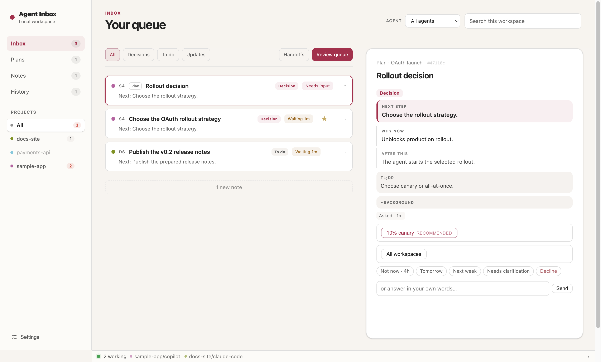
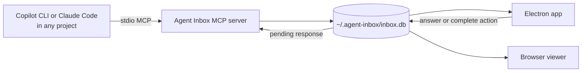

# Agent Inbox

[](https://github.com/shariqh/agent-inbox/actions/workflows/ci.yml)
[](https://nodejs.org/)
[](LICENSE)

**A local command center for questions, plans, and live status from coding agents.**

Agent Inbox gives GitHub Copilot CLI and Claude Code one shared place to surface
decisions, handoffs, notes, milestones, and multi-step plans. You respond in the
Electron app; agents pick the response up through MCP and continue working.
The app opens on Home: the requests waiting on you, the first one open beside
the list, then a card for each session, the plans still in progress, what just
landed, and a Today ribbon of each project's activity. You can also send a message
to a running session.



The app is local-first infrastructure, not another agent: its core data path has no
model calls, hosted service, or telemetry. An agent you point at Claude Code sends
that agent's text to Anthropic, with the account `claude` is signed in with; Agent
Inbox itself still makes no model calls. A stdio MCP server and the desktop viewer
share one SQLite database on your machine.

## What it does

| Capability | What you get |
|---|---|
| **Home** | The requests waiting on you with the first one open in front, a card per session with its plan's progress and recent activity, a session panel you answer from, the plans in progress, and a Today ribbon of asks and outcomes |
| **Cross-project inbox** | Questions and handoffs from every active coding session in one prioritized queue |
| **Action-aware responses** | Recommended options, free-text answers, snooze, pin for later, clarify, and decline controls |
| **Durable plans** | Tracking boards with stable rows, progress, next steps, outcomes, and human-owned actions |
| **Agents view** | Ambient status for every connected session and its current work without turning activity into alerts |
| **Agent cards** | A tab of your A2A agent cards, built in or added by you, each with its state, its card and its recent runs; in the app, also where you set up the built-in agents and their model servers; never a count or an alert |
| **Session messages** | Write to a running session, and see before you send whether it arrives now or at the session's next check |
| **Session launcher** | On macOS, start Copilot CLI sessions from the app, each in its own git worktree, approve their tool calls from the inbox, and message, park, resume or take them over from their session cards. Off until you turn it on |
| **Dual-host setup** | Audited installers and instructions for GitHub Copilot CLI and Claude Code |
| **Local security boundary** | A loopback-only viewer with strict Host, Origin, Fetch Metadata, and anti-framing checks |

Pending requests use the stated next step as their headline when one is available.
A card shows the question, one line of why, its PR and issue, its links and its
answers, with each option's tradeoff on one line (**Compare options** shows them in
full). Warnings and your own answer stay in view. Open **Details** for why it matters,
what happens next, who acts, the original tracking title, branch, background, and
delivery timeline.

## Quick start

### Requirements

- macOS 13.5 (Ventura) or later on Apple silicon for the notarized desktop app
- Linux x64 or arm64 with kernel 4.18+, glibc 2.34+, and GLIBCXX_3.4.29+ for AppImage/DEB packages
- **Node.js 24** for source builds, the MCP server, and the browser viewer
- macOS or Linux for the source-build path
- GitHub Copilot CLI and/or Claude Code

Agent Inbox is not published to npm. When a public release is available, download the
matching macOS DMG, Linux AppImage, or Debian package from
[GitHub Releases](https://github.com/shariqh/agent-inbox/releases).

### 1. Install a desktop package

On macOS, download `Agent-Inbox-vX.Y.Z-arm64.dmg` from
[GitHub Releases](https://github.com/shariqh/agent-inbox/releases), drag **Agent Inbox**
to `/Applications`, and launch it. The app requires a Mac with Apple silicon and includes
the Node 24 agent runtime, so it does not require a system Node installation.
Intel Macs stay on [v1.8.0](https://github.com/shariqh/agent-inbox/releases/tag/v1.8.0),
the last version for them.

On Linux, choose the filename matching the machine:

| Architecture | Portable | Debian/Ubuntu |
|---|---|---|
| x64 / amd64 | `Agent-Inbox-vX.Y.Z-linux-x86_64.AppImage` | `agent-inbox_X.Y.Z_amd64.deb` |
| arm64 | `Agent-Inbox-vX.Y.Z-linux-arm64.AppImage` | `agent-inbox_X.Y.Z_arm64.deb` |

Verify `SHA256SUMS.txt` before launch or installation. AppImages require `chmod +x`;
install DEBs with `sudo apt install ./agent-inbox_X.Y.Z_ARCH.deb`. The complete
no-FUSE AppImage fallback, supported distribution floor, package lifecycle, and macOS
trust checks are in the [installation guide](docs/INSTALL.md).

On first launch, open **Setup**, choose GitHub Copilot CLI, Claude Code, or both, and
select **Install now**. Setup verifies and installs the bundled runtime, registers the MCP
server, and adds the reporting instructions. Start a fresh agent session afterward.
After an app update, Setup's **Agents** section shows which build each host's agents
are registered to run; **Update agents** moves the ones Setup manages to the new
runtime (after a downgrade, **Match agents** moves them back to the app's runtime) and
says which running sessions still need a restart. See
[After an app update](docs/INSTALL.md#after-an-app-update).

If no public release is listed yet, or if you want to develop Agent Inbox, use the
source-build fallback:

```sh
git clone https://github.com/shariqh/agent-inbox.git
cd agent-inbox
npm ci
npm run build
```

### 2. Connect your coding agents from a source build

Preview the changes first, then install the MCP registration and global reporting
instructions:

```sh
npm run install:agents
npm run install:agents -- --apply
```

The installer supports both hosts by default. Use `--target claude` or
`--target copilot` to install only one. It verifies the Node 24 runtime, backs up
instruction files before changing them, and owns only its marked block.
A second Claude Code account with its own config folder (`CLAUDE_CONFIG_DIR`) is set
up with `--claude-config-dir`; see [A second Claude Code config folder](docs/INSTALL.md#a-second-claude-code-config-folder).

Start a fresh agent session after installation.

### 3. Launch a source build

```sh
npm run electron
```

The Electron app starts or safely reuses the local viewer and opens the desktop
workspace. Its **Setup** panel can also run the same audited host installer. A source
build uses port 4392 unless `AGENT_INBOX_PORT` is set, so it runs beside the installed
app (port 4319) instead of taking its port.

To package a standalone local development app on an Apple silicon Mac:

```sh
npm run generate:icons
npm run package:app
open "out/Agent Inbox-darwin-arm64/Agent Inbox.app"
```

The protected release pipeline builds and verifies every native package, signs/notarizes
the Apple silicon macOS DMG, and publishes the DMG plus both AppImages and both DEBs only
after remote download and rehash. Release inputs, platform evidence, and the publication
runbook are documented in [`docs/macos-release.md`](docs/macos-release.md) and
[`docs/linux-release.md`](docs/linux-release.md).

`assets/icon.svg` is the editable full-color source of truth.
`assets/icon-mark.svg` is its deliberately simplified single-color derivative for
tiny in-product use. `npm run generate:icons` deterministically refreshes
`assets/icon-1024.png`, browser favicon/mark assets under `public/`, and
`electron/icon.icns`, and `electron/icon.ico`; `assets/icon-manifest.json` pins the source and generated
output hashes. `npm run generate:icons -- --check` validates that manifest,
dimensions, SVG copies, and the complete ICNS representation set without
rerasterizing. Generation requires `rsvg-convert`; generation and checking use
macOS `iconutil`.

The macOS package carries a `darwin-arm64` Node 24 agent runtime;
see [`electron/README.md`](electron/README.md#portable-agent-runtime-staging). Setup
installs the matching payload under `~/.agent-inbox/runtime/`, so registered agents do
not depend on the app bundle remaining in place.

### Browser viewer on macOS or Linux

Use the browser surface when Electron packaging is unavailable or when developing
the frontend:

```sh
npm run view
```

Open <http://127.0.0.1:4319>. `http://localhost:4319` is retained as an exact browser
alias.

See [the full installation guide](docs/INSTALL.md) for host-specific setup, manual
MCP registration, uninstall behavior, optional dependencies, and platform support.

## Where to start agent conversations

Clone Agent Inbox once to host the app and MCP runtime. Start Copilot CLI or Claude
Code **inside the repository you actually want the agent to work on**, not inside the
Agent Inbox checkout.

The global MCP registration points every agent session at this installation. Agent
Inbox infers project and branch identity from each session's working directory, then
reconciles all of those sessions through the shared local database.

## How the loop works



1. An agent calls `flag`, `status`, or a board tool.
2. The shared SQLite hub updates immediately.
3. You answer or complete the requested action in the Electron app.
4. The agent calls `pending`, receives the response, acknowledges it, and continues.

Claude Code can use the optional deterministic hooks in
[`docs/hooks.md`](docs/hooks.md) for idle-session pickup of question replies and
responses on blocked plan rows, including "I've done my part", clarification, and
decline. The hook checks for an answer before it starts waiting. An armed watcher
does not lose a later answer just because another agent received it first. A Stop
continuation does not wake repeatedly for the same unread response; it can still
wait for answers to requests that were unanswered when it started. It also watches
a project the session chose with `register`, and questions the session raises after
its turn ended; a newer turn's watcher replaces the older one.

Copilot questions and new blocked plan actions return host-owned watcher commands.
The agent must launch them in its CLI session; the MCP server never does so.
`pending` (when no message is waiting) and `status({done:true})` also return a
per-session message watcher, so a message you send an idle Copilot session wakes it;
one copy runs per session, and it ends when the session does.
Each plan watcher follows one row action, not every future use of that row.
Routine plan edits do not create duplicate watchers. After a timeout or restart,
`board_get({title, watch:true})` returns watches for the plan's remaining blocked
actions. `pending({project:"..."})` retrieves answers for the original project
without changing the current session scope. Each re-arm of the same unanswered
request waits longer (30 minutes, then 1, 2 and 4 hours), so a long wait costs the
agent a few wakes instead of dozens. On a Copilot request you can also choose
**I'll take a while**: stop the agent waiting (it will not wake on its own, so
prompt it in its terminal after you answer) or ask it to wait quietly for a few
hours or until tomorrow. With the Later section on (the default), the same choice also sets the
request aside: **Stop waiting** pins it in Later, and a quiet wait snoozes it there
until the same time. With the section off, the request stays in Needs you. A
snooze also keeps its watcher quiet, checking in at most once a day. The choice
appears only on requests raised by a Copilot session running this version, whose
watcher honours it.

**Saved, delivered, and acted on are different states.** Watchers only notify the
host; they never mark a response delivered or complete. An agent receives the
response through `pending`, then records the result by resolving the question or
changing the plan row's status. A delivery receipt is not proof that the intended
agent resumed. Hooks still select requests by project, but each host session keeps
its own watcher so one session cannot take away another's wake source. An
unavailable host connection cannot be repaired by a database watcher.

The Agents view shows connected MCP processes and the work they report, not an
authoritative inventory of every agent or subagent. A connection with no task report is unknown
activity, not proof of inactivity. `register` updates its displayed project and
branch immediately; child-agent descriptions still come from the manager.
Each session's panel also shows the Agent Inbox build its MCP server runs. A session
on an older build gets a quiet "older build" chip on its card whose advice fits where that session runs from: a
session on Setup's agent runtime is told to restart once its own host (Claude Code
or Copilot CLI) is registered to the new runtime, or to update agents from Setup
first, and a session running from a source checkout is told to update and rebuild
it. After Setup matches agents back to an older app, sessions still on the newer
build are marked too. A server too old to report its build shows nothing rather than
a guess.

## Home

The app opens on Home (`G D`), for all projects and agents. Home is one page: the
requests waiting on you first, then your sessions and what they did. There is no
separate Inbox page.

- **Needs you** lists the requests waiting on you, the same set the badge counts,
  with the number still waiting beside the heading. Answered requests stay at the
  foot, dimmed, until the agent picks the answer up; set-aside ones wait in
  **Later** below. **Filter** shows the filters (All, Decisions, To do, Updates),
  the sort order, **Handoffs** and the **Review queue**; they stay shown while a
  filter or a sort other than your default is on. `G I` goes straight to the list.
- **The request in front.** In a window 1280 pixels wide or more, the first request
  waiting on you opens by itself beside the list, with its question and its answers,
  and nothing moves your focus or the page. Click any other request to put it in
  front instead. Close it with **×** or `Esc` and it stays closed until you open a
  request again, come back to Home from another page, or a new request arrives when
  nothing was waiting. Once you answer, the request stays in front; once you resolve,
  dismiss, snooze or pin it, the next one comes forward, and the keys work on it. While
  a request is in front, the rest of Home sits in a column beside it; close the request
  and the page uses the full width. A session panel and a request never show together
  there: opening one closes the other, and closing the panel brings the request back.
  While you are working in the sessions or the plans below (your focus is there, or your
  pointer is over the page), a new request appears in the list and waits to come forward
  until you leave them, and the number keys, `E`, `X` and `Esc` never act on a request
  from there. In a narrower window a
  request opens under its row when you click it, and nothing opens by itself.
- **Working** has a card for every session with live work, grouped by project: what
  it reports, its agent, branch and time since its last call, its plan's progress
  (done, in progress, waiting on you, to do), its subagents and a small trace of its
  MCP calls over the last 30 minutes. **Open** opens its session panel.
- **Quiet** lists every other session in a compact table, one row each: its state,
  project and agent, branch, last caption, how long since, and its main action
  (**Open**, or **Take over** and **Resume…** for a parked one). A terminal
  session with no live claim reads **Quiet** ("no Agent Inbox call for 40m"), because
  one busy with other tools makes no Agent Inbox call either; **Idle** is kept for an
  app-driven session whose driver reports no running turn. A claim that is no longer
  live shows as "Last reported: … · 52m ago". A session with no call for 8 hours
  folds under **Dormant**, and ended sessions under **Ended**, at the end of the lane.
  A session moves between Working and Quiet as soon as it starts or stops working,
  but a card under your pointer stays where it is. A session that is asking you
  something shows an **Asking you · N** chip in either lane, which puts its first
  waiting request in front. **New session…** sits at the right end of the Working
  lane's heading. Click a card or row to open its session panel: its
  requests, its plan, its recent outcomes, PR and CI state, links, and a place to
  message it.
- **Plans in progress** lists up to six plans that still have open steps, in the
  projects you are looking at: each one's title, its project, a bar of steps done
  ("7/15"), how many steps need you, in pink, and when it last changed. Plans with a
  step waiting on you come first. Click a row, or press `Enter`, to open that plan in
  Plans; **All plans ›** opens Plans.
- **Just landed** shows the four newest outcomes. An outcome on a pull request that
  is still waiting on you is counted there instead of shown.
- **The Today ribbon**, last on the page, draws one line per project over the last
  24 hours, 7 days or 30 days: when its agents worked, ◆ where one asked you
  something and ● where an outcome landed.
- After at least 30 minutes away, one line says what happened since you last looked.

In search (`Cmd/Ctrl K`), type `answer `, `open plan ` or `jump to session ` to list
those targets first.

**Find** (`G F`) is one list of your answers, notes, plans and finished work, newest
first, with a large field and five chips: All, Answers, Notes, Plans and Chats. A row shows
what it is, its title, one small extra (the answer you gave, the start of a note, a
plan's bar, an outcome), the project and an age. A note or a finished item opens in
place with its full card; an open ask goes to Home and a plan to Plans. The Find tab
counts notes you have not seen; they count as seen when shown under the Notes chip with no query typed.

**Agent cards** (`G M`) is a tab while the mesh is on (`mesh.json` names an agent), and in the
app's own window also before that, once the installed mesh command can be run from the app. Its
**Yours** section shows one card for every A2A agent set up on this Mac: the
built-in ones (unslop, unslop-code and request-post) and the ones you added with `meshctl add`, each with its state, one line of what
its card says it does, where it runs, its version and a **Built in** or **Added by you** tag.
**Refresh** checks the built-in agents' cards now; entering the tab checks them too, and
nothing else does. An agent you added is never contacted by the app: its card comes from the
copy `meshctl add` keeps, and `meshctl check <id>` writes that copy for an agent added before
it existed; its page has no Refresh and says so. A link `#cards/<name>` opens that agent's page. Click a card to open its page in the same tab (its runs, its card's details and
the raw Card JSON); **← Agent cards** or `Esc` goes back. The tab never carries a count.

In the app's own window the tab also sets agents up, with the same command you would type, a dry
run first. **Marketplace** lists the built-in agents that are off: **Set up** on unslop-code asks
for a model server and a model (the list comes from the server), and on request-post for the
service's address and its token file; **Check** shows what turning it on will do, then **Turn on**.
unslop's rules folder is still set in a terminal (see [`docs/unslop.md`](docs/unslop.md)).
**Model servers** lists each server with **Check** (is it reachable, how many models) and
**Remove**, **Add a server** (a name, an address, and no key or a key file you pick), and **Make it
a server** for an agent whose settings hold their own address. An agent that is on has **Turn
off** at the foot of its page, and unslop and unslop-code **Change server**. A key or token file is
picked in the app's own file dialog; the page sees only its name. In a browser, or showing another
Mac's Inbox, the Marketplace is a list only.

The **Chats** chip (`G C`) lists the Claude Code and Copilot CLI chats on this Mac, newest
first; the field matches their title, project, branch and folder, never what was said in
them. A chat row has one button beside it: Resume in the desktop app, Copy resume
elsewhere, or Show session for a chat Agent Inbox drives. Open the row for its branch,
folder and last activity, and for Copy resume, Jump to session and Continue here…. A
line under the chips holds the Claude Code / Copilot toggle, Show all and Refresh. With
a query, All lists matching chats too.

**Settings → Motion** chooses Full or Calm. Calm turns off looping animation and the
brief pulse a card gives when its session makes a call. Your system's Reduce motion
setting turns motion off whichever you choose.

## Messaging a running session

You can write to a connected session without finding its terminal. Each session's
card or row in the Working and Quiet lanes on Home has a **Message** button, which opens its session
panel at the **Message** section. Messages go to the whole CLI
session: any of its agents, a subagent included, may pick one up first. A message
can be up to 4,000 characters, and it never changes a badge or a count.

Before you send, the composer says how the message will arrive:

| Delivery | When |
|---|---|
| **Arrives now** | A Claude Code session started with the channels flag (below), one whose wake-up hooks ([`docs/hooks.md`](docs/hooks.md)) are waiting, or a Copilot CLI session whose message watcher is running |
| **It sees this when it next checks Agent Inbox** | Any other session on v2.2.0 or later: it reads the message the next time it calls `pending` |
| **Can't receive** | A session still running an older build; restart it to load v2.2.0 or later |

Each message then shows **Sent · not picked up yet**, **Picked up · working on it**
or **Acknowledged**, with the outcome the agent recorded through `ack_message`.
**Withdraw** takes back a message the session has not acknowledged; after pickup the
agent may already have started. **Not delivered**, at the foot of the Quiet lane, lists
messages to sessions that ended, with **Copy text** and **Withdraw**. An unsent
message is kept like any other draft, and a send that was not confirmed never sends
twice.

**Claude Code channels (research preview).** Claude Code can push a message straight
into a running session, even an idle one, through its channels feature. It is a
Claude Code research preview: it needs a claude.ai or Console login, works only in
interactive sessions, and Team and Enterprise organizations must allow channels. The
MCP registration must be named `agent-inbox`, which the installer does. Start Claude
Code with

```sh
claude --dangerously-load-development-channels server:agent-inbox
```

and accept its warning. The push carries only a notice to call `pending`, never the
message text.

**Driven Copilot sessions (preview).** Agent Inbox can start a Copilot CLI session
and drive it from a terminal, so your messages and answers arrive in it as new turns
(**Arrives now**). Run it from the runtime the installer set up; the installer prints
the exact command at the end of an install:

```sh
~/.agent-inbox/runtime/<runtime-id>/bin/node ~/.agent-inbox/runtime/<runtime-id>/dist/driver-cli.js \
  copilot --cwd <folder> --mode ask --prompt-file <task file>
```

`--mode` is `ask` (every tool call asks) or `read-only` (file edits are denied). `--reasoning-effort <level>` sets the effort for models that refuse the one in your Copilot settings. Each
approval is answered y/n in that terminal and also shows as an alert in the **@sessions** project. Stop it with
Ctrl-C, by typing `stop`, or with `… dist/driver-cli.js stop <launch id>`, which it
prints when it starts. From a source checkout, `npm run driver -- copilot …` does the
same. Once any shell command is allowed, the session can run anything: answer each
ask with that in mind. Design:
[`docs/superpowers/specs/2026-10-31-driven-sessions-design.md`](docs/superpowers/specs/2026-10-31-driven-sessions-design.md).

## Starting sessions from Agent Inbox (macOS, preview)

The Agent Inbox app can start a Copilot CLI session in one of your projects and run
it for you, so its approvals come to the inbox and your messages arrive as new turns.
It is off until you turn it on, and it works only in the macOS app, not in a browser.

**Try it:**

1. Open **Settings → Agent sessions** and turn on **Start sessions from Agent Inbox**.
   The key that signs your approvals is protected by the macOS Keychain, so macOS
   may ask once to allow Agent Inbox to use it.
2. On Home, choose **New session…** at the right end of the Working lane's heading. Pick a project Agent Inbox has seen (or **Choose folder…**), a
   mode, optionally a model and reasoning effort, the budgets, and the task. Don't
   paste secrets into the task: it is stored with the session.
3. Agent Inbox shows its own confirmation of exactly what will start. **Start** runs
   Copilot in that folder, with your login shell's environment.
4. Each tool call that needs your approval arrives in the inbox under **@sessions**:
   choose **Allow once** or **Deny** there. Only the app's own window can answer
   them; a browser tab says so.
5. Message the session from its card. While it works, a message is **Queued**
   until the turn ends; **Interrupt and send** stops the turn and sends it now.
6. **Park now** stops Copilot and keeps the session; it also parks by itself after
   two idle hours. **Resume and send** starts it again with your message, and so it
   does for a session you stopped. **Stop** ends it. **Transcript** (in its session
   panel) shows what it did; the **Ended** fold lists ended sessions, and **Earlier
   sessions** inside it older ones. An ended session whose worktree is kept offers
   **Remove worktree…** on its card, and the fold says how many worktrees are kept.
   Once it has no worktree, **Forget…** removes the session from Agent Inbox for good: its
   card, transcript and logs. Its branch and commits, and Copilot's own session files, stay.
   A session you stopped whose Copilot session is kept reads **Stopped**, offers Resume… and
   Forget…, and is listed with the parked sessions in the Quiet lane.
7. **Take over in Terminal** moves a running or parked session to a Terminal window:
   after your confirmation, Agent Inbox stops driving it (cancelling its current turn
   and approvals) and runs `copilot --resume` there with its history. From then on you
   answer it in Terminal; **Resume in Terminal** opens it again.

| Mode | What runs without asking |
|---|---|
| **Ask for everything** | Nothing, except what your own Copilot settings already allow |
| **Read-only** | Nothing; file-edit tools are denied, and shell commands still ask |
| **Plan first** | Nothing: it writes a plan, and once you approve it, each tool call asks |
| **Edits in the worktree** | File edits inside the project folder (never a `.git` folder or file, at the top or nested); shell commands, network and anything outside the folder still ask |

Once any shell command is allowed, the session can run anything, in its folder and
beyond, and an edited file can change what an allowed command then runs. Answer each
approval with that in mind. A session has no limit on its active time or tool calls
unless you set one in New session (1 minute to 8 hours; 1 to 2000 calls), counted
across parks and resumes; its card shows what it has used. When you quit the app
with sessions running, it asks whether to keep them running or stop them all.
Design: [`docs/superpowers/specs/2026-10-31-driven-sessions-design.md`](docs/superpowers/specs/2026-10-31-driven-sessions-design.md);
how it is built: [`docs/architecture/driven-sessions.md`](docs/architecture/driven-sessions.md).

## Setting requests aside

A request's **More** menu can set it aside. **Pin for later** keeps it
with no return time. **Not now · 4h**, **Tomorrow** and **Next week** snooze it
until then. A request you set aside leaves the title badge, the tab count and the
app icon badge, but it stays on screen.

Set-aside requests wait in the **Later** section at the foot of the Needs you list on Home. It is
collapsed under one count for the current filters, such as `Later · 3` and
`2 pinned · 1 snoozed, next back in 2h`. Snoozed requests come first, soonest
back first, then pinned requests, oldest first. Each row says why it waits, and
**Back to inbox** returns it at once. You can still answer, clarify or decline a
request inside Later. A snoozed request comes back by itself when its time
passes. A pinned request comes back when you return it, or when the agent ends
the request or starts a new one. When nothing else needs you, the queue says how
many requests wait in Later ("Nothing needs you · 3 in Later"). Search still finds them: a question is listed under
Open items with a Later label, and a plan row under Active plans with its plan.

The Later section is on by default. Turn it off in **Settings → Inbox** to keep
the earlier layout: a snoozed fold, a pinned fold for requests you already
pinned, and no Pin for later choice. The setting is saved for each browser or
app profile and changes only the layout. Badges, counts and notifications are the
same either way.

## Unsent drafts

A response you typed but did not send survives a reload, a closed window and an
app restart: answers and their context, plan-row notes, Note attempts and the
**unsent responses** list. Drafts stay in this browser or app profile for 30 days
after your last edit and never reach the hub or an agent until you send them.
Nothing is sent for you. A draft whose request is unchanged comes back in its
card. A plan step an agent touched while you typed keeps your text in its editor
as long as it still asks the same thing: if only something else moved, your Send
goes through; if the ask's words were edited, the step says so and your next Send
goes to the edited ask (the same goes for a note on a step that is not waiting on
you, which says the step was updated). If your text already reached the step, the
draft just goes away. One whose request changed meanwhile (closed, or a plan step
with a new ask), or whose project you closed, is kept with the reason: beside the
plan step while its card is open, otherwise under **unsent responses**. **Retry**
sends a question's reply again, **Use this text** puts a step's text in its editor,
**Copy** copies it, and **Discard** removes an entry for good.
While one of these is for a question or plan step the Review queue would show, the
queue waits and the Needs you list says "Finish or discard the 1 unsent response first", with
a **Show it** button; one for a question or step that has since closed or moved on
never holds the queue. If you had already sent it and no answer came back,
it says the send was not confirmed rather than that it was never sent. When you
send or retry such a response, the question is checked first: if it already holds
exactly your answer, nothing is sent again; if its answer changed since, yours is
sent as a new answer. If your earlier send turns out to have gone through but a
newer answer has replaced it since, your text stays under **unsent responses** and
says so. A Send or Retry never replaces an answer you have not seen: if a newer
reply arrived (from another window, or the agent recording what you said in chat),
the first click shows it, "A newer reply was sent: …", and only a second click
replaces it. Sending,
emptying or discarding a draft deletes it. A crash in the moment after you type can
still lose the last keystrokes. Another browser or profile does not see these
drafts, and neither does the viewer opened at its other address (`localhost`
instead of `127.0.0.1`).

## Keyboard controls

Press **F** (or choose **Show keys**) to place short letter codes on the visible
controls. Type a code to click a button, open a link or disclosure, or focus an
editor or native selector. Hints stay inside the active dialog; press **Esc** to
cancel. A changed action loses its old code instead of silently reusing it.

Common actions also have permanent key tiles. Press **?** for the full guide.
Letters do not run shortcuts while you are typing or using a select.

| Keys | Action |
|---|---|
| `G D` / `G I` / `G P` / `G F` | Home / Needs you (the first request on Home) / Plans / Find |
| `G N` / `G H` | Find with Notes / Find with All, the query cleared and the list focused |
| `G C` | Find with Chats, the query cleared and the field focused |
| `G M` | Agent cards, while the tab shows |
| `G S` / `G O` / `G A` / `G L` | Settings / project picker / agent filter / Sessions (the Agents view) |
| `Cmd/Ctrl K` or `/` | Focus search (on Find, Find’s own field) |
| `J` / `K`, then `Enter` | Move through the queue and expand an item |
| `R` / `1`-`4` | Focus the current reply / choose an answer |
| `Cmd/Ctrl Enter` | Send a multiline response; plain Enter adds a line |
| `E` / `X` | Resolve / dismiss the current item, with an undo window for dismiss |
| `T` | Open the review queue |
| `Tab` / `Shift Tab` | Move between native controls |

`G` starts a sequence: release it, then press the destination letter. `Esc`
cancels a sequence without closing the item underneath. Expanded cards scroll
with the page at intermediate widths; the desktop inspector and full-screen
phone card retain their own scrolling.

Selected text stays selected while the viewer refreshes, unless that text changes.
To copy it without pressing `Cmd/Ctrl C`, turn on **Copy text when selected** in
Settings. Finishing a selection with the mouse or keyboard then copies it, except
text you select in a reply box or other field.

## MCP tools

| Tool | Purpose |
|---|---|
| `flag` | Raise a question, non-blocking note, or completed milestone |
| `pending` | Read open questions, informational feedback, plan responses and the human’s messages to this session; optionally re-read one open item |
| `answer` | Record an answer the human gave in chat while preserving inbox precedence |
| `resolve` | Close an item after the agent acts on it |
| `ack_message` | Acknowledge, with an outcome, a message the human sent this session |
| `status` | Publish ephemeral live work and child-agent presence |
| `board_upsert` | Create or refresh an entire tracking board |
| `board_row` | Update one stable board row |
| `board_advance` | Advance a row to its next human action without changing its label |
| `board_get` | Read board state and human annotations; optionally re-arm Copilot row watches |
| `board_archive` | Archive a finished board |
| `register` | Override automatically inferred project, stream, repository, or issue scope |
| `whoami` | Report the current inferred scope |

The recommended agent behavior is defined in
[`docs/reporting-snippet.md`](docs/reporting-snippet.md). The installer adds that
contract plus the host-specific appendix under [`docs/instructions/`](docs/instructions/).

Item responses and annotations carry a monotonic `response_revision`. After handling a response,
call `resolve` with `expected_response_revision` from that exact `pending` item or
successful `answer` result. A missing or stale revision is refused: read and handle
the current response before retrying. Another agent's pickup does not authorize an
older response. Items without response history still support ordinary resolution.
Replies and annotations on closed items are refused rather than rewriting history.

Feedback on an open note or milestone reaches `pending()` until picked up; pickup
does not close the item or add human attention. `annotated_at`, `annotation_seen_at`,
and `annotation_seen_by` report saved/pickup state, not proof that the intended
session acted. Legacy annotations keep unknown timestamps rather than fabricated
receipts. Clearing feedback queues its empty, versioned state once. Use
`pending({item_id: id})` to recover the current open item after pickup or a clear,
and add `full: true` for its complete background. This adds no automatic host-wake
guarantee for informational feedback.

Summaries should say what changed, what remains, or what needs a decision in plain
language. For example, "The fix is ready for review, but has not shipped" is more
useful than a commit hash and a review transcript. Keep that evidence in the
expandable details, and do not label a prepared pull request as a shipped result.

## PR previews in approval cards

When GitHub reports a successful, explicitly non-production deployment for the
current PR commit, approval questions and blocked approval rows show a **Preview**
link beside their PR. Preview links use the existing source-chip controls and work
with the keyboard hints.

The viewer reads deployment `environment_url` values, never arbitrary check URLs
or links from agent prose. It rechecks the PR head before accepting a result.
Across environments it selects the newest successful status, then environment
name and deployment id as stable tie-breakers. Conflicting URLs for the same
environment, incomplete reads, and pending or inactive deployments produce no link.

Preview lookup is optional: ordinary PR state appears first, and a failure cannot
hide an approval request. Links expire after five minutes even if polling stops,
are withheld from closed projects (including shared branches), and are disabled rather than
silently retargeted if the PR changes while a reply draft protects the card.
Other PR history remains available when a refresh fails.

To bound background work, each branch lookup considers at most five deployments
and declines a larger result instead of choosing from a truncated page. Providers
that do not supply GitHub deployment URLs and explicit non-production metadata
are not supported. A Preview link reports GitHub's last observed deployment
state; it does not independently verify a provider's served content.

## Grouping plans by parent issue

Plans can gather active plans of one project whose GitHub issues share a parent
under a heading for that parent: its title, GitHub's "N of M sub-issues done" and
how many plans it holds. The plan pinned to the parent itself comes first, then the
others in GitHub's sub-issue order. Grouping is off by default. Turn it on in
**Settings → Plans** to use it every time Agent Inbox opens, or with the **Group by
parent issue** switch under **View** on the Plans page for the current view only.
While grouping is on, Plans shows the grouped list in place of its Needs you, Moving
and Stalled sections.

Grouping only reorders. No plan is hidden, plans from different projects are never
merged, and a plan whose relationship data is missing, older than seven days or
unavailable stays in its usual place. Badges, counts and notifications do not change.

## Dependencies in Plans

When a plan's or a row's GitHub issue is blocked by open issues ("blocked by" on
GitHub), or a row says it waits on other steps of its plan, Plans shows a quiet
"waits on #119", "waits on 3" or "waits on step Build" chip; hover it for the list.
The plan card adds "Dependencies on GitHub" with what the issue waits on and what it
unblocks, and an expanded row lists everything it waits on and where that came from.
Only open issues and steps that are neither done nor marked not applicable count. A dependency is not a request for you:
it never marks a row blocked or changes a badge, count or notification. GitHub data
dims after 30 minutes without a refresh and disappears after seven days.

**Plan flow** shows the same dependencies on each step, in the agent's own order:
"Waits on" and "Unblocks" name the other steps as buttons that take you to them, and
an issue no step of the plan links shows as its GitHub chip with what Agent Inbox is
doing about it. A step filed under a different parent issue says "Part of #200",
sub-issues of the plan's issue that no step covers sit in a "Not in this plan" fold,
and a loop says "Circular dependency".

## Links in cards

Agent text links GitHub references (`#287`, `PR #284`, `owner/name#12`) and local
files written as absolute paths (`/Users/…/spec.md` or `~/notes.md`, optionally with
`:line`), as well as web addresses. Every open card lists its links in a **Links**
strip under its title: the item's own PR and issue first, then the rest in the order
they appear, each once. More than six fold into **+N more**.

A bare `#N` on a plan row is read against the row's own issue link, else the plan's
pinned issue, else the project's repository, so write `owner/name#N` for any other
repository.

Paths relative to a repository (`docs/superpowers/specs/spec.md`,
`public/app.js:7491`) link too, against the folder of the repository the agent's
session was working in, which Agent Inbox records with each item and plan; a plan row
whose `#N` reads against another repository leaves them as text. They need
a folder and a file name with an extension or a `:line`. A file that folder doesn't
have, such as a doc that only exists on a pull request's branch or in another
worktree, is not opened: clicking it shows its nearest folder inside the repository
in Finder and says so. A path whose
symlinks lead outside the repository is never opened. Items and plans written before
this, or by an older Agent Inbox, recorded no folder, so their relative paths stay
text.

Detection is cautious, so some things that could be links stay text: a single-digit
`#N` needs `issue`, `PR` or a word such as `Fixes` before it, and paths with spaces,
routes such as `/api/items`, versions, dates and words such as `and/or` never link.

In the desktop app a web link opens in your browser, and a common document (Markdown,
text, logs, JSON, YAML, TOML, CSV, PDF, images, SVG, HTML, diffs, MOV and MP4)
opens in its default app. Anything else is only shown in Finder: folders, apps,
scripts and other code, installers, disk images, aliases, files set to open with a
particular app, and anything with an execute bit. A file in your home folder that
isn't there shows its nearest existing folder; one elsewhere only says it isn't
there. Copying a path is the chip's own **Copy path** button, never a click. Files open only in the
viewer the app started itself: if it is showing a viewer it found already running,
and in a browser tab, clicking a file link copies its path instead and says why.

On macOS, **Settings → Links** chooses how links open from the Inbox instead of the
Mac's defaults: web links in a browser you pick, and Markdown (`.md`, `.markdown`) or
any file type you add with Quick Look, Reveal in Finder or an app you choose (and the
system default, for the common documents above). That is also how to open other
types, such as code in your editor: add `.py` and choose Sublime Text. Folders, apps,
installers, aliases, files set to open with a particular app and anything with an
execute bit are still only shown in Finder, whatever you choose, and some types (such
as `.command`, `.pkg` or `.dmg`) can't have a rule at all. In the desktop app every
file chip also has **Reveal in Finder** and **Copy path**. Both, and Settings →
Links itself, work only in the viewer the app started itself.

## Using this Inbox from your other Macs (macOS, preview)

On the Mac that runs your sessions, **Settings → Other devices** lets your other Macs use this
Inbox through [Tailscale](https://tailscale.com). A paired Mac can read everything in this Inbox
and send messages to your sessions, which may act without asking, so only pair Macs you own.

1. Switch on **Let my other Macs use this Inbox**. If Tailscale Serve is not set up yet, the panel
   shows one command, `tailscale serve --bg 4320`. Run it once in Terminal on this Mac, then switch
   on again. Agent Inbox never changes Tailscale itself.
2. Press **Test**. It says whether Tailscale reaches this Inbox and asks for a paired Mac. For a
   moment after switching on the status says "On, starting…", and Test waits until it says On.
3. Switch on **Open Agent Inbox at login**, so sharing comes back after this Mac restarts.
4. Press **Add a Mac**. It shows a code that works once, for 10 minutes, and this Mac's address.
   On the other Mac, enter them in Settings → Use another Mac's Inbox (next section).

The status line beside the switch says Off, On, Paused (sharing comes back by itself once the cause
is fixed, for example once Tailscale is running again) or Needs you, with one thing to do. If this
Mac's Tailscale name or account changed, switching on asks first, because it removes the paired
Macs. If the sharing settings were changed outside Agent Inbox, the panel says what changed at the
top (or that it can't tell, when the app was closed) and how they are now; press **Looks right**
once you have checked them, or switch sharing off and remove a Mac you don't know. **Remove** stops
a paired Mac at its next request. When sharing is off and Tailscale still forwards to this Mac, the
panel shows the command that stops it, `tailscale serve --https=443 off`.

Sharing works only in the viewer the app started itself; in one it found already running, quit and
reopen Agent Inbox to change it.

## Use another Mac's Inbox

On macOS, the desktop app can show the Inbox of another Mac of yours, for example the one your
agents run on, while you sit at a laptop. Both Macs need Tailscale, signed in to your own account,
and the other Mac must share its Inbox (previous section).

1. On the other Mac: **Settings → Other devices → Add a Mac**. It shows a code and its address
   (like `mac-name.tail1234.ts.net`).
2. On this Mac: **Settings → Use another Mac's Inbox**. Type the address and the code, then press
   **Connect**. Connecting can take 10 seconds or more.
3. Press **Show its Inbox**. A strip at the top of the window names the Mac whose Inbox is on
   screen and says Online, Connecting…, Reconnecting… or Not connected. Press **This Mac** in the
   strip, or choose **View → This Mac**, to come back. While the other Mac's Inbox is on screen,
   this Mac's own Inbox underneath does nothing, keys included.

If connecting fails, Settings says why and what to do next. **Disconnect** stops this Mac using the
other Mac's Inbox; the other Mac keeps this Mac in its list until you remove it there. The other
Mac's settings are changed on that Mac: its Settings page here shows only how the page looks.
Like sharing, this works only in the viewer the app started itself.

## Agents view

The Working and Quiet lanes on Home are the one home for your sessions: a card for
each working session, grouped by project with its agent kind on the card, and a row for
each other one. The sidebar's **Sessions** line, on every tab, says how many are working
and connected and opens them.
The view adds no poll read, no network traffic beyond this machine and nothing to
your badges.

It began as the first phase of the
[agent mesh design](docs/superpowers/specs/2026-10-29-agent-mesh-design.md) and was
switched on by `mesh.json`; since #454 it is always on. `mesh.json` now turns on only
the experimental unslop agent (`npm run meshctl -- enable --unslop`, #483; see
[`docs/unslop.md`](docs/unslop.md) to set it up and call it, and
[`docs/architecture/mesh.md`](docs/architecture/mesh.md)), the experimental unslop-code agent,
which removes the comments a coding agent added to a change (`npm run meshctl -- enable --unslop-code`,
#652; see [`docs/unslop-code.md`](docs/unslop-code.md)), and the request-post client
(`npm run meshctl -- enable --request-post`, #500; see
[`docs/request-post.md`](docs/request-post.md)). `npm run meshctl -- add <card-url>`
adds an A2A agent this repo doesn't ship, by its card, as a dry run until `--apply` (#529), and
`npm run meshctl -- call <id>` calls it (#530; see [`docs/mesh-call.md`](docs/mesh-call.md)).
The two local agents can share one model backend: `npm run meshctl -- server add <name> …` adds a
model server once, and each agent's profile names it (see [`docs/model-servers.md`](docs/model-servers.md)).
The app's **Agent cards** tab shows the agents `mesh.json` turns on: the three built-in ones (unslop, unslop-code and request-post) and the ones you added. In the app it also adds model servers and turns unslop-code and request-post on and off, through the same command.
To write such an agent on `@a2a-js/sdk`, start from the agent kit and its example
([`docs/agent-kit.md`](docs/agent-kit.md), #539).
`npm run meshctl -- status`
says what the file holds, and `npm run meshctl -- disable --apply` removes it (keeping a
backup).

Without a checkout, the app's own `meshctl` does the same (#540): installing or updating the
agents from Setup writes `~/.agent-inbox/bin/meshctl`, which runs the meshctl inside the app's
signed runtime. Setup never edits a shell profile; add the line it shows to `~/.zprofile`
(`export PATH="$HOME/.agent-inbox/bin:$PATH"`), open a new terminal, and `meshctl status`
works. A checkout's `npm run install:agents -- --apply` writes the same shim for the checkout.

## Architecture

- **`src/store.ts`** owns schema, migrations, WAL configuration, and every database
  read/write, including the bounded local activity spans used by the dashboard.
- **`src/mcp-server.ts`** serves MCP over stdio. Its stdout is protocol-only and the
  process makes no network calls.
- **`src/viewer-server.ts`** serves the Hono API and static frontend through the
  loopback network boundary.
- **`public/`** is a plain JavaScript frontend with no bundler.
- **`electron/`** wraps the viewer, manages safe local-server reuse, notifications,
  setup, and packaging.

The default database is `~/.agent-inbox/inbox.db`. Set `AGENT_INBOX_DB` to use a
different file and `AGENT_INBOX_PORT` to change the viewer port.

## Local security model

The viewer binds one IPv4 listener to `127.0.0.1`, accepts only exact loopback
authorities, requires a trusted Origin for mutations, rejects cross-site Fetch
Metadata, denies framing, and lets the page run only script files from its own
origin (CSP `script-src 'self'`). Electron reuses only viewers carrying the expected
local-boundary marker.

This is an intentionally unauthenticated **single-user workstation** boundary.
Programs running as the same OS user can read the SQLite file directly. Do not expose
the viewer through a tunnel or run it on a shared host; authenticated hosted mode is
tracked in [issue #8](https://github.com/shariqh/agent-inbox/issues/8).

Live pull-request state is optional and viewer-owned through the local `gh` CLI. It
never enters the MCP server process or changes what counts as human attention.

Links in agent text are opened only by the desktop app's main process, which accepts
requests only from its own viewer window, opens only http and https addresses, and
only reveals a folder, app, script, installer or executable file. A file link carries
its path in a data attribute, never an `href`.

## Development

```sh
npm test
npm run typecheck
npm run build
```

For the local marketing site, run `npm run marketing` and open
`http://127.0.0.1:4320`. The page at `marketing/index.html` uses fictional
demo data and does not connect to your inbox. Its hero visual loads Three.js
from the page's own `marketing/vendor/` folder, so the page makes no
third-party requests.
See [Marketing preview](CONTRIBUTING.md#marketing-preview) for the port option.

The test suite uses real temporary SQLite databases and real stdio MCP integration
round trips. Node 24 is required because this checkout's `better-sqlite3` binding is
compiled for that ABI.

Before contributing, read [CONTRIBUTING.md](CONTRIBUTING.md), the architectural
invariants in [CLAUDE.md](CLAUDE.md), and the subsystem docs in
[docs/architecture/](docs/architecture/) that it points to.

## Roadmap

- [Hosted mode with streamable HTTP and authentication](https://github.com/shariqh/agent-inbox/issues/8)
- [Remote answer to exact local-session wake and continuation](https://github.com/shariqh/agent-inbox/issues/51)

## Project links

- [Downloads](https://github.com/shariqh/agent-inbox/releases)
- [Installation](docs/INSTALL.md)
- [Claude hook integration](docs/hooks.md)
- [Contributing](CONTRIBUTING.md)
- [Security policy](SECURITY.md)
- [Issue tracker](https://github.com/shariqh/agent-inbox/issues)
- [MIT license](LICENSE)
