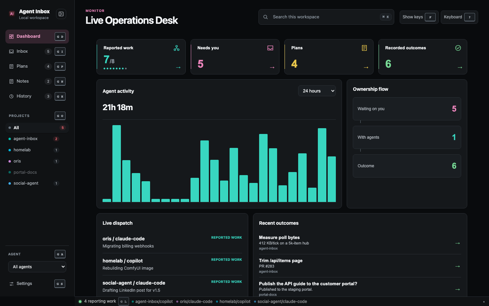
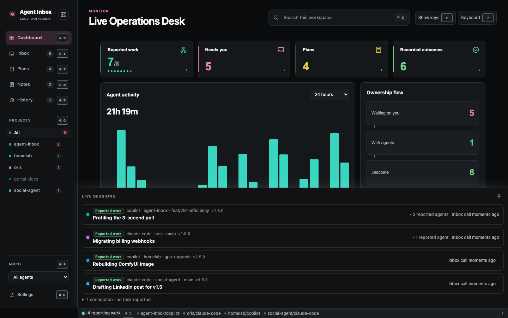
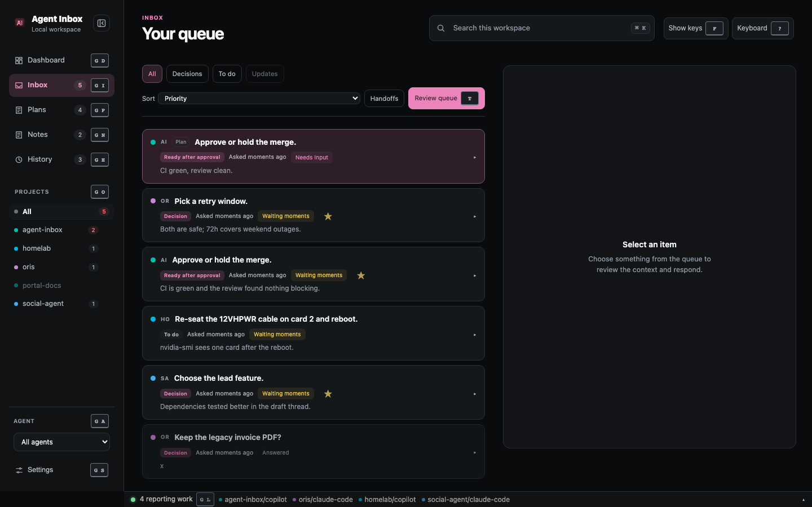
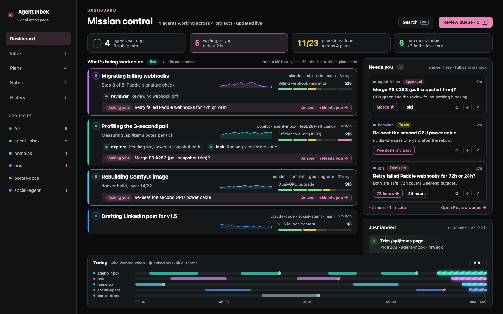
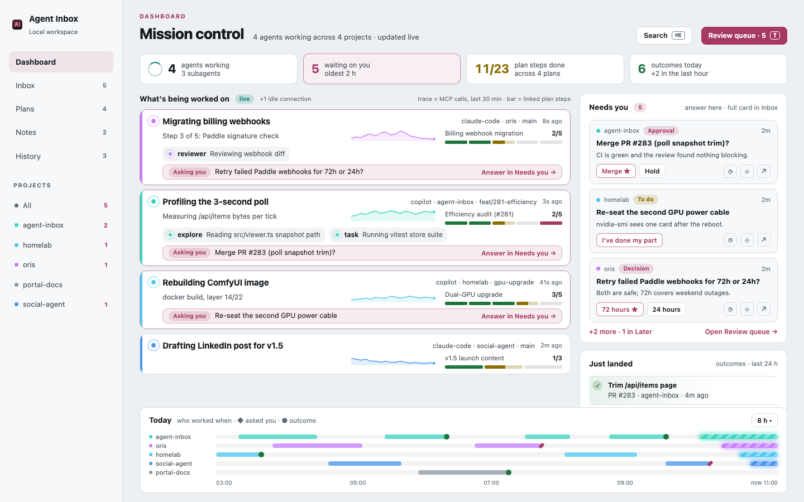
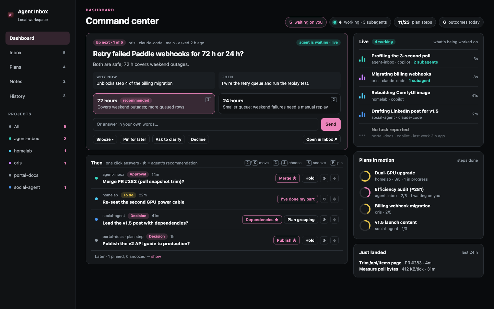
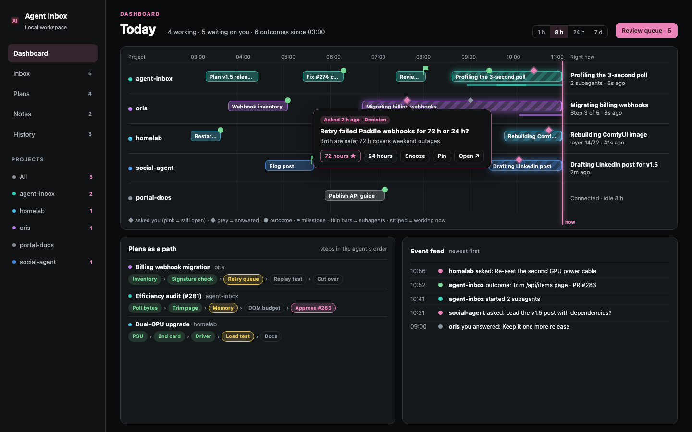

# Proposal: Dashboard 2.0 (issue #280)

**Date:** 2026-10-22
**Status:** Proposal for review. Eight decisions for Shariq are in §12.
**Milestone:** v2.0. Research for #280; the redesign becomes separate issues once a direction is picked.
**Scope of this PR:** this document, three concept mockups and screenshots of today's UI. No source
or test changes.
**Related:** #281 (efficiency audit). The performance budget in §10 is written to be checked with
#281's measurements.

Every screenshot and mockup uses synthetic data in a scratch database. None of it is real inbox data.
The mockups are static HTML built on the app's own `public/style.css` tokens and fonts; their sources
sit beside the PNGs in [`assets/2026-10-22-dashboard-2/`](assets/2026-10-22-dashboard-2/).

---

## §0 — Summary

1. **Today's Dashboard counts things but lets you do nothing.** Every number is a link to another
   tab. It shows no open question, no plan progress and no subagent, and a 24-hour bar chart takes
   most of the screen. That is why the Inbox stays the default habit.
2. **Three directions** were mocked up:
   - **A — Mission control:** one live lane per working session (what it is doing, its subagents,
     a heartbeat, its plan's progress and whether it is asking you), a "Needs you" rail you can
     answer from, and a "Today" ribbon of who worked when.
   - **B — Command center:** the Inbox brought onto the Dashboard: the top ask fully expanded with
     every response, the next asks answerable in one click, and a compact Live and Plans rail.
   - **C — Timeline:** swimlanes per project over the last hours, with work spans, asks and
     outcomes on one time axis; asks are answered from popovers on the timeline.
3. **Recommendation: A**, with B's one-click answers and keys in its rail, and C's timeline kept as
   the slim "Today" ribbon. It is the only direction that answers both halves of the request:
   a visual "what's being worked on" view *and* a place to act.
4. **Everything in phases 1–3 uses data the 3-second poll already reads.** Only two optional
   additions need new data: a per-session call trace (the heartbeat sparkline) and an explicit
   session-to-plan link.
5. **Motion is CSS-only, compositor-friendly, capped, paused when the window is hidden, and off
   under the OS reduced-motion setting.** The app has no reduced-motion handling today, so that
   foundation ships first.
6. **Six PR-sized phases** (§11). Phase 1, answering from the Dashboard, is shippable alone and is
   the change most likely to keep Shariq on the Dashboard.

---

## §1 — What exists today

### 1.1 The Dashboard

The Dashboard (`renderDashboard` / `renderDashboardAmbient` in `public/app.js`, model in
`public/dashboard.js`) is the cold-launch tab. It has:

- **Four signal cards:** Reported work (working lanes / total, with dots), Needs you, Plans,
  Recorded outcomes. Each is a button that switches tab.
- **Agent activity:** a bar chart of summed session time over 24 hours, 7 days or 30 days, from
  `/api/activity/history`, with one headline total ("21h 18m").
- **Ownership flow:** three boxes, Waiting on you → With agents → Outcome, each a count and a link.
- **Live dispatch:** one row per session: project / agent and its `doing` text.
- **Recent outcomes:** the four newest recorded outcomes.

The structure is mounted once and the data regions are refreshed by the ambient painter, so a
focused control survives polls ("Dashboard focus must not freeze monitoring detail").

### 1.2 Live sessions

The Live strip sits in the footer of every tab. Opening it shows a drawer: one row per session with
a "Reported work" chip, agent, project, branch, build, `doing` text, a collapsed "N reported agents"
toggle for subagents and the time of the last Inbox call. Idle connections fold into one line.
`public/livebar.js` owns the summary, dormancy and build-version advice.

### 1.3 The Inbox

The Inbox is where every action lives: options with tradeoffs, free-text answers, "I've done my
part", Snooze, Pin for later, Clarify, Decline, the Later section, sort and filters, the Review queue
and Handoffs.

### 1.4 What is weak

1. **Nothing is actionable on the Dashboard.** Every control except the range menu navigates away. Even with five
   questions waiting, the Dashboard never shows one.
2. **"What's being worked on" is a single line.** Live dispatch shows `doing` but not `detail`,
   subagents, recency or progress. The richer view is in a footer drawer that covers the page.
3. **No sense of life.** Nothing on screen tells a working session from one that went quiet ten
   minutes ago. There is no animation at all.
4. **The biggest panel answers the least urgent question.** The activity chart is about two
   thirds of the screen and sums parallel sessions, so "21h 18m" in a 24-hour window reads as a
   bug to a newcomer.
5. **Plans are a count.** The `progress` each board already carries is not drawn.
6. **Counts disagree in meaning.** "Reported work 7/8" counts subagents as lanes while Live says
   "4 reporting work"; "Needs you 5" and "Waiting on you 5" repeat each other.
7. **The Ownership flow repeats the signal cards** with no new information.

---

## §2 — Needs, restated as jobs

From Shariq's request on #280:

| # | Job | Today |
|---|-----|-------|
| J1 | **See what every agent is doing right now**, including subagents, at a glance. | One line per session; subagents hidden in the drawer. |
| J2 | **Tell at a glance which sessions are alive, quiet or stuck.** | Only "Reported work" vs folded idle. |
| J3 | **See progress**: how far each effort has got. | Plans shown as a count. |
| J4 | **Answer, approve or defer without leaving the Dashboard.** | Not possible. |
| J5 | **Know what just landed** without opening History. | Four outcomes, no sense of "new". |
| J6 | **Feel the system is live**: tasteful motion that shows activity. | No motion. |
| J7 | **Use it as a command center**: keyboard, triage, jump to the right place. | Navigation only. |
| J8 | **Keep the Inbox as the full tool.** The Dashboard borrows its most common actions; the long tail stays in the Inbox. | — |

---

## §3 — Constraints any design must keep

These come from `CLAUDE.md` and are not up for redesign:

- **One attention predicate.** Any ask drawn on the Dashboard comes from `attentionEntries` /
  `laterEntries` in `public/attention.js`, so the badge, tab counts, dock and Dashboard agree.
  Snooze and pin stay demotions: a deferred ask leaves the rail but still counts in "1 in Later".
- **Two activity stamps.** Liveness (`updated_at`) is never shown as work. Only `last_call_at`
  and a live `doing` claim mean "working"; a claim decays after 30 minutes.
- **Exactly two render entries.** `load()` → `renderIfIdle()` for the poll and `reloadAndPaint()`
  for human writes. Every Dashboard write ends in `reloadAndPaint()`. No third entry for animation.
- **Dashboard focus must not freeze monitoring detail.** Live lanes, the ribbon and counts update
  through the ambient painter even while a reply is being typed in the rail.
- **A held pointer defers the rebuild**; **remembered focus is not keyboard ownership**; a
  background window never gets focus pulled back; **text selections survive rebuilds**.
- **Drafts are protected.** A draft in the rail gates only the editable surfaces and joins the
  existing draft recovery and viewer-restart rules.
- **Attention-first cold launch** keeps opening the Dashboard with all projects, all agents.
- **PR, check and dependency state never enter attention.** The Dashboard may show them; they never
  turn into "Needs you".
- **All agent text goes through `esc()` or `textContent`; every link through `chipHtml()`.**

---

## §4 — Concept A: Mission control

### What it shows

- **Now strip** (top): agents working (+ subagents), waiting on you (+ age of the oldest), plan steps
  done across active plans, outcomes today. Each is still a link, but the strip is one line, not
  the main event.
- **What's being worked on** (main column): one **lane per live session**, working sessions first,
  then by last call. A lane shows:
  - a **pulse** dot in the project colour, beating only while the claim is live;
  - `doing` in large type, `detail` beneath, agent · project · branch and "8s ago" from `last_call_at`;
  - a **heartbeat trace** (MCP calls over the last 30 minutes) — optional, needs new data (§9);
  - the **linked plan's progress** as a segmented bar (done, in progress, waiting on you, to do)
    with "2/5";
  - **subagents** as chips with their own small pulse (`children[].name`, `doing`);
  - an **"Asking you" strip** when one of the session's asks is in the attention set. It names the
    ask and jumps to its card in the rail; it does not carry the buttons (decision D2).
  Idle connections fold into "+1 idle connection".
- **Needs you rail** (right): the top three attention entries as compact cards: project, owner
  chip (Decision / Approval / To do), title, the TL;DR, and the actions. Below: "+2 more · 1 in
  Later" and **Open Review queue**.
- **Just landed**: newest outcomes, with a one-time highlight on arrival.
- **Today ribbon** (bottom): one thin swimlane per project over 8 hours (selectable), work spans
  from `/api/activity/history`, a striped segment for work happening now, ◆ where the agent asked
  you and ● where an outcome landed.

### Inbox capabilities ported

| Action | In the rail | Notes |
|---|---|---|
| Pick an option (decision / approval) | Yes, one click; ★ marks the recommendation | Same write as the Inbox card. |
| "I've done my part" (task rows) | Yes | Same `markRowHandled` path. |
| Free-text answer | Expand the card in place | Reuses the Inbox reply editor; becomes a draft. |
| Snooze, Pin for later | Yes (icons with labels on hover/focus) | Through `deferAsk`, so drafts are kept. |
| Clarify, Decline, "I'll take a while" | Under "More…" | Rarely used; keeps cards small. |
| Open in Inbox | Yes | Deep link to the full card. |
| Review queue | Header button and `T` | Unchanged. |

### Motion

Open [`mockup-a-mission-control.html`](assets/2026-10-22-dashboard-2/mockup-a-mission-control.html) in a browser to see the motion (macOS "Reduce motion" turns it off).

| Element | Motion | Reduced motion |
|---|---|---|
| Lane pulse | `transform: scale` + `opacity` ring, 2 s loop, only while the claim is live | Solid dot plus the word "live" |
| Lane top edge | A short light sweep (`translateX`) every few seconds, only on the lane with the newest call (keeps infinite animations within the §10 cap of 12 and marks the latest activity) | None |
| Subagent pulse | Same as lane, smaller, staggered | Solid dot |
| Heartbeat trace | Static SVG redrawn per poll; the head dot pulses only on the lane with the newest call (same reason) | Static |
| Now ring | Slow rotation of a partial ring while anything is working | Static ring |
| New outcome / new ask | One-time 500 ms fade and slide on arrival | Instant |
| Ribbon "now" segment | Stripes drift (on a transformed pseudo-element) | Static stripes |

### Data sources

Existing: `/api/activity` (doing, detail, children, idle, `last_call_at`), `/api/items`,
`/api/boards` (rows and `progress`), `/api/activity/history`, closed projects. New and optional:
the call trace and an explicit session-to-plan link (§9).

### Cost

Medium–large: five PRs (§11). Most work is rendering; the actions reuse existing Inbox controls.

---

## §5 — Concept B: Command center

### What it shows

- **Up next**: the first attention entry fully expanded, exactly as the Inbox inspector shows it:
  TL;DR, "Why now" (`impact`), "Then" (`next_after`), options with their tradeoffs, the answer box,
  Snooze, Pin for later, Clarify, Decline and Open in Inbox. A chip says whether the asking agent
  is live and waiting.
- **Then**: the next four asks with one-click answers, plus "Later · 1 pinned".
- **Keys**: `J`/`K` move, `1`–`4` choose, `S` snooze, `P` pin, `Enter` expands.
- **Right rail**: Live (compact rows with a small equalizer animation, subagent count), Plans in
  motion (progress rings), Just landed.

### Inbox capabilities ported

All of them for the focused ask; one-click options, task done, snooze and pin for the next four.
It is essentially the Review queue laid flat on the Dashboard.

### Motion

Equalizer bars in Live (transform `scaleY`), ring fill easing when progress changes, the "Up next"
card sliding up when the previous one is answered. Reduced motion: static bars, no slide.

### Data sources

Only existing APIs.

### Cost

Small–medium: three PRs. Most of the UI already exists in the Review queue (`renderTriage`) and the
Inbox card (`answerEl`, `rowAnswerEl`, `dispositionEl`).

### Weakness

It is the Inbox again. It answers "spend more time there" but not "more obvious/cool stuff" or
"what's being worked on": the live view is a side rail of one-liners.

---

## §6 — Concept C: Timeline

### What it shows

- **Swimlanes per project** over 1 h, 8 h, 24 h or 7 d. Work spans are labelled bars; subagents are
  thin bars beneath; the span happening now is striped and glows at the "now" line.
- **Markers**: ◆ an ask (pink while open, grey once answered), ● an outcome, ⚑ a milestone.
- **Popover answers**: clicking an open ◆ opens a popover with the options, Snooze, Pin and Open.
- **Right now** column: each lane's current `doing`.
- **Plans as a path**: each active plan as a row of step pills in the agent's order.
- **Event feed**: asks, outcomes, answers and subagent starts, newest first.

### Inbox capabilities ported

Option choice, snooze, pin and open from the popover. No free-text answering (popovers are a poor
place for drafts).

### Motion

The "now" line advances; live spans grow and their stripes drift; new markers drop in. Reduced
motion: the line jumps per poll, no drift.

### Data sources

Spans and item timestamps exist. Subagent start and end times and an event log do not: `children`
is a full-replace list with no timestamps, so subagent bars and "started 2 subagents" need new
storage.

### Cost

Large: a new time-axis renderer, hit-testing, popover focus management (popovers are hard to do
accessibly under the focus and press-guard rules), and new event storage.

### Weakness

Beautiful for "what happened today", weaker for "what needs me now": asks are small diamonds, and
answering from a popover is slower than a card.

---

## §7 — Comparison

| | A Mission control | B Command center | C Timeline |
|---|---|---|---|
| J1 what's being worked on | **Strong** (lanes, subagents) | Weak (one-liners) | Medium (labels on bars) |
| J2 alive / quiet / stuck | **Strong** (pulse, recency, trace) | Medium | Medium |
| J3 progress | **Strong** (per-lane plan bar) | Medium (rings) | Strong (step paths) |
| J4 act without leaving | Strong (rail) | **Strongest** | Medium (popovers) |
| J5 what just landed | Medium | Medium | **Strong** (feed, markers) |
| J6 feels live | **Strong** | Medium | Strong |
| J7 command center | Strong (rail + keys) | **Strongest** | Weak |
| New data needed | Optional (trace, plan link) | None | Yes (events, subagent times) |
| Cost | M–L | S–M | L |
| Risk to invariants | Medium (two painters) | Low (reuse) | High (popovers, new axis) |

---

## §8 — Recommendation: A, with B's actions and C's ribbon

**Pick A, Mission control**, built so that:

- its **Needs you rail uses B's interaction model**: one-click options with ★, task done, snooze,
  pin, `J`/`K`/`1`–`4`/`S`/`P`, and a card that expands in place for a written answer;
- its **Today ribbon is C in miniature**, and a later phase may let the ribbon expand into C's full
  timeline if Shariq wants it.

Why:

1. **It is the only direction that is both a visual tool and a command center**, which is how the
   request describes the goal. B is a command center without the picture; C is a picture without
   the command center.
2. **"What's being worked on" becomes the headline.** Lanes put `doing`, `detail`, subagents,
   recency and progress where the eye lands, instead of in a footer drawer.
3. **It ships in useful slices.** Phase 1 (the rail) is B's value on today's layout. Phase 2 (lanes)
   is the visual change. Nothing waits on new storage.
4. **It keeps the Inbox the full tool.** The rail holds the common actions; anything longer links
   out.
5. **The architecture fits the invariants.** Lanes, Now strip and ribbon are ambient (refreshed
   while you type); only the rail is an editable surface under the render gate.

---

## §9 — Data: what exists and what is new

| Need | Source | Status |
|---|---|---|
| Sessions, `doing`, `detail`, subagents, idle, last call | `/api/activity` (fresh every tick, ~2 KB for 5 sessions) | Exists |
| Asks for the rail | `/api/items`, `/api/boards` through `attentionEntries`/`laterEntries` | Exists |
| Plan progress | `/api/boards` (`progress`, row statuses) | Exists |
| Ribbon spans | `/api/activity/history` (already polled for 30 days) | Exists |
| Ask and outcome markers | item `created_at`, outcome stamps | Exists |
| Ask ↔ session | `items.session`; blocked rows by board | Exists for items |
| **Session ↔ plan** | boards carry `project`, `stream`, `agent`, **not** `session` | Phase 2 joins by project + branch + agent (most recently updated active plan); phase 4 may stamp it (D4) |
| **Heartbeat trace** | only `last_call_at` is stored | New (D5): 30 one-minute call counts per session, kept on the `activity` row by `recordActivityCall` and served with `/api/activity` |
| Agent-reported progress ("step 3 of 5") | free text in `detail` today | Optional `status({ progress })` (D7) |
| Subagent start/end times | `children` has no timestamps | Only needed for C; not planned |

New fields are additive, follow the omission rules (an older server's writes keep or ignore them)
and get a mixed-version test, as every additive column has so far.

---

## §10 — Motion and performance budget

### Motion rules

1. **CSS only, on `transform` and `opacity`.** No JavaScript animation loops, no canvas, no WebGL,
   no chart library. Stripes move on a transformed pseudo-element, never by animating
   `background-position`.
2. **At most 12 infinite animations on screen.** The lane sweep and heartbeat head run only on the lane with the newest call; lanes beyond the cap, and every idle lane, are static.
3. **Paused when the page is hidden** (`document.hidden`); Electron already throttles hidden
   windows. A visible but unfocused window keeps its motion, since glancing at it is the point.
4. **Reduced motion is honoured.** A new `@media (prefers-reduced-motion: reduce)` block turns every
   infinite animation off and shortens one-shot ones to instant. Today the app has none, so this
   foundation lands first (phase 0). Settings may add a Motion choice (Full, Calm, Off; D6).
5. **Motion never moves focus, scrolls or reorders under the pointer.** Lane order is pinned like the
   Needs-you list: new sessions append at the foot and order is re-sorted only on a forced paint.
6. **Updates are keyed, not rebuilt.** The ambient painter updates lanes in place (the
   `renderDashboardOutcomes` pattern), so an animation does not restart every three seconds and the
   held-pointer guard keeps working.

### Budget

Measured on the scratch hub: one poll tick makes 8 reads; unchanged ones answer 304 and
`/api/activity` (always fresh) is about 2 KB. The Dashboard today is 138 elements; the whole page
about 1,160.

| Item | Budget |
|---|---|
| Poll | No new reads in phases 0–3. Phase 4 adds ≤ 150 bytes per session to `/api/activity`. |
| DOM | Dashboard ≤ 1,500 elements: rail ≤ 3 cards (one expanded), ≤ 12 lanes, ribbon ≤ 200 bars. |
| Per tick | No full rebuild of lanes or ribbon; text and attribute updates only. |
| Animation | Compositor-only; renderer CPU with the Dashboard visible and 4 working sessions within #281's idle baseline + 1 percentage point. |
| Electron memory | No new dependencies; inline SVG only. Renderer heap within #281's baseline + 10 MB. |

#281 should record the baseline numbers (and whether the poll should slow down while the window is
hidden) before phase 2 merges; each phase then reports against them.

---

## §11 — Phased plan for v2.0

Each phase is one reviewable PR and ships on its own.

| Phase | PR | What ships | New data | Size |
|---|---|---|---|---|
| 0 | Motion foundation | Motion tokens, the reduced-motion block, hidden-page pause, and a test that every infinite animation is covered. | None | S |
| 1 | **Answer from the Dashboard** | The Needs you rail on today's Dashboard (replacing Ownership flow): top 3 attention entries, one-click options, task done, snooze, pin, expand to answer, Open in Inbox, "N in Later", keys. Drafts join the render gate and recovery. | None | M |
| 2 | **Live lanes** | Lanes replace Live dispatch: `doing`, `detail`, recency, subagents, pulse, linked plan bar (joined by project + branch + agent), "Asking you" strip. Now strip replaces the signal cards. | None | M |
| 3 | **Today ribbon and Just landed** | Ribbon replaces the bar chart (range menu kept); ask and outcome markers; arrival highlight. | None | M |
| 4 | **Heartbeat and explicit links** | Per-session call trace; optional `boards.session` stamp; optional `status({ progress })`. Store, MCP, mixed-version tests, then the UI. | Yes | M |
| 5 | **Command-center polish** | Project/agent quick filters on lanes, Dashboard keys in the keyboard help, lane click opens the Live drawer row or plan, optional full timeline from the ribbon (C). | None | S–M |

Phases 1–3 deliver the recommended direction with no schema change. Phase 4 is optional
enrichment; phase 5 is polish.

Tests per phase follow the house rules: pure model tests for `public/dashboard.js`, jsdom tests for
drafts, focus, press guard and background windows (`test/dom/`), an attention-parity test showing
the badge, tabs and dock are identical with the new Dashboard, and source pins for the
reduced-motion CSS that jsdom cannot evaluate.

---

## §12 — Decisions for Shariq

| # | Decision | Options | Recommendation |
|---|---|---|---|
| D1 | Direction | A Mission control · B Command center · C Timeline | **A**, with B's rail actions and C's ribbon |
| D2 | Where a lane's ask is answered | Rail only, lane shows "Asking you" and jumps there · Buttons on the lane too | **Rail only**: one answer surface on screen, simpler drafts |
| D3 | How much of the queue the rail holds | Top 3 + Review queue · The whole queue, scrolling | **Top 3**; the Inbox and Review queue stay the full tools |
| D4 | Session-to-plan link | Join by project + branch + agent now, stamp later · Stamp `boards.session` before lanes ship | **Join now, stamp in phase 4** |
| D5 | Heartbeat trace | Add 30 one-minute call counts per session · No trace, pulse by recency only | **Add it in phase 4**; lanes ship without it |
| D6 | Motion level | Full by default (OS reduced motion turns it off) + Settings "Calm" · Calm by default | **Full by default**, with the setting |
| D7 | Agent-reported progress | Add optional `status({ progress: { done, total } })` · Plans only | **Plans only for v2.0**; revisit after lanes ship |
| D8 | Today's charts | Remove the bar chart and Ownership flow · Keep them under a fold | **Remove**: the ribbon and rail replace them |

---

## §13 — Alternatives and non-goals

- **Making the Inbox the default tab.** Rejected: cold launch stays attention-first on the
  Dashboard; the fix is to make the Dashboard worth staying on.
- **A chart library or canvas renderer.** Rejected for size, memory (#281) and accessibility.
  Inline SVG and CSS cover every mockup here.
- **Porting every Inbox action.** Rejected: the long tail (history, Handoffs, sort modes, Later
  section management) stays in the Inbox.
- **Showing PR and CI state in lanes as alarms.** Allowed only as ambient chips; they never enter
  attention.
- **A separate always-on-top mini window.** Out of scope for v2.0; it would need its own Electron
  design.
