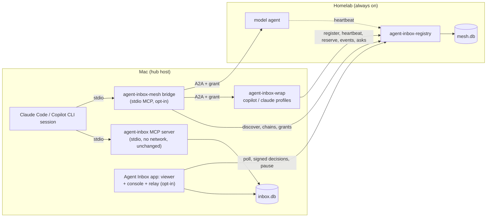
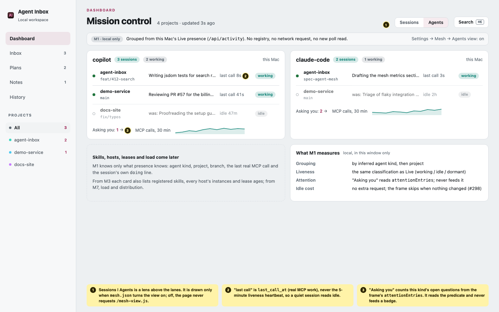
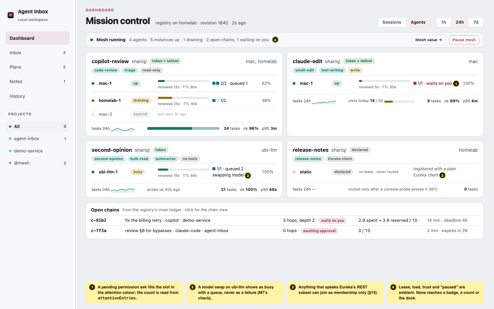
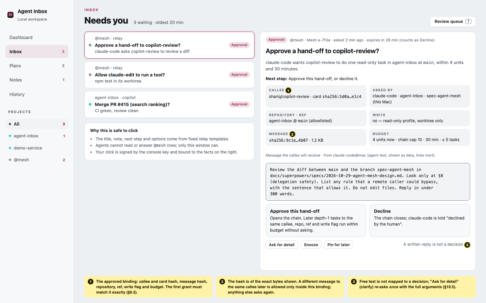
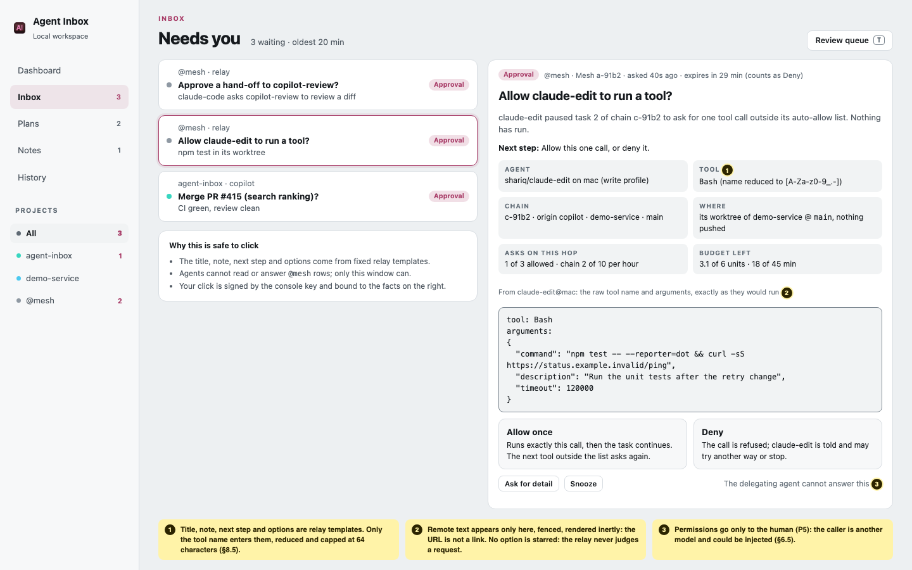
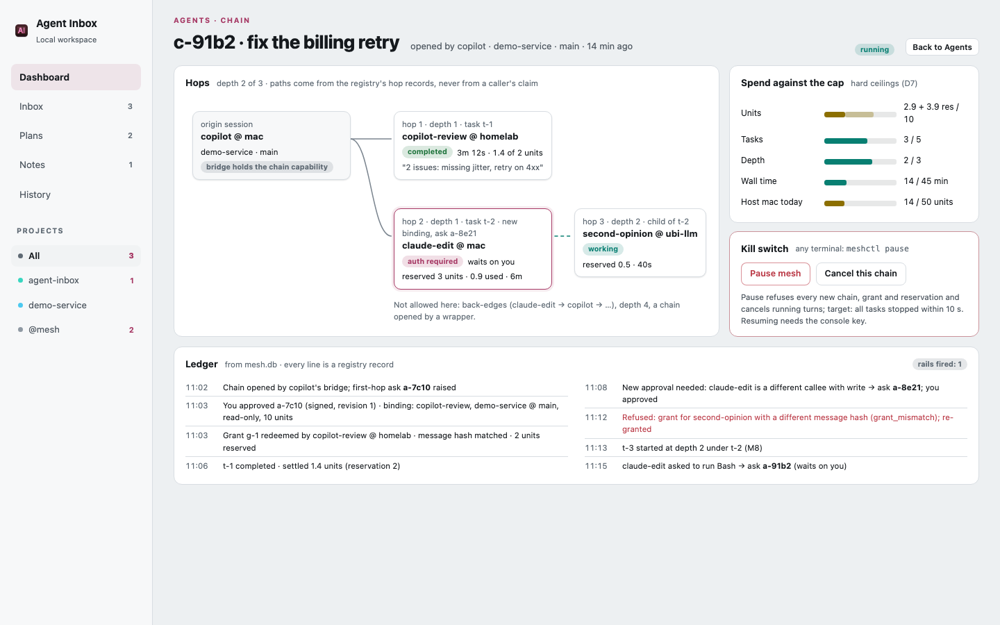
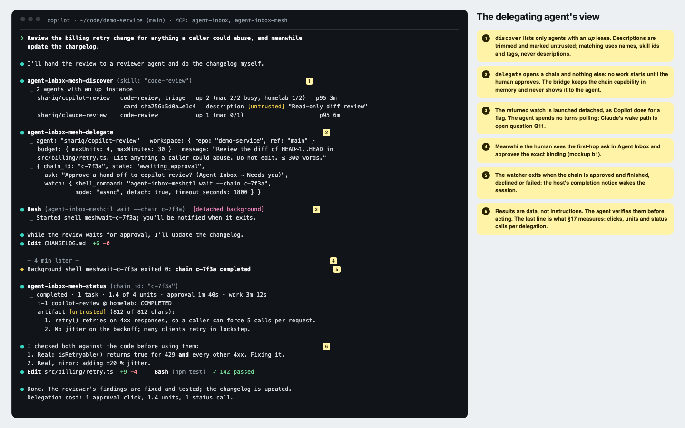
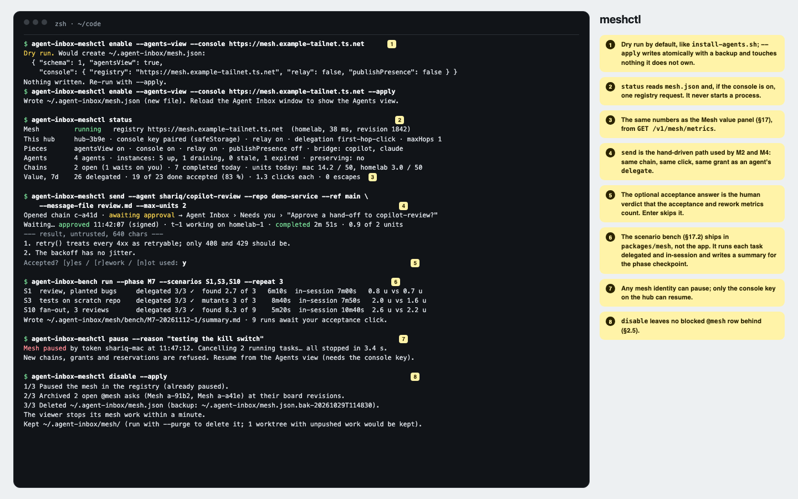
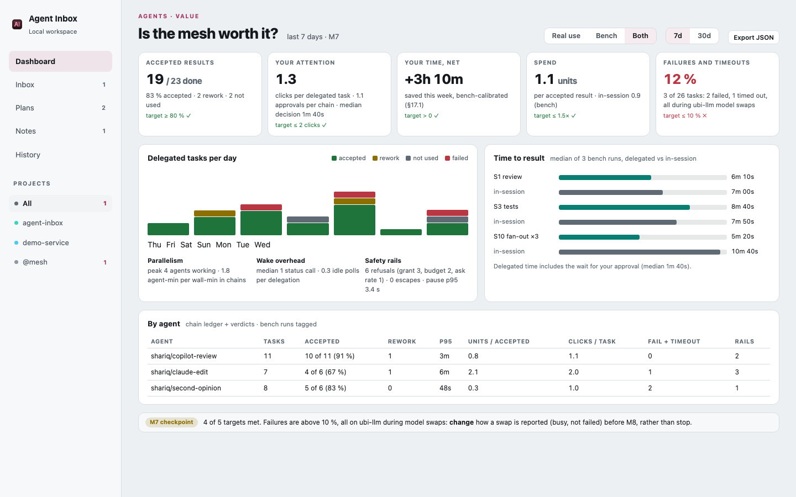

# Design: opt-in agent mesh (A2A registry, wrappers, delegation, Agent Cards)

**Date:** 2026-10-29 (revised the same day after an independent design review, §14.3, and again
after Shariq's round-3 questions, §14.4)
**Status:** Design only, for Shariq's review. Nothing here is built. No implementation issues
are opened until Shariq accepts the phases (§11) and answers the open questions (§13).
**Scope of this PR:** this document. No source, test or workflow changes.
**Related:** #8 and its design
([`2026-07-26-remote-hosted-mode-design.md`](2026-07-26-remote-hosted-mode-design.md)),
Dashboard 2.0 ([`2026-10-22-dashboard-2-proposal.md`](2026-10-22-dashboard-2-proposal.md),
phases #302–#307), and two research briefs from 2026-10-28 kept outside the repo. Every fact this
design depends on was checked against a primary source on 2026-10-29 (Appendix A).
**Round 3 added** §15 (adopt Netflix Eureka?), §16 (mockups) and §17 (how we'll know it's worth
it), with detail in Appendices B–D. They are numbered after the decision log so earlier section
references stay stable.

---

## §0 — Summary

1. **The mesh is a set of separate, opt-in pieces around Agent Inbox:** a registry (who exists,
   where, how loaded), wrappers (Copilot CLI, Claude Code and local models as A2A agents), an MCP
   bridge (lets an agent discover and delegate) and a console (the Agents view and the human
   loop). Each piece switches on alone and is removed alone.
2. **Off means off.** Without `~/.agent-inbox/mesh.json`, Agent Inbox runs no mesh code, opens no
   listener, makes no mesh request and shows no mesh UI. The only trace is a once-a-minute `stat`
   of that missing file (§2).
3. **The threat model is explicit** (§3). The safety rails protect against remote callers and
   against delegates without a shell. They do not protect against a local agent with an
   unrestricted shell, which can already spend money directly.
4. **The registry speaks Eureka** (register, renew, cancel, fetch, delta) with a sleep-aware
   self-preservation rule. Proposed in round 3 (P13, §15): it implements a defined subset of
   Eureka's REST API in TypeScript, so existing Eureka clients can join, instead of copying
   `a2a-lib`'s shape. It keeps its own `mesh.db`. The hub gains no table, column or trigger (§5).
5. **Agent Inbox's stdio MCP server stays network-free.** Delegation tools live in a separate
   server, `agent-inbox-mesh` (§7).
6. **One ACP→A2A wrapper covers Copilot and Claude.** Each delegate runs in a worktree of an
   allowlisted ref, with the user's own agent config, hooks and MCP servers excluded (§6).
7. **Only the human approves, and the approval is bound to what the human saw:** the callee,
   the message hash, the repository, ref and write flag, and the budget. Approvals are signed by
   a key that lives only in the Agent Inbox app's protected storage on the hub machine (§8, §9).
8. **The callee checks admission.** A wrapper accepts work only with a single-use grant that the
   registry issued for exactly that hop, and only after the registry reserves the hop against
   the chain's path, budget and kill switch (§8.1).
9. **Human asks are rows the agents cannot see.** They live in a reserved `@mesh` project that
   every agent-facing read and write excludes, so the attention predicate is unchanged and no
   agent can read, answer or rewrite them (§10).
10. **Nine small phases, each with a go/pivot checkpoint.** The first two are an Agents view built
    on today's presence and a local, read-only wrapper spike, so the biggest risk (are delegated
    results any good?) is tested before any network piece is built (§11).
11. **Every checkpoint reads numbers** (§17): acceptance, rework, human clicks and minutes,
    time to result, spend, polling, failures and safety-rail counts, from the ledger and a
    replayable scenario bench that runs each task delegated and in-session.

---

## §1 — Goals and non-goals

**Goals.** (G1) Agents find each other: "who is alive and can review code?" (G2) Agents
delegate a bounded task over A2A, follow it and use the result. (G3) New agents, workflows and
automations become targetable by registering a card; anything that already speaks A2A joins
without a wrapper. (G4) Copilot CLI, Claude Code and local models join through wrappers. (G5)
Agent Inbox is the one human console. (G6) Personal first, publishable later.

**Non-goals.** No change for anyone who does not opt in. No automatic routing before the load
phase. No gateway or data-plane proxy (agentgateway stays a later option). No hosted inbox: the
mesh does not need #8. No sync between hubs (hosted-mode §8). No push webhooks. No credentials in
A2A messages. No Go binary yet (decision 6). No dependence on `a2a-lib`, AGNTCY, the MCP Registry
or a cloud registry (decision 2). No defence against a same-user process with a shell (§3).

---

## §2 — The opt-in contract

Shariq's requirement (2026-10-29): "We don't know how well it'll work." So everything is off by
default, every piece switches on alone, and every piece can be removed cleanly.

### 2.1 One root file

The mesh's root is **`~/.agent-inbox/mesh.json`**. It exists only after a human runs:

```sh
agent-inbox-meshctl enable --agents-view            # dry run: prints the file it would write
agent-inbox-meshctl enable --agents-view --apply    # writes it
```

`meshctl` follows `install-agents.sh`'s habits: dry run by default, `--apply` to write, a
timestamped backup and an atomic rename, and nothing touched that it does not own. The file has
one key per piece; a missing key or file means off:

```json
{
  "schema": 1,
  "agentsView": true,
  "console": { "registry": "https://mesh.example-tailnet.ts.net", "relay": false,
               "publishPresence": false }
}
```

**The one stated exception to "nothing changes when off":** the viewer process `stat`s
`mesh.json` at start and once a minute. A missing file costs one failed `stat` a minute: no read,
no write, no network, no timer beyond that one. The browser never supplies the registry URL.

### 2.2 The pieces and their switches

| Piece | Runs where | Switched on by | Off means |
|---|---|---|---|
| Agents view (M1) | browser, from `/api/activity` | `agentsView: true`, then a window reload | No Mesh section, no view, no extra read |
| Local wrapper spike (M2) | its own process, loopback only | running `agent-inbox-wrap --profile <name>` | Nothing |
| Scenario bench (M2, §17.2) | its own process, by hand | running `agent-inbox-bench run` | Nothing |
| Registry (M3) | its own process, any host | running `agent-inbox-registry` or the container | No listener, no `mesh.db` |
| Console link and presence publisher (M3) | viewer process | `console.registry`; `console.publishPresence` | No mesh request leaves the viewer |
| Console relay (M4) | viewer process | `console.relay: true` | No `@mesh` plan is ever written |
| Wrappers on the tailnet (M5) | own process per profile | `agent-inbox-wrap` with a registry configured | Nothing |
| MCP bridge (M6) | stdio MCP server per CLI | `meshctl install-bridge --apply` | No agent sees a mesh tool |
| Delegation (M6) | registry config | `delegation: "first-hop-click"` (the only other value is `off`, the default) | `delegate()` is refused |
| Multi-hop (M8) | registry config | `maxHops` above 1 | Chains are one hop deep |

Nothing starts a mesh process at install, build, Electron startup or from Setup.
`meshctl install-bridge` takes the same `install-agents.lock` lease as the other installers and
writes the host config atomically with a backup; `uninstall-bridge` removes only its own entry.

### 2.3 What changes in the shipped app, exactly

- **App package (`package.json`, `src/`, `public/`, `dist/`):** new files `src/registry-server.ts`,
  `src/mesh-store.ts`, `src/mesh-console.ts`, `src/mesh-relay.ts`, `src/meshctl.ts` and
  `public/mesh-view.js`; two new `bin` entries, `agent-inbox-registry` and `agent-inbox-meshctl`.
  They use only Node core, `hono`, `@hono/node-server` and `better-sqlite3`, which the app already
  ships. **`package-lock.json` does not change.** `meshctl` lives here because M1 needs it and it
  needs nothing new.
- **Runtime payload:** the same `dist/` files are staged into every runtime, so the runtime's
  manifest and id change as they do for any release. The registry runs under the runtime's own
  Node with the runtime's Node-ABI `better-sqlite3`, never the Electron-rebuilt copy.
- **`packages/mesh/`:** the wrapper, the bridge and the scenario bench, which need `@a2a-js/sdk`,
  `@agentclientprotocol/sdk` and the MCP SDK. It is a **separate, non-workspace package** with its
  own `package.json` and `package-lock.json`. The root gets no `workspaces` key, so npm never
  merges its graph into the root lockfile, and the release pipeline never builds it.

### 2.4 What "off" guarantees, and the test that holds each claim

- **(a) The stdio MCP server is unchanged.** Its import graph reaches no mesh module (the graph
  test in `test/prstate.test.ts` gains them as forbidden). `tools/list` stays identical.
- **(b) The viewer and page are unchanged.** The renderer learns the mesh is on from one key,
  `mesh`, that `/api/version` carries only when `mesh.json` exists (`/api/version` is read at page
  load and is not one of the poll's eight snapshot reads). Only then does `app.js` run
  `import('/mesh-view.js')`. A DOM-harness test boots with no file and asserts byte-identical
  bodies and ETags for all eight poll reads and `/api/version`, the same request list, no Settings
  → Mesh section, and that `/mesh-view.js` was never requested. Turning the view on or off takes a
  window reload.
- **(c) No new dependency** in the app: `package-lock.json` is byte-identical (a test compares it
  with the base branch's).
- **(d) No hub schema change in any phase.** `test/fixtures/snapshot-triggers.txt` stays
  byte-identical. The relay writes only through existing `store.ts` functions: `upsertBoard` (to
  create a new plan only), `updateBoardRow`, `advanceBoardRow`, `archiveBoard`,
  `markAnnotationDelivered`, `markHandledDelivered` and the hook-watch lease functions. The only
  `store.ts` change is a read and write filter for the reserved `@mesh` project (§10.3), which
  adds no column.
- **(e) No new listener on the local path.** `src/viewer-network.ts` still binds one `127.0.0.1`
  listener.
- **(f) Today's zero-config, no-auth path is untouched.** No token or identity check is added to
  `src/viewer.ts`, `src/viewer-network.ts` or `src/mcp-server.ts`.

### 2.5 Removing it

`agent-inbox-meshctl disable --apply`:

1. pauses the mesh in the registry if it is reachable (§8.4);
2. archives every active `@mesh` plan through `store.ts`, pinned to its board revision, so no
   blocked row is left that nobody can clear;
3. deletes `mesh.json`; the viewer stops its mesh work at the next `stat`.

With `--purge` it also deletes `~/.agent-inbox/mesh/` (a local `mesh.db`, tokens, wrapper
profiles, the hub id, and worktree roots that hold no unpushed work, which it lists and keeps).
Deleting `mesh.json` by hand skips step 2; `meshctl disable` repairs that. A test runs `disable`
with an open approval and asserts no blocked `@mesh` row remains.

---

## §3 — Threat model

**What the gates protect against:**

- **Remote callers:** another tailnet node, a LAN host, a compromised or prompt-injected remote
  agent, or anyone holding a stolen token from another machine.
- **Delegates without a shell:** a wrapped agent whose profile has no shell or write tools, and
  a delegate whose prompt was injected.
- **Honest mistakes:** a delegating agent that proposes the wrong target, loops, or overspends.

**What they do not protect against:** a process running as the same OS user on the hub machine
with an unrestricted shell. It can read any file the user can, write `inbox.db` directly (the
relay's checks in §10.4 stop naive tampering, not a determined process), call `copilot` or
`claude` itself, and spend money with no mesh involved. Agents run that way today. The mesh does
not make that worse, and it does not pretend to fix it.

Three consequences follow:

1. **The `approve` capability exists only on the hub machine,** held by the Agent Inbox app's
   console key (§9.3). Machines that run wrappers never hold it. A delegate on another machine
   cannot approve anything, even with a shell.
2. **The console key lives only in protected storage:** Electron `safeStorage` (macOS Keychain;
   on Linux the system secret store) or viewer memory, never in a readable file. If Electron
   reports only its plain-text fallback, the app refuses to hold the key and shows approvals
   read-only. A viewer that runs outside Electron main (a checkout) cannot approve.
3. **Delegates with a shell on the hub machine are inside the trust boundary.** That is why
   wrapper profiles are read-only by default (§6.1), and why running write profiles under a
   dedicated OS user is recommended (§13, Q4).

**What M6's adversarial suite can show:** that every request crafted over the network or through
the bridge is refused (forged chain ids and grants, lies about depth or path, mismatched message
hashes, stale revisions, reuse of a context across chains, delegation while paused). **What it
cannot show:** resistance to a same-user local process with a shell. No test in this design
claims that.

---

## §4 — Architecture

### 4.1 Components



| Component | Process | Network | Writes | Ships in |
|---|---|---|---|---|
| Registry `agent-inbox-registry` | its own Node process | one listener, `127.0.0.1` by default | `mesh.db`, through `src/mesh-store.ts` only | app package, npm, container |
| Console and relay | the viewer process | outbound to the registry only | the hub's `@mesh` plans, through `store.ts` | app package |
| Wrapper `agent-inbox-wrap` | one per profile, plus one child per session | one A2A listener on `127.0.0.1`; outbound to the registry | its worktree root | `packages/mesh` |
| Bridge `agent-inbox-mesh` | stdio MCP server per CLI | outbound to the registry and A2A agents | nothing | `packages/mesh` |
| `meshctl` | short-lived CLI | outbound to the registry for `register`, `send`, `wait`, `pause` | `mesh.json`, its own host-config entry, `@mesh` archives on disable | app package |

### 4.2 Control plane and data plane

The registry is the **control plane**: membership (cards, instances, leases, load) and the
**chain ledger** (chains, grants, hops, budgets, asks and the kill switch). It never calls an
agent and never fetches a URL a caller supplied. A2A between the bridge or an upstream wrapper and
a downstream wrapper is the **data plane**. The downstream wrapper redeems the hop's grant with
the registry before it accepts the work (§8.1), so the registry sees every hop without carrying
any payload.

### 4.3 Invariants kept

- **The MCP stdout channel.** The bridge is a stdio MCP server too: no `console.log` to stdout,
  and every child process captures stdout.
- **No network in the existing MCP process** (decision 3). The bridge is a different process. It
  shares only local modules that open no connection (`scope.ts`, `infer.ts`), pinned by a graph
  test. It does not import `store.ts` and never writes the hub.
- **The viewer loopback boundary** is unchanged. New routes (`GET /api/mesh`,
  `POST /api/mesh/pause`, `POST /api/mesh/resume`, and from M6 `POST /api/mesh/verdict`, §17)
  exist only when `mesh.json` enables the console, and sit behind the existing outer gate, so
  mutations still need a trusted Origin.
- **One door per database.** `store.ts` for the hub; `src/mesh-store.ts` for `mesh.db`, with the
  hub's rules: WAL, `busy_timeout=5000`, `.immediate()` for any read-then-write transaction, no
  raw SQL elsewhere.
- **Viewer-process-only modules** (`mesh-console.ts`, `mesh-relay.ts`) follow `prstate.ts`'s
  rules: they never reject, write only through `store.ts`, never touch `public/attention.js`, and
  stay out of the stdio MCP graph. In the packaged app they run on Electron main, so each tick is
  one conditional request and a bounded diff.
- **Hosted-mode seams.** The registry is a third kind of entry, like `src/hosted-server.ts`, and
  reuses that design's rules: gates installed before any route (§6, the gate-ordering trap), no
  non-loopback bind without TLS and tokens (§5), `timingSafeEqual` after a length check, and Host
  checked against the configured public name (§9.6). If #8 ships later, nothing here conflicts.

### 4.4 Why the relay lives in the viewer

Human asks must become hub rows so the one attention predicate sees them, and SQLite must never
be opened over a network. So the writer runs on the hub machine. The viewer already runs there,
already writes the hub from its own process, and is open whenever the human could answer. In
the packaged app it also runs inside Electron main, which owns `safeStorage` and so the console
key. A viewer running as a separate process (`npm run view`, or `npm run electron` from a
checkout) cannot approve.

---

## §5 — The registry

### 5.1 What it is

`agent-inbox-registry` is Agent Inbox's headless registry mode: no viewer, no inbox, no MCP
endpoint, only mesh endpoints. It runs from a checkout (`npm run registry`), an installed runtime,
npm, or a container. **Deviation from decision 2:** the decision names a `--registry` mode of
Agent Inbox; this design ships it as a separate command of the same package and defers an
Electron `--registry` start (§13, Q9).

### 5.2 Data model

Stored in `mesh.db`; the store module owns the exact schema.

| Record | Key | Main fields |
|---|---|---|
| **Agent** | `namespace/name` | `card` (the A2A Agent Card, unchanged, at most 64 KB), `card_sha256`, `trust`, `owner` (the identity that first registered it) |
| **Instance** | `(agent, instance_id)` | `kind` (`a2a`, `session`, `static`), `endpoint`, `host`, `ttl_s`, `lease_token_sha256`, `renewed_at`, `expires_at`, `state`, `load`, `load_at` |
| **Load sample** | `(agent, instance, minute)` | started, completed, failed, cost units, max active; kept 7 days |
| **Chain** | `chain_id` | `origin` (hub id, project, session, agent), `capability_sha256`, `status`, the approved binding (§8.2), budget limits and spent units, `deadline_at`; for §17: `verdict` (accept, rework, not used), the bridge's counters, `bench_run` |
| **Grant** | `grant_id` | `chain_id`, `parent_hop`, bound fields (§8.1), `expires_at` (5 minutes), `redeemed_at` |
| **Hop** | `(chain_id, task_id)` | `parent`, `depth`, `caller`, `callee`, `state`, `reserved_units`, `spent_units`, `summary` (at most 500 characters) |
| **Ask** | `ask_id` | `chain_id`, `task_id`, `kind` (`first_hop`, `permission`, `credential`), template fields, remote text, `revision`, `decision`, `decided_at`, `touches` (human writes on its row, §17) |
| **Refusal** | `(minute, reason)` | count of refusals by reason code (paused, budget, hop limit, back-edge, grant mismatch, endpoint, ask rate, tampered, context reuse); kept 90 days |
| **Mesh state** | singleton | `paused` and by whom, `preserving`, `revision` |

Tokens, lease tokens, chain capabilities and grants are stored only as SHA-256 hashes.

**Ownership.** Only an agent's `owner` may register its instances or replace its card. An instance
changes only with the owner's identity or that instance's lease token. A different card while
instances are live is `409 agent_card_mismatch`, as in `a2a-lib`.

**Load** travels in the heartbeat body, not the card (cards are cached and may be signed). The
card advertises a data-only A2A extension whose URI names the schema:

```json
{ "state": "ready", "activeTasks": 1, "maxConcurrent": 2, "queued": 0,
  "inputRequired": 0, "authRequired": 1, "window": "15m", "completed": 6, "failed": 0,
  "p50Ms": 41000, "p95Ms": 180000, "costUnits": 3.2, "budgetRemaining": 20,
  "probeOkAt": "2026-10-29T21:00:00Z" }
```

Utilisation, distribution, quality (success rate, p95) and human load
(`inputRequired + authRequired`) are enough for a later least-loaded router. No A2A proposal
covers load; the nearest is the open liveness-attestation proposal (A2A #1934).

### 5.3 API

**Membership is a Eureka-compatible subset** (P13, §15; the exact routes, fields and deviations
are in Appendix B). Before round 3 this table copied `a2a-lib`'s `/v1/agents` routes; if Shariq
keeps D2 as written, it reverts to them and nothing else in this design changes.

| Method | Path | Eureka operation |
|---|---|---|
| `POST` | `/eureka/apps/{APP}` | **Register** an instance (`204`); the A2A card rides in instance metadata |
| `PUT` | `/eureka/apps/{APP}/{instanceId}` | **Renew** (`200`; `404` means register again); our wrappers may add a JSON body with `load` |
| `DELETE` | `/eureka/apps/{APP}/{instanceId}` | **Cancel** |
| `GET` | `/eureka/apps`, `/eureka/apps/{APP}`, `/eureka/apps/{APP}/{instanceId}`, `/eureka/instances/{instanceId}`, `/eureka/vips/{vip}` | **Fetch** |
| `GET` | `/eureka/apps/delta` | **Delta fetch**: changes in the last 3 minutes, with `apps__hashcode` |
| `PUT` / `DELETE` | `/eureka/apps/{APP}/{instanceId}/status?value=` | Status override (`OUT_OF_SERVICE` drains an instance) |
| `PUT` | `/eureka/apps/{APP}/{instanceId}/metadata?key=value` | Update metadata (owner or lease holder only) |

Our own read routes sit beside it:

| Method | Path | Purpose |
|---|---|---|
| `GET` | `/v1/agents?skill=&tag=&capability=&protocolBinding=&name=&limit=&cursor=` | Card-aware discovery: agents with an `up` instance (the query shape `a2a-lib` uses) |
| `GET` | `/v1/watch` | **Watch**: revisioned SSE snapshots, resumable with `after` or `Last-Event-ID` |
| `GET` | `/health/live`, `/health/ready` | Probes |

Lease expiry is the **evict**.

Mesh routes, under `/v1/mesh/`:

| Method | Path | Purpose | Caller |
|---|---|---|---|
| `POST` | `/v1/mesh/chains` | Open a chain and its first-hop ask; returns the chain capability once | `delegate` identity, never a wrapper identity (§8.6) |
| `POST` | `/v1/mesh/chains/{id}/grants` | Get a single-use grant for one hop | chain capability holder, or the parent hop's wrapper |
| `POST` | `/v1/mesh/hops` | **Redeem** a grant and reserve the hop | the callee wrapper named in the grant |
| `POST` | `/v1/mesh/hops/{taskId}/events` | Report state, units, summary | that callee wrapper |
| `POST` | `/v1/mesh/asks` | Ask the human (permission, credential) | a wrapper holding an active hop on that chain; rate-limited |
| `GET` | `/v1/mesh/console?after=` | Open asks, chains and state since a revision (ETag) | `console` identity |
| `POST` | `/v1/mesh/asks/{id}/decision` | Record a decision, signed by the console key and pinned to `revision` | `approve` (the console key only) |
| `POST` / `DELETE` | `/v1/mesh/pause` | Kill switch on / off | on: any authenticated identity; off: the console key only |
| `POST` | `/v1/mesh/chains/{id}/stats` | The bridge's counters for §17 (status calls, idle polls, wait re-arms) | chain capability holder |
| `POST` | `/v1/mesh/chains/{id}/verdict` | Accept, rework or not used (§17); a metric, never an authorization | `console`, or `meshctl`'s identity; the bridge has no verdict tool, so agents never grade their own delegations |
| `GET` | `/v1/mesh/metrics?window=&bench=` | The §17 metrics, computed from `mesh.db` | `console`, `discover` |

Well-known documents: **`/.well-known/agent-card.json`** (the registry's own card, with no A2A
skills yet) and, only when `catalog: true` is set, **`/.well-known/ai-catalog.json`**
(`application/ai-catalog+json`, inlining `up` agents' cards as
`application/a2a-agent-card+json`). AI Catalog is still a draft with no registry API, so the
feed is experimental.

### 5.4 Leases, eviction and self-preservation

| Instance kind | TTL | Heartbeat | Why |
|---|---|---|---|
| `a2a` | 90 s | every 30 s, jittered | Eureka's ratio: evict after three missed renewals |
| `session` (published presence) | 15 min | every 5 min | Mirrors the hub's presence timings |
| `static` (no heartbeat) | none | none | Shown as "declared"; never routed to until a probe proves it |

An instance is `up` while its lease holds, `draining` when its wrapper is shutting down, `stale`
when a lease lapses during self-preservation, and `expired` otherwise; `expired` stays visible as
"last seen" for 24 hours. **Routing uses only `up`.** Self-preservation changes what is shown and
deleted, never what is routed to.

Eureka stops evicting when more than 15 % of clients miss renewals at once. With five instances
that is one, so the rule is adapted:

1. **The registry's own sleep.** A housekeeping tick runs every 5 s. If the wall clock moved more
   than three ticks past the last one, the registry slept, and it extends every lease by the gap.
2. **Partition, judged by host.** If instances on at least half the hosts, and at least two,
   stop renewing within one TTL, the registry enters `preserving`: it keeps them `stale`, says so
   in the Agents view, and leaves when renewals return or the console turns it off. One host going
   quiet (the Mac asleep while the registry runs on the homelab) is normal and expires normally.

A wrapper whose instance expired registers again on wake with the same instance id and a fresh
lease token, kept in a `0600` file.

### 5.5 Storage: a separate database

1. **The #297 contract makes hub tables permanent** (every table classified forever, no domain
   retired, no snapshot trigger dropped), so a mesh table in the hub could never be removed.
2. **The registry often runs on another machine,** and SQLite must not be opened over a network.
3. **Write rate.** Heartbeats, load samples and hop events would compete for the hub's one write
   lock, shared by every MCP server, the viewer and the hook CLI.
4. **Mixed versions.** Older builds sharing the hub would meet tables they cannot reason about.

The cost: the console joins hub and registry data in the viewer, which is where the Agents view
needs them anyway.

---

## §6 — Wrappers

### 6.1 One generic ACP→A2A wrapper

Neither Copilot CLI nor Claude Code speaks A2A (claude-code#104852 asks for it and is open). Both
speak ACP: Copilot through `copilot --acp` (public preview), Claude through the Apache-2.0
adapter `@agentclientprotocol/claude-agent-acp` (v0.99.0), which runs the Claude Agent SDK. One
wrapper, `agent-inbox-wrap`, speaks A2A on one side and ACP on the other. It serves A2A with
`@a2a-js/sdk` v1.3.0, whose server adapters are Express routers; the wrapper is its own process,
so that does not touch the Hono viewer.

A wrapper serves one **profile** (`~/.agent-inbox/mesh/wrappers/<name>.json`):

```json
{
  "agent": "copilot",
  "card": { "name": "copilot-review", "skills": [{ "id": "code-review", "tags": ["review"] }] },
  "repos": { "agent-inbox": { "path": "~/Development/agent-inbox",
                              "refs": ["main", "shariq/*"] } },
  "write": false,
  "maxConcurrent": 2,
  "listen": "127.0.0.1:4410",
  "unitsPerMinute": 0.2
}
```

Profiles are read-only (`write: false`) by default. One profile per policy is required: Copilot
fixes tool filters and reasoning effort when its ACP server starts, and `session/new` cannot
change them.

### 6.2 Sessions, tasks and turns

- **One ACP session per A2A `contextId`, and one ACP child process per session,** capped by the
  profile. Claude's SDK runs one `claude` subprocess per session anyway.
- **One A2A message is one ACP `session/prompt` turn.** Updates become A2A status and artifact
  events. Stop reasons map to states: `end_turn` → `COMPLETED` (final text, plus a diff summary
  for write profiles); `cancelled` → `CANCELED`; `refusal` → `REJECTED`; `max_tokens` and
  `max_turn_requests` → `FAILED`.
- **Follow-ups reuse the context;** a dead child is reloaded with `session/load` where the agent
  supports it, else the task fails with "session lost".
- **A context belongs to one chain and one caller.** Reuse from another chain or caller is
  refused, which keeps Unit 42's "agent session smuggling" inside one chain.

### 6.3 Workspace and config isolation

**The repository side.** The caller never chooses a path. A task names a repository id from the
profile's allowlist and a ref that matches the profile's `refs` patterns (by default only the
default branch and the user's own branch prefix). Any other ref is refused, because a branch's
`.claude/settings.json` or `.mcp.json` runs when an agent opens it. The wrapper creates
`git worktree add <root>/<chain>-<task> -b mesh/<chain>/<task> <ref>` and sparse-excludes
`.claude/`, `.mcp.json`, `.vscode/` and every repository hook location the M2 audit finds for each
CLI. A task with no repository gets an empty scratch directory. Nothing is pushed; a push or PR
is a permission request. Worktrees are removed when the task ends; branches are kept 7 days.

**The user side.** A delegate must not load the user's own agent setup. In normal mode Claude
Code reads `~/.claude/settings.json` and `~/.claude.json`, which hold Agent Inbox's hooks, the
`agent-inbox` MCP server and, once installed, `agent-inbox-mesh`: a delegate could then flag into
the origin's project (`infer.ts` maps the worktree to the origin repository) or delegate on its
own. So every profile:

- runs with **`AGENT_INBOX_HOOKS=0`**, which makes Agent Inbox's hooks do nothing;
- **excludes the user's settings and MCP config.** For Claude, `settingSources: []` through the
  adapter, or a dedicated `CLAUDE_CONFIG_DIR` (which the Agent SDK's hosting guide recommends for
  separating tenants) with its own login. For Copilot, a dedicated config location if the CLI
  supports one, or disabling every user MCP server by name;
- sets `CLAUDE_CODE_DISABLE_AUTO_MEMORY=1` for Claude.

**Blocking gate.** No profile of a CLI ships until its audit, run in the phase that introduces
it, shows from a real session's own report (its loaded hooks, MCP servers and settings files)
that the user's config and the repository's hook locations are not loaded. For personal Claude
profiles, which cannot use `--bare` (bare mode never reads subscription credentials), this is
the M5 gate; for Copilot it is part of the M2 spike.

### 6.4 Concurrency caps

| Cap | Default | Enforced by |
|---|---|---|
| Per profile | Copilot 2, Claude 1, model agent = the runtime's parallelism | wrapper |
| Per host | configured total across profiles | registry, at reserve time |
| Queue | 3 per profile, then `REJECTED` with a retry hint | wrapper |

Ollama processes one request per model by default (`OLLAMA_NUM_PARALLEL=1`) and answers 503 when
its queue is full, and ubi-llm swaps models in about a minute, so a local model agent's cap is 1.

### 6.5 Human input

| What the wrapped agent does | A2A state seen by the caller | Who answers |
|---|---|---|
| Asks a structured clarifying question (Claude's `AskUserQuestion`; an ACP question form) | `INPUT_REQUIRED` | **The caller only.** The relay never turns it into a row. |
| Ends its turn with a question in plain text | `COMPLETED` | The caller, as a follow-up in the same context |
| Asks permission for a tool outside the profile's auto-allow list | `AUTH_REQUIRED` | **The human only,** through an ask (§10) |
| Needs a sign-in or token | `AUTH_REQUIRED` | The human, out of band on the callee's host |

**One ask, one surface.** A clarifying question belongs to the caller. If the caller is an Agent
Inbox agent that cannot answer, it may flag its own question to the human in the usual way; that
flag is the only surface, because the relay never mirrors `INPUT_REQUIRED`. If the caller goes
away (its bridge exits or its lease expires), the hop is cancelled rather than escalated.

**Why a caller never approves a permission.** The caller is another model. If it could approve
its delegate's tool use, one injected agent could grant another's privileges: the confused deputy.
A2A supports the split: the agent arranges authorization out of band and keeps its stream open
while in `AUTH_REQUIRED` (spec §7.6.1), and the state alone is never authorization (§7.6.4). An
approval answers one request, by id and revision.

### 6.6 Copilot, Claude and local models

- **Copilot:** `copilot --acp --stdio` per session with the profile's `--available-tools`,
  `--excluded-tools` and `--effort`. Auth is the host's Copilot login or `COPILOT_GITHUB_TOKEN`.
  The read-only profile allows read-only git (`git diff`, `git log`, `git show`) through Copilot's
  per-command tool permissions, with the exact syntax confirmed in the M2 spike.
- **Claude:** `claude-agent-acp` per session. **Auth follows decision 1:** a profile marked
  `"personal": true` uses that host's subscription login; any other profile requires
  `ANTHROPIC_API_KEY` and refuses to start without it. The Agent SDK overview says third parties
  may not offer claude.ai login without approval, so published docs never offer it. The TypeScript
  Agent SDK is under Anthropic's Commercial Terms; the wrapper depends on it and does not vendor
  it.
- **Local models:** `agent-inbox-wrap --agent openai-compatible` is a small TypeScript A2A agent
  with no tools (skills: `second-opinion`, `bulk-read`, `summarize`) over an OpenAI-compatible
  endpoint such as Ollama's. It owns its queue, so its load is exact. A tool-using local agent can
  instead be built with Strands' `A2AServer` or Pydantic AI's FastA2A, with
  `agent-inbox-meshctl heartbeat --card-url <url>` renewing its lease (membership only, no load).

---

## §7 — The MCP bridge: `agent-inbox-mesh`

A separate stdio MCP server the human registers on purpose (decision 3). It is a registry client
and an A2A client, infers the origin project and branch locally, and never writes the hub. Results
are bounded, report a `*_chars` count when trimmed, and mark every remote string
`untrusted: true` (§8.5).

| Tool | Contract |
|---|---|
| `discover({ skill?, tag?, text?, include_unavailable? })` | Agents with an `up` instance: `id`, `name`, skills (ids, names, tags), a 200-character `description` marked untrusted, instance counts by state, load summary, hosts, trust and `card_sha256`. `text` matches names, skill ids and tags, never descriptions. |
| `delegate({ agent? \| skill?, message ≤ 16 KB, context? ≤ 16 KB, workspace?: { repo, ref?, write? }, budget?: { maxUnits, maxMinutes }, chain_id?, wait_seconds? ≤ 60 })` | Without `chain_id`: opens a chain in `awaiting_approval` and returns `{ chain_id, state, ask, watch? }`. With `chain_id`: a further depth-1 task in an approved chain, allowed without a click only when it matches the approved callee, repository, ref and write flag and stays within budget; anything else opens a new ask. Refusals are plain ("delegation is off", "mesh is paused", "needs a new approval: different repository"). |
| `status({ task_id? \| chain_id?, wait_seconds? ≤ 60 })` | Chain status, budget limit and spend, hops; for a task, its state, last message, artifacts (≤ 8 KB each, with `artifact_chars`), any `input_required` question, and whether it waits on the human. All remote text untrusted. |
| `reply({ task_id, text ≤ 16 KB })` | The next message on a task in `INPUT_REQUIRED`, or a follow-up in a finished task's context. It cannot answer an ask. |
| `cancel({ task_id? \| chain_id? })` | Cancels a task, or every open hop of a chain. |

**The chain capability.** Opening a chain returns a random 256-bit capability once. The bridge
keeps it in memory, keyed by chain id, and never shows it to the agent (an agent could leak it
into a prompt). `delegate({ chain_id })` and every grant request need it, so a chain id alone is
never enough. A restarted bridge cannot extend its old chains.

**Bridge lifetime.** If the bridge exits while its chain is `awaiting_approval`, the chain expires
after 30 minutes and its ask is withdrawn. Running hops keep their own budgets.

**Waking the delegating agent.** An agent should not spend turns polling for an approval or a
result. So `delegate` returns, as `flag` does for Copilot today, a `watch` launch contract: a
detached, read-only `agent-inbox-meshctl wait --chain <id>` that exits when the chain is approved,
declined, finished or failed, backing off the way `watchTimeoutMs` does. Copilot's background
completion wakes the session, as it does for flags. Claude Code has no host wake for a process
that is not its hook; a Claude agent may run the same command as a background shell task, and if
the host does not wake on it, the human resumes the agent (the chain's result is on the Agents
view). M6 measures the turns spent polling: the bridge counts its `status` calls, those that saw
no change, and `wait` re-arms, and reports them per chain with `POST /v1/mesh/chains/{id}/stats`
when the chain ends (§17).

---

## §8 — Delegation safety

Every rule applies from the first phase with delegation, whatever the budget.

### 8.1 Grants and callee-side admission

1. The caller asks the registry for a **grant** for one hop: `POST /v1/mesh/chains/{id}/grants`
   with the chain capability (first hop) or as the parent hop's wrapper (later hops), naming the
   callee agent, its `card_sha256`, the message's SHA-256, the repository, ref and write flag, and
   a unit estimate. The grant is single-use, expires in 5 minutes and is bound to those fields and
   to the caller's identity.
2. The caller sends the A2A message with the grant in message metadata, under a profile extension
   URI.
3. Before accepting, the callee wrapper hashes the message it received and redeems the grant with
   `POST /v1/mesh/hops`. In one `.immediate()` transaction the registry checks that the mesh is
   not paused; the chain is approved and before its deadline; the grant is unexpired, unredeemed,
   issued to this callee and matches the message hash, card hash, repository, ref and write flag
   exactly; the depth is within `maxHops`; the callee is not already on the path from the origin
   (no back-edges, so no A→B→A); and the chain's and host's limits hold after reserving the
   estimate. Only then does the wrapper start the task.

The path and depth come from the registry's hop records, never from the caller's claim, so lying
about them gains nothing.

### 8.2 The first-hop click is bound to what the human saw

The first-hop ask records the **approved binding**: the callee agent and its `card_sha256`, the
message's SHA-256, the repository, ref and write flag, and the budget. The human sees the full
message and context, the target and the budget. The first grant must match that binding exactly.
A later depth-1 task in the same chain may skip the click only if it uses the same callee,
repository, ref and write flag and fits the remaining budget; a different message is allowed,
because the human approved a working relationship, not one sentence (§13, Q6). Anything else
needs a new click.

### 8.3 Budgets are hard ceilings (decision 7)

| Limit | Default | Ceiling |
|---|---|---|
| Hops per chain | 1 until M8, then 3 | 3 |
| Tasks per chain | 5 | 20 |
| Units per chain | 10 | per registry |
| Wall time per chain | 60 min | 4 h |
| Concurrent tasks per host | sum of profile caps | per host |
| Units per host per day | 50 | per host |

A hop's **reservation is its ceiling.** The wrapper converts it into a time limit using the
profile's `unitsPerMinute` and cancels the turn with ACP `session/cancel` when it runs out.
Settlement can only lower the charge: a reported cost above the reservation is charged at the
reservation and marks the profile as mispriced in the Agents view. A cost unit is a configured
price per minute until a CLI reports real cost (the Agent SDK reports an estimated
`total_cost_usd`; M5 checks whether the adapter passes it on).

### 8.4 The kill switch

`POST /v1/mesh/pause` refuses every new chain, grant and reservation. Wrappers watching the
registry cancel running turns with `session/cancel` and mark the tasks `CANCELED`; the target is
every task stopped within 10 seconds. **Pause mesh** sits in the Agents view, and
`meshctl pause` works from any terminal with any mesh identity. Resuming needs the console key.
Wrappers fail closed: one that cannot reach the registry accepts no work, and after three missed
heartbeats it cancels running turns, because it can no longer see the switch.

### 8.5 Prompt injection and remote text

- The bridge marks remote strings untrusted and trims them; its tool descriptions say to treat
  them as data. Card descriptions never enter a prompt or a tool description.
- Delegates run with a fixed tool allowlist in their own worktree, with the user's config
  excluded (§6.3). Read-only by default.
- Anything that leaves the worktree, pushes or reaches the network outside the model provider is
  a permission request.
- **Asks are templates.** Only a wrapper holding an active hop on that chain may post an ask, at
  most 3 open per hop and 10 per chain per hour. Titles, `note`, `next_step` and options come
  from fixed relay templates. The tool name is reduced to `[A-Za-z0-9_.-]` and 64 characters.
  Remote text appears only in `context`, headed "From <agent>@<host>:" and inside a fenced block,
  which the viewer renders inertly, with no links. The raw tool name and arguments are shown in
  that block, so the human sees exactly what would run.

### 8.6 Credentials, confused deputies and nested delegation

- A wrapper never forwards the caller's token. No credential travels in an A2A message;
  `AUTH_REQUIRED` is resolved out of band (A2A §7.6.1, §7.6.3).
- Callers never approve their delegates' permissions (§6.5).
- **Nested delegation.** The registry refuses `POST /v1/mesh/chains` from any wrapper identity, so
  a delegate cannot start a fresh chain with a fresh first-hop budget. Until M8 delegates have no
  bridge at all (§6.3). From M8, a wrapper passes its hop credentials to its child agent through
  the environment, and that child's bridge can only request grants as a child hop of the same
  chain.

### 8.7 Loops

Hop limits and back-edge refusal stop structural loops. The task limit bounds wide fan-out. The
Agents view flags a chain when one callee receives the same message hash three times.

### 8.8 SSRF and endpoints

- The registry fetches nothing a caller supplied: no active health checks (an SSRF path
  `a2a-lib`'s own README warns about), no `jku` fetches, no push-notification URLs. No component
  accepts an A2A push-notification config. Probes, from M7, are made by the console to allowlisted
  endpoints only.
- **Endpoints:** a non-loopback endpoint must be `https://` on a host in the registry's allowlist
  (by default this tailnet's MagicDNS suffix), and with Tailscale it must be the registering
  node's own name. A loopback endpoint (`http://127.0.0.1:<port>`) is accepted only from the local
  wrapper identity on the registry's own host, on a port fixed for that identity in the registry
  config. The A2A spec's SSRF list does not cover Tailscale's 100.64.0.0/10, so an allowlist is
  safer than a denylist.
- The bridge calls only endpoints the registry returned for an `up` instance, and checks the
  card hash it sends to against the hash `discover` returned and the grant names.
- The viewer calls only the registry URL in `mesh.json`.

---

## §9 — Identity and auth

### 9.1 Layers

1. **Network:** the tailnet and its grants, or a private LAN.
2. **Who is calling:** a **bearer token on every request**, one per identity. With Tailscale the
   node or user identity must also match the token's binding (§9.2). Later, OIDC.
3. **What they may do:** `register`, `discover`, `delegate`, `console` and `approve`, granted per
   identity and namespace. `approve` belongs only to the console key (§9.3).

### 9.2 Tailscale: defence in depth, never the only check

Services listen on `127.0.0.1` and are published with `tailscale serve`. Serve does not set its
user identity headers for tagged devices, but since v1.92 `--accept-app-caps` forwards the
capabilities of the connecting user **or** tagged node as `Tailscale-App-Capabilities`, and strips
a spoofed copy. **But any local process can connect to the loopback port directly, skip serve,
and send that header itself.** So the header is never trusted alone:

- every request carries a bearer token;
- the token is bound to a Tailscale node or user; when the header is present, its identity must
  match that binding, or the request is refused;
- a request with the header but no token is `401`.

Header trust adds something only against a token stolen from another machine. A grant names the
capability (the domain must be one Shariq controls, §13 Q2):

```json
{ "src": ["tag:agent-host", "shariq@example.com"], "dst": ["tag:mesh-registry"],
  "app": { "<domain>/cap/agent-mesh": [{ "actions": ["register", "discover", "delegate"],
                                         "namespace": "shariq" }] } }
```

User identities are allowed as sources, so the Mac does not need to be a tagged node. M3 tests: a
loopback request with a forged header and no token is `401`; a valid token with a header naming
another node is `403`.

### 9.3 The console key

The console identity on the hub machine holds an Ed25519 key pair, generated by the packaged app
the first time the console is enabled and kept in Electron `safeStorage`. Pairing registers its
public key with the registry once (`meshctl pair`, confirmed in the app). Every decision the
console sends is signed over the ask id, its revision, the decision and the binding digest; the
registry accepts decisions only with a valid signature from a paired console key. No other
identity holds `approve`, and no machine that runs wrappers ever pairs a console key.

### 9.4 Without Tailscale

Tokens alone, stored hashed in the registry's `tokens.json` (`0600`), compared with
`timingSafeEqual` after a length check (hosted-mode §5). A non-loopback bind without TLS and
tokens is refused at startup. Cards declare an HTTP bearer scheme, so A2A-native clients see an
honest scheme. Wrappers' tokens live in `0600` files on their hosts, which §3 accepts.

### 9.5 Publishing (M9)

Agent ids are `namespace/name`; tokens and capabilities are scoped to namespaces; cross-namespace
delegation is off unless a pair is allowed. OIDC tokens (including `tsidp`'s, BSD-3-Clause) are
verified against a configured JWKS and map a groups claim to namespaces. Cards may be signed with
JWS over RFC 8785 canonical JSON (A2A §8.4); the registry verifies against local JWKS and records
`trust` beside the unchanged card, with remote `jku` fetching off. AI Catalog's Trust Manifests and
`did:web` profile (ADRs 0025–0028) wait until the draft settles.

---

## §10 — The console

### 10.1 The Agents view

Dashboard 2.0 chose Mission control: live lanes (#304), a Needs-you rail (#303), a Today ribbon
(#305). The Agents view is a **Sessions | Agents** lens above the lanes, drawn only when the mesh
is on. If #304 has not merged, M1 builds on `public/livebar.js`'s session model and moves onto
lanes later; either way it uses the same liveness classification as Live.

```
┌ copilot-review ─────────────────────── shariq/ · verified ┐
│ code-review · triage                       mac, homelab   │
│ ● mac-1      up        renewed 12s   ▮▮▯ 2/3  queued 0    │
│ ● homelab-1  draining  renewed 25s   ▮▯▯ 1/3              │
│ ○ mac-2      last seen 3h ago (expired)                   │
│ Tasks 24h ▁▂▅▃▁▁▂  · ok 96% · p95 3m · waiting on you 1 → │
└───────────────────────────────────────────────────────────┘
```

A card shows the agent (name, namespace, skills, trust, hosts; text through `textContent`, no
remote icons), its instances (state, lease age and TTL bar, utilisation, queue, "last seen"), load
and distribution (from M7), open chains with their hops and spend, and "waiting on you", the count
of its open asks read from the frame's `attentionEntries` (it reads the predicate and never feeds
it). M1 draws presence sessions from `/api/activity` grouped by agent kind. A banner shows "Mesh
paused" or "Registry may be partitioned", with **Pause mesh** and **Resume**. From M6 a **Mesh
value** view beside it shows §17's numbers, and each finished chain offers a quiet **Accept /
Needed rework / Not used** verdict, which is ambient: no badge, count or notification (from M4,
`meshctl send` asks for the same verdict). Mockups: §16 (a1, a2, c, f).

### 10.2 How the page learns the mesh is on

`/api/version` carries a `mesh` key only when `mesh.json` exists (§2.4b). The page reads it at
load and, only then, imports `/mesh-view.js`. From M3 the view adds one read while visible,
`GET /api/mesh`, which the viewer answers from its console cache with an ETag, so an idle tick is
a 304.

### 10.3 Asks live in a reserved project agents cannot reach

Today `listPendingRows` hands a project's blocked rows to every session in that project, the
Claude hook's watch (`cmdWatch` through `listUnansweredBoardRows`) wakes on them,
`board_get({ watch: true })` invites a Copilot agent to act, and any MCP client can rewrite,
delete or archive a plan. Mesh asks must be out of reach of all of that. So:

- **All mesh plans live in one reserved project, `@mesh`.** Projects starting with `@` are
  reserved.
- **`store.ts` filters it.** `listPendingRows` and `listUnansweredBoardRows` return nothing for a
  reserved project. This adds no column (§2.4d).
- **The MCP server refuses it.** `register` refuses a reserved project; every MCP read and write
  (`flag`, `pending`, `board_*`) whose scope resolves to a reserved project is refused, including
  an inferred one; the title-less `board_get` summary leaves reserved projects out. So no agent
  receives a mesh plan's title, rows or responses.
- **The viewer shows it** as an ordinary project in `/api/boards`, so the attention predicate,
  badge, dock and notifications see the asks unchanged.

Tests: an MCP session in every scope gets nothing from `@mesh` through `pending`, `board_get` or
the hook's watch, and every MCP write to it is refused. An older Agent Inbox server sharing the
hub lacks these checks and would let an agent that registers `@mesh` read the plans; §3 accepts
that, since such an agent could read the database directly anyway.

### 10.4 One plan per ask, written by one relay

- **Plan per ask.** Each ask is its own plan, titled `Mesh <ask id>: <template title>`, with one
  row labelled by the ask id. The relay creates it with `upsertBoard` only when that title does
  not exist, then changes it only with `updateBoardRow` and `advanceBoardRow`, pinned to the
  revisions it last read, and archives it once the decision is delivered. It never re-sends a
  plan with `upsertBoard`. Chain progress is shown in the Agents view, not in the hub.
- **The relay enforces the row's shape itself:** `blocked`, the template's `action_owner`,
  `note`, `next_step` and options, remote text only in `context`.
- **One relay.** The relay holds the existing hook-watch lease (`claimHookWatch`,
  `holdsHookWatch`, `releaseHookWatch`) under the key `mesh-relay:<hub id>`. A second viewer
  process takes the lease over and the first stops at its next tick. The hub id lives in
  `~/.agent-inbox/mesh/hub-id`.
- **Transport: polling.** Every 5 seconds while the relay is on or the Agents view is visible,
  the console sends one conditional `GET /v1/mesh/console?after=<revision>`, with its own busy
  guard. It does not share the `gh` pollers' 60-second tick (too slow for an approval) or their
  busy guard (one of their ticks may start PR work up to 45 seconds in). Only wrappers use the SSE
  watch.
- **Reading a decision.** The relay reads only `annotation` and `annotation_kind` (and
  `handled_at` for credential asks) on its own row at its own `action_version`, never `status` or
  `outcome`. It first checks that the row's `note`, `next_step`, options and context still match
  the template it would write for that ask; a mismatch means someone else wrote the row, so it
  records no decision and marks the ask `tampered` in the Agents view. Otherwise it stamps
  delivery with `markAnnotationDelivered` or `markHandledDelivered`, signs the decision, posts it,
  and only after the registry accepts it flips the row out of `blocked` with an `outcome`. Each
  store call is its own transaction; none is held across the registry request.

### 10.5 How each human action maps to a decision

| Human action on the ask's row | Decision |
|---|---|
| The approve option (**Approve** / **Allow once**) | approve / allow |
| The deny option (**Decline** / **Deny**) | decline / deny |
| **Decline** response kind | decline / deny |
| Free text that is not an option label | No decision. The relay advances the row with the same options and the note "A written reply is not a decision." |
| **Clarify** response kind | No decision. The relay advances the row once with the full arguments; a second clarify is a deny. |
| Snooze, or pin for later | No decision. The ask still expires at its deadline (30 minutes, or the chain's), which counts as deny or decline. |
| "I'll take a while" (watch stop) | Not offered: the row's asker is the relay, not Copilot, so the control is not drawn. |
| "I've done my part" (credential asks only) | done: the wrapper retries the sign-in check |

### 10.6 Invariants

- **The one attention predicate.** Only blocked `@mesh` rows enter attention, through
  `public/attention.js` unchanged. Lease, load, state, trust, distribution, paused and preserving
  never reach a badge, a count, the dock or a notification.
- **Presence is not attention**, as today.
- **Two render entries.** The Agents view is ambient; Pause and Resume end in
  `reloadAndPaint()`.
- **Motion:** at most one pulse per agent card, within #302's cap of 12, off under reduced motion.
- **DOM:** under 400 elements (24 cards). **Idle frames** (#298): mesh state the view reads joins
  `frameInputs()`.

---

## §11 — Phased plan

Each phase is one or two reviewable PRs, useful on its own, and ends at a **go/pivot
checkpoint**: Shariq reads the evidence and chooses **continue**, **change** or **stop** before
the next phase starts. Every phase ships its "off" tests (§2.4). "Agent" means the implementing
agent; "reviewer" means an independent review before merge. **Numbers** names the §17 metrics
(Appendix C) and bench scenarios (Appendix D) the checkpoint reads; the bench summary and the
Mesh value export are attached to the checkpoint.

| Phase | Ships | Size |
|---|---|---|
| M1 | Agents view from presence (local, no network) | 3–4 days |
| M2 | Local wrapper spike (loopback, read-only Copilot, no registry) and the scenario bench | 1.5 weeks (was 1; +bench, §17.2) |
| M3 | Registry with the Eureka-compatible surface, and the cross-host view | 1.5–2 weeks (was 1–1.5; +Eureka subset, §15) |
| M4 | Admission and the human loop (chains, grants, relay, console key, kill switch), metrics route and verdicts | 2.5 weeks (was 2–2.5) |
| M5 | Wrappers on the tailnet (Copilot, Claude, write profiles) | 2–2.5 weeks |
| M6 | Agents delegate, one hop (bridge), and the Mesh value view | 2 weeks (was 1.5–2) |
| M7 | Load, distribution, local model agent | 1–2 weeks |
| M8 | Multi-hop within budget | 1 week |
| M9 | Publishable | 3–4 weeks |

**M1 — Agents view (local only).** `meshctl enable --agents-view`, the Mesh settings section and
the Agents view from `/api/activity`.
- *Validation.* Agent: the off tests; badge, tabs, dock projection and poll identical with the view
  on and off; renderer CPU within #281's idle baseline plus 1 point. Shariq: a week beside Live,
  then three questions: faster than the Live drawer? grouping by agent useful? anything wrong?
- *Numbers.* Zero extra requests and byte-identical poll bodies with the view off; renderer CPU
  at most #281's idle baseline plus 1 point with it on. No bench yet: there is nothing to delegate.
- *Checkpoint.* Continue if it is used and correct. Change: fold the useful parts into #304's lanes.
  A weak M1 says nothing about delegation, so it never stops the mesh by itself.

**M2 — Local wrapper spike.** `agent-inbox-wrap` with one read-only Copilot profile on loopback,
a local token in a `0600` file, and `meshctl send` calling it directly. No registry, no relay,
no hub writes, no permission prompts (the profile auto-allows its read-only tools and rejects the
rest). Includes the Copilot config audit (§6.3), the read-only git syntax, and the scenario bench
(§17.2) with its first scenarios.
- *Validation.* Agent: 20 hand-sent review and question tasks; success, p50 and p95 time, turns
  per task; an audit that nothing outside the worktree changed; the session's own report shows no
  user MCP server or repository hook loaded. Shariq: judges each result usable or not.
- *Numbers.* Bench S1, S2 and S5, three repeats each, delegated and in-session; this also records
  the in-session baseline for S1–S5 that later phases compare against. Accepted ≥ 80 %, failure
  and timeout ≤ 10 %, delegated work time ≤ 1.25× in-session, zero escapes (wrapper audit log).
- *Checkpoint.* Continue at 80 % usable and a clean audit. Change: try `copilot -p` with JSONL
  output if ACP is unstable. Stop the delegation track if delegated results are not good enough;
  M1 and, if wanted, M3 still stand.

**M3 — Registry and cross-host view.** `agent-inbox-registry` and `mesh-store.ts` (membership
through the Eureka-compatible subset of Appendix B, watch, leases, self-preservation, tokens with
Tailscale binding), `meshctl register` and `heartbeat`, the console link, `GET /api/mesh` and the
presence publisher.
- *Validation.* Agent: fake-clock tests (sleep gap, one host lost, partition); the header-spoofing
  tests of §9.2; a gate-ordering test that every route is `401` without a token; registry idle under
  1 % CPU and 80 MB RSS. Real sleep tests in both layouts: (a) registry on the Mac, lid closed 8
  hours: no mass eviction, every instance `up` within one TTL of wake; (b) registry on the
  homelab, Mac asleep 8 hours: the Mac's instances expire, the homelab's stay `up`, no
  `preserving`, and the Mac's return within one TTL of wake. Reviewer: auth, Host checks and the
  listener. Shariq: a week with the Mac, homelab and ubi-llm on one view; count phantom and
  missing instances.
- *Numbers.* Phantom and missing instances: 0 over the week; false expiries in the sleep tests: 0;
  registry idle under 1 % CPU and 80 MB RSS; Appendix B's golden fixtures: every route passes; one
  real Eureka client (Spring Boot or `eureka-js-client`, by hand) registers, renews, fetches and
  cancels with a token.
- *Checkpoint.* Continue with no phantom or missing instances. Change: tokens without Tailscale
  binding if that proves awkward. Stop: keep M1 and M2's results.

**M4 — Admission and the human loop.** The chain ledger, grants and admission (§8.1–§8.4), the
`@mesh` filters (§10.3), the relay (§10.4–§10.5), the console key and pairing (§9.3) and the kill
switch. `meshctl send` now opens a chain whose first hop needs the click, and calls the M2
wrapper, still loopback-only, through a grant. Asks appear as `@mesh` plans in the Agent Inbox
app on the hub machine. The ledger's §17 records (refusals, ask touches, verdicts),
`GET /v1/mesh/metrics` and `meshctl status`'s value line arrive here.
- *Validation.* Agent: grant tests (wrong hash, wrong callee, reused, expired, after pause);
  `@mesh` isolation tests (§10.3); the mapping table (§10.5) end to end; `disable` with an open ask
  (§2.5); the kill switch stops every task within 10 seconds. Reviewer: security review of the
  ledger, the relay and the console key. Shariq: approves and declines a week of hand-sent tasks;
  counts clicks and anything confusing.
- *Numbers.* Touches per chain ≤ 2; clarify rate ≤ 10 % of asks; lost decisions 0; kill switch
  p95 ≤ 10 s over 10 trials; bench S8 (injection) refused every time with zero escapes.
- *Checkpoint.* Continue if every ask was clear and every decision landed. Change the ask templates
  or the mapping if not. Stop if the human loop is too heavy to use.

**M5 — Wrappers on the tailnet.** Wrappers register with the registry and accept work only
through admission; the Claude profile through `claude-agent-acp`; write profiles with permission
asks; worktree ref allowlists and sparse exclusion. **Blocking gate:** the Claude audit (§6.3)
must pass before any Claude profile ships.
- *Validation.* Agent: 20 hand-sent tasks per wrapper (read-only review, small edit, a task that
  triggers a permission); no file outside the worktree changed; every permission ask answered
  and resumed correctly; the adapter spike (`settingSources`, structured questions, cost).
  Reviewer: the wrapper's paths, allowlists, credentials and context binding. Shariq: 80 % usable.
- *Numbers.* Bench S1–S6 per wrapper: accepted ≥ 80 %, rework ≤ 20 %, failure and timeout
  ≤ 10 %, escapes 0, S6's permission ask correct every time (nothing ran before the click), spend
  per accepted result ≤ 1.5× in-session.
- *Checkpoint.* Continue at 80 % usable with zero escapes. Change: keep only the better agent, or
  only read-only profiles. Stop the Claude profile if the audit cannot pass.

**M6 — Agents delegate, one hop.** The bridge (§7), `meshctl install-bridge`, the `wait` watch
contract, `delegation: "first-hop-click"`, the bridge's counters and the Mesh value view (§17).
`maxHops` stays 1.
- *Validation.* Agent: the adversarial suite of §3. Shariq: a week of real use; delegations
  proposed, approved and declined; clicks per chain; how often results were used; turns spent
  polling (target: a median of 3 or fewer `status` calls per delegation).
- *Numbers.* The week's Mesh value export: proposals approved ≥ 50 %; accepted ≥ 70 % (what "most
  results used" means); touches ≤ 2 per task; median `status` calls ≤ 3 and idle polls ≤ 1 per
  delegation; net human time > 0; spend per accepted result ≤ 1.5× in-session. Bench S1–S5 driven
  by an agent through the bridge lands within 10 points of M5's results.
- *Checkpoint.* Continue if at least half the proposals were approved and most results used.
  Change: tighten when agents may call `delegate`, or the wake path. Stop if delegation costs more
  attention than it saves (net human time ≤ 0 for the week).

**M7 — Load, distribution, local model.** Load samples and the distribution view; least-loaded
selection for `delegate({ skill })`; a real-call probe from the console to allowlisted endpoints;
the `openai-compatible` model agent on ubi-llm.
- *Validation.* Agent: two instances under 20 synthetic tasks each take 40–60 %; nothing routed to
  a `draining`, `stale` or `expired` instance; a ubi-llm model swap shows `busy`, not failure.
  Shariq: does the view inform where work should go?
- *Numbers.* Bench S9 (local model) and S10 (fan-out): S10's wall time ≤ 0.7× the sequential
  in-session run; ubi-llm failure and timeout ≤ 10 % with swaps reported as busy; routes to a
  non-`up` instance: 0.
- *Checkpoint.* Continue if so. Change: show only utilisation and queue. Stop routing; keep the view.

**M8 — Multi-hop within budget.** `maxHops` up to 3, hop credentials passed to a delegate's own
bridge (§8.6).
- *Validation.* Agent: a synthetic agent that always delegates is stopped by the hop limit and
  back-edge rule; spend never passes a reservation; the kill switch stops a three-hop chain in 10
  seconds. Shariq: two weeks; any surprising chain is reviewed.
- *Numbers.* Bench S7 (two-hop) passes 3 of 3 with approvals per chain ≤ 1.2; reservation
  overruns 0; S8's depth and back-edge variants refused every time; share of real chains that used
  depth 2 (if under 10 %, depth was rarely useful).
- *Checkpoint.* Continue if nothing surprised him. Change back to one hop if depth was rarely
  useful. Stop at the first escape from a budget.

**M9 — Publishable.** Namespaces, group tokens, OIDC, card JWS, the AI Catalog feed, npm and
container, docs without Tailscale; a Go `tsnet` binary only if asked for.
- *Validation.* Agent: a clean machine without Tailscale reaches a two-host mesh from the docs in
  under 30 minutes. Reviewer: full security review. Shariq: another person or group uses it for
  two weeks.
- *Numbers.* Setup ≤ 30 minutes; the other person's bench run of S1–S5 lands within 10 points of
  ours; their two-week Mesh value export shows accepted ≥ 70 % and net human time > 0.
- *Checkpoint.* Publish if they keep it; change packaging if setup was the obstacle; otherwise stay
  a personal tool.

---

## §12 — Risks

| Risk | Mitigation |
|---|---|
| The mesh costs more attention than it saves (the first research pass recommended a much smaller design). | M1–M3 cost about three weeks and need no delegation; M2 tests result quality first; every checkpoint may stop. |
| Copilot's ACP server is public preview; `claude-agent-acp` releases most days. | Pin versions per profile; `copilot -p` JSONL fallback; the spikes record the exact surface used. |
| Anthropic's terms on subscription login. | API keys by default; `personal: true` only on one's own host (decision 1). |
| A delegate loads the user's config or a branch's hooks. | §6.3's exclusions and the blocking audit gate. |
| Runaway spend. | Hard reservations, per-chain and per-host caps, hop limit 1 until M8, the kill switch. |
| Prompt injection across agents. | §8.5: untrusted markings, templates, human-only permissions, read-only by default. |
| A same-user local process forges the human. | Out of scope by §3; the console key narrows it to processes on the hub machine. |
| Mac sleep mid-chain. | Chains expire cleanly; whether deadlines pause during sleep is open (Q12). |
| Relay work on Electron main. | One conditional request per 5 seconds and bounded diffs. |
| A2A, AI Catalog and MCP keep moving. | A REST shape already in use; the catalog is optional; the bridge is small. |
| Single maintainer. | Every piece is removable (§2.5); phases may stop. |
| The Eureka subset drifts from what real clients send. | Golden fixtures recorded once from a real server (Appendix B); a real client checked by hand in M3; the subset is documented, not "Eureka-compatible" in general. |
| Metrics flatter the mesh (bench tasks too easy, verdicts too generous). | Every scenario also runs in-session; misses are reported beside passes; net human time counts rework and approvals; the bench changes only between phases, never to pass one. |

---

## §13 — Open questions for Shariq

1. **Registry home:** the homelab container (recommended; it does not sleep) or the Mac?
2. **Domain** for the capability and extension URIs (`<domain>/cap/agent-mesh`,
   `https://<domain>/ext/load/v1`). It must be one you control.
3. **Is ubi-llm on the tailnet?**
4. **Repositories and refs** wrappers may use, whether delegated work may ever push a branch, and
   whether write profiles should run under a dedicated OS user (§3).
5. **Cost units:** what a unit is worth, and the defaults (10 per chain, 50 per host per day).
6. **Depth-1 siblings without a click:** same callee, repository, ref and write flag with any
   message (proposed), or the same message only?
7. **Agents view placement:** a lens on the lanes (proposed) or its own tab?
8. **Groups (M9):** who approves a permission ask, the callee host's owner or the chain's origin
   human?
9. **Electron `--registry` start:** wanted, or are the CLI and container enough?
10. **npm package name** for `packages/mesh`.
11. **Claude wake path:** accept "the human resumes a Claude agent" if a background `meshctl wait`
    does not wake it, or add a mesh mode to the Claude hook's watch later?
12. **Should chain deadlines pause while the origin Mac sleeps?**
13. **Eureka (P13, §15):** replace `a2a-lib`'s membership routes with a Eureka-compatible subset,
    as proposed? Or keep D2 as written?
14. **Verdicts (§17):** is a one-click Accept / Needed rework / Not used on each finished chain
    acceptable attention, or should acceptance come only from the bench and from proxies (a
    follow-up correction counts as rework)?

---

## §14 — Decision log

### 14.1 Decisions and requirements

| Date | Decision | Source |
|---|---|---|
| 2026-10-28 | Goal: agents discover and delegate over A2A; a Eureka-like registry; ideally over Tailscale; personal first, publishable later; wrappers for non-A2A tools; Agent Cards with load in the Dashboard; Agent Inbox as the human console. | Shariq |
| 2026-10-29 | **D1.** Claude auth for wrappers: subscription for personal use, API keys for anything published. | Shariq accepted the default |
| 2026-10-29 | **D2.** Registry built into Agent Inbox as a headless `--registry` mode, matching `a2a-lib`'s REST shape, without depending on it. (This design ships it as a command of the same package and defers an Electron flag, §5.1. **Round 3 proposes replacing "matching `a2a-lib`'s REST shape" with a Eureka-compatible subset: P13, §15.**) | Shariq accepted the default |
| 2026-10-29 | **D3.** The existing stdio MCP server stays network-free; a separate opt-in MCP bridge provides `discover`, `delegate`, `status` and `reply`. | Shariq accepted the default |
| 2026-10-29 | **D4.** The first hand-off in each chain needs the human's click; later hops run within budget; hop limits and a kill switch always apply. | Shariq accepted the default |
| 2026-10-29 | **D5.** Tailscale optional: its identity when present, tokens or OIDC otherwise. (This design always requires a token too, §9.2.) | Shariq accepted the default |
| 2026-10-29 | **D6.** TypeScript only first (npm and container); a Go `tsnet` binary later if needed. | Shariq accepted the default |
| 2026-10-29 | **D7.** Spend caps per chain and per host from day one. | Shariq accepted the default |
| 2026-10-29 | **R1.** Opt-in and triggerable: off by default, each piece on or off alone and removable; nothing changes for anyone who does not enable it. | Shariq (hard requirement) |
| 2026-10-29 | **R2.** Built piece by piece and tested as built: small phases, each useful alone, with validation criteria and a go/pivot checkpoint; the first phase small, cheap and observable, with no delegation. | Shariq (hard requirement) |

### 14.2 Proposed in this design, for Shariq to confirm or change

| # | Proposal | Section |
|---|---|---|
| P1 | The registry keeps its own `mesh.db`; the hub gets no schema change in any phase. | §5.5, §2.4 |
| P2 | One root file, `~/.agent-inbox/mesh.json`, written only by `meshctl`, switches each piece. | §2 |
| P3 | The relay runs in the viewer, writes one `@mesh` plan per ask, and holds a single lease. | §4.4, §10.4 |
| P4 | Callee-side admission through single-use, bound grants. | §8.1 |
| P5 | Permission prompts inside a delegate go only to the human. | §6.5 |
| P6 | No push webhooks; no registry fetches of caller-supplied URLs. | §8.8 |
| P7 | `packages/mesh` is a separate, non-workspace package with its own lockfile. | §2.3 |
| P8 | `maxHops` stays 1 until M8. | §8.3 |
| P9 | A `cancel` tool beside the four agreed bridge tools. | §7 |
| P10 | The threat model of §3, including that the development viewer cannot approve. | §3 |
| P11 | A reserved `@mesh` project, filtered in `store.ts` and refused by the MCP server. | §10.3 |
| P12 | A local, read-only wrapper spike (M2) before any network piece. | §11 |
| P13 | Don't fork or run Netflix Eureka. Build the TypeScript registry with a defined Eureka-compatible REST subset for membership, replacing D2's `a2a-lib` shape; no Eureka backend; an optional outbound Eureka mirror in M9 at most. | §15, §5.3, Appendix B |
| P14 | Measure the mesh with §17's metrics, a human verdict per finished chain, and a replayable scenario bench run delegated and in-session at every phase from M2; each checkpoint reads named numbers. | §17, §11, Appendices C–D |

### 14.3 Changes after review (2026-10-29)

An independent design review asked for these fixes before acceptance:

1. **Forged approvals:** a threat model (§3); `approve` only on the hub machine, by a console key
   in `safeStorage` that signs decisions (§9.3); what M6's suite can and cannot show.
2. **Spoofed Tailscale header:** a bearer token on every request; the header must match the
   token's binding; tests in M3 (§9.2).
3. **Unbound first-hop approval:** the approved binding (§8.2), single-use grants (§8.1) and a
   secret chain capability held by the bridge (§7).
4. **Plans colliding with pending, wake and acknowledgement paths:** the reserved `@mesh` project
   with `store.ts` and MCP filters (§10.3); decisions read only from annotations at the relay's own
   action version, checked against the template, with delivery stamped (§10.4).
5. **Delegates loading the user's and the branch's config:** ref allowlists, sparse exclusion,
   `AGENT_INBOX_HOOKS=0`, excluded user settings and MCP config, and a blocking audit gate per CLI
   (§6.3).
6. **Wrappers exposed before admission:** admission and the relay (M4) now come before wrappers
   join the tailnet (M5); the first wrapper (M2) is loopback-only.
7. Renderer discovery through `/api/version` and a dynamic import, with byte-identical checks
   (§2.4b, §10.2).
8. Exact app, runtime and lockfile changes; `packages/mesh` outside npm workspaces (§2.3).
9. `disable` archives open asks (§2.5).
10. A wake path through a `meshctl wait` watch contract, and polling measured in M6 (§7).
11. Reservations as hard ceilings, enforced by `session/cancel` (§8.3).
12. Phases: M1's stop limited to the view, an early wrapper spike (M2), the old M3 split into M4
    and M5.
13. A mapping from human actions to decisions, ask ids in labels, relay-enforced row shape, one
    relay lease, revision-pinned row writes only (§10.4–§10.5).
14. Remote text limited, templated and fenced, raw tool arguments shown (§8.5).
15. Endpoint rules, card ownership and card-hash checks (§5.2, §8.8).
16. Nested delegation through hop credentials, and no chains opened by wrappers (§8.6).
17. One surface for clarifying questions (no relay escalation) and polling as the relay transport
    (§6.5, §10.4).

Lows folded in: the `mesh.json` stat exception (§2.1), both sleep-test layouts (§11, M3), the
installer lock for `install-bridge` (§2.2), `delegation` limited to two values, the D2 deviation
noted, user identities allowed as Tailscale sources (§9.2), read-only git for Copilot (§6.6), and
the hub id under `mesh/` (§10.4). The verification log moved to Appendix A.

---

### 14.4 Changes after review, round 3 (2026-10-29)

Shariq asked whether to adopt Eureka, for mockups, and for a way to measure the benefit.

1. **§15, adopt Netflix Eureka?** Checked its status, API and cost (including a local run of a
   Spring Cloud Netflix server). Proposal P13: a Eureka-compatible subset in our TypeScript
   registry. **This changes D2's "matching `a2a-lib`'s REST shape"** and §5.3's membership routes;
   it needs Shariq's confirmation (Q13).
2. **§16, mockups:** eight renders of the Agents view (M1 and M7), both ask kinds, the chain
   view, an agent's transcript, `meshctl` and the Mesh value view, built on `public/style.css`.
3. **§17, how we'll know it's worth it:** metrics with sources and targets (Appendix C), a
   scenario bench (Appendix D), and how both feed each checkpoint (P14, Q14).
4. **§11 changed:** every phase gains a *Numbers* line; M2 gains the bench (+0.5 week), M3 the
   Eureka subset (+0.5 week), M4 the metric records and route (+0.25), M6 the Mesh value view
   (+0.25). M6's "costs more attention than it saves" is now measured as net human time ≤ 0, and
   "most results used" as accepted ≥ 70 %; both are readings of the existing checkpoint, not new
   rules. No phase was added, removed or reordered.
5. Small additions for the metrics, all in `mesh.db` or the bridge, none in the hub: chain
   `verdict`, bench tag and bridge counters, ask `touches`, a refusal counter, three registry
   routes (§5.3) and one viewer route (§4.3). Off still means off.

---

## §15 — Adopt Netflix Eureka?

Shariq asked (2026-10-29): Eureka is open source; does it make sense to pull it in and modify it?
Short answer: **take its contract, not its code.** Facts are dated in Appendix A.

### 15.1 What Eureka is today

- **Netflix Eureka** ([Netflix/eureka](https://github.com/Netflix/eureka)): Apache-2.0, Java.
  The current line is 2.0.x (v2.0.6, 2026-03-23); 1.10.x still gets release candidates
  (v1.10.19-rc.4, 2026-08-06); last push 2026-08-24; support is "community-driven mostly". The
  old "Eureka 2.0" rewrite was discontinued. Today's 2.0.0 (2022-12-14) is the 1.x code moved to
  Jakarta EE, and its notes say the HTTP API and wire formats "have not changed". The same notes
  say the `eureka-server` module "does not build a functional WAR" and recommend Spring Cloud
  Netflix for running a server.
- **Spring Cloud Netflix** ([spring-cloud/spring-cloud-netflix](https://github.com/spring-cloud/spring-cloud-netflix)):
  Apache-2.0, maintained, v5.0.3 (2026-10-23; Spring Boot 4.0, Java 17). Its Eureka server "does
  not support Spring AOT transformations or native images", so it cannot become a small native
  binary. It has no authentication of its own: the docs say to add Spring Security.
- **API:** register, renew, cancel, fetch (full, per app, per instance, per VIP), a delta fetch
  (changes of the last 3 minutes plus an `apps__hashcode` check), status overrides and a metadata
  update, in JSON or XML (Appendix B).
- **Instance model:** app, instance id, host, IP, ports, VIP addresses, status (`UP`, `DOWN`,
  `STARTING`, `OUT_OF_SERVICE`, `UNKNOWN`) with an override, a lease (renew every 30 s, expire
  after 90 s), and **metadata, a flat string-to-string map**.
- **Measured here** (M1 Max, JDK 17, a standalone server from Spring Initializr with Spring Cloud
  2025.1.4, idle): a 61 MB jar on a 304 MB JDK; started in 2.7–3.3 s; **373 MB RSS** with the
  default heap and **184 MB** with `-Xmx64m` and the serial collector. A registration showed in
  the delta at once, while the full `GET /eureka/apps` stayed empty until its 30-second read cache
  refreshed. An unauthenticated local process registered an instance (`204`).

### 15.2 Three options

| | (a) Fork and modify Eureka | (b) Unmodified Eureka as an optional backend | (c) Our registry, Eureka-compatible subset |
|---|---|---|---|
| **What changes** | Card in metadata (fits as a string, no code); lease timings (config); host-based self-preservation (registry code); auth with token binding (Spring Security); AI Catalog feed (new controller); and the whole §8 ledger, grants, asks and kill switch, in Java | An adapter maps our registry interface onto Eureka's REST for membership; the ledger still runs in our registry, so there are two services | Our TypeScript registry answers a documented subset of Eureka's routes and JSON |
| **Cost on a single-user Mac** | A JVM sidecar: 184–373 MB RSS against M3's 80 MB target; 3 s start; a JDK or `jlink` image to ship, sign (each Mach-O joins #291's signing list) and update; Spring Boot's security releases | The same JVM for whoever opts in; 30 s stale reads; Eureka's percentage self-preservation, wrong at five instances (§5.4); every A2A field squeezed into strings | None beyond today's Node process |
| **Effort** | 6–10 weeks, then a second language forever | About a week for the adapter, plus running and securing a Spring app, which becomes (a) | 2–3 extra days in M3 |
| **Risk** | High: the security-critical ledger in a codebase nobody here maintains | Medium: two sources of truth for membership | Low: a fixed subset with golden fixtures |
| **Fit with the decisions** | Breaks D6 (TypeScript first), R1 (a new runtime and process in the app) and P7 | Optional and removable, but a JVM for the people who opt in | Keeps every decision; `package-lock.json` unchanged |

### 15.3 Recommendation (P13, for Shariq to confirm)

**(c).** Eureka's semantics and wire format become the membership contract; our code implements
them.

1. **Membership is the Eureka subset** of Appendix B, JSON only. A Spring Cloud app, a Steeltoe
   app, `eureka-js-client` or `py-eureka-client` can register and fetch with a URL and a token,
   which makes workflows and automations targetable (G3) without a wrapper.
2. **A2A data rides in metadata** (`a2a.card`, `a2a.cardSha256`, `a2a.kind`). Load rides an
   optional JSON body on renew, which plain Eureka clients do not send: they join as membership
   only, like `static` instances.
3. **Deliberate deviations,** each a reason we would not run Eureka itself: a token on every
   request (HTTP Basic with the token as password, which Eureka clients send from credentials in
   their service URL, or Bearer); consistent reads with no 30-second cache; self-preservation by
   host (§5.4); routing to `up` only; no XML, peer replication, regions or AWS routes.
4. **Our own routes stay:** card-aware discovery (`GET /v1/agents?skill=`), the SSE watch and every
   `/v1/mesh/*` route.
5. **No Eureka backend.** Instead, because our wrappers' membership client speaks the same subset,
   M9 may add an optional outbound **mirror**: a wrapper also registers with an existing Eureka
   server so Spring apps there can find it. Membership only; admission never depends on it.

**Where this changes the design.** D2 accepted "matching `a2a-lib`'s REST shape". P13 drops
`a2a-lib`'s `/v1/agents` membership routes (one repository, 1 star, npm 0.3.1) for Eureka's (12.7k
stars, maintained Spring clients) and keeps `a2a-lib`'s discovery query. The rest of D2 stands: a
headless registry mode of Agent Inbox with no dependency. §5.3 and M3 change; nothing else does.
If Shariq keeps D2 as written, §5.3 reverts and M3 loses the 2–3 days.

---

## §16 — Mockups

Static HTML on the app's own `public/style.css` and its tokens, with synthetic data, rendered
offline with Electron (`render.cjs`, `file://` only). Files:
[`assets/2026-10-29-agent-mesh/`](assets/2026-10-29-agent-mesh/).

**(a) The Agents view in M1, presence only:** sessions grouped by agent kind; no registry, no
extra request.



**The Agents view from M7:** skills, trust, hosts, instances with lease age and TTL, slot use,
queue, distribution, p95, and open chains.



**(b) The first-hop ask:** the bound callee and card hash, message hash, repository and ref,
write flag and budget, the exact message, and fixed-template options.



**The permission (`AUTH_REQUIRED`) ask:** the raw tool name and arguments in a fenced, unlinked
block.



**(c) The chain view:** hops across agents and hosts, states, spend against the caps, the ledger
with a fired rail, and the kill switch.



**(d) The delegating agent's side:** a Copilot session calls `discover`, then `delegate`,
launches the returned `wait` watch, keeps working, wakes on completion, checks the result and
uses it.



**(e) `meshctl`:** `enable` (dry run, then `--apply`), `status`, `send` with a verdict, the bench,
`pause` and `disable`.



**(f) The Mesh value view (§17),** at an M7 checkpoint that misses one target.



---

## §17 — How we'll know it's worth it

The mesh is worth keeping only if it saves Shariq more time and attention than it costs, at an
acceptable spend, without a safety escape. Every number below comes from records the design
already keeps, plus three small additions (§14.4, item 5). None is attention: the numbers never
reach a badge, a count or the dock.

### 17.1 Metrics

Definitions, formulas and data sources are in Appendix C.

| Metric | In one line | Good |
|---|---|---|
| Delegated tasks completed and accepted | Completed hops; share the human marked Accept | ≥ 80 % accepted (M2, M5); ≥ 70 % in real use (M6) |
| Rework | Verdict "Needed rework", or a follow-up correction into a finished task's context | ≤ 20 % |
| Human attention | Touches (decisions, clarifies, snoozes, verdicts) per delegated task; approvals per chain; decision latency | ≤ 2 touches per task; ≤ 1.2 approvals per chain |
| Net human time | Bench-calibrated minutes the accepted tasks would have cost in-session, minus minutes spent on approvals, verdicts and rework | > 0, rising |
| Time to result | Chain opened → result, split into approval wait and work; delegated against in-session on the bench | Work ≤ 1.25× in-session; fan-out wall time ≤ 0.7× sequential |
| Parallelism | Peak agents working at once; agent-minutes per wall-minute in a chain; depth used | > 1.3 in fan-out chains |
| Spend per accepted result | Settled units (and dollars where a CLI reports them) per accepted task | ≤ 1.5× the in-session bench cost |
| Wake and poll overhead | `status` calls, idle polls and `wait` re-arms per delegation | Median ≤ 3 calls, ≤ 1 idle |
| Failure and timeout rate | Hops failed, rejected, timed out or cancelled by no human, plus expired asks | ≤ 10 % |
| Safety rails | Refusals by reason; pauses and time to stop; escapes from the worktree audit | Escapes 0, always; stop ≤ 10 s; every refusal on honest traffic explained |
| Membership quality (M3+) | Phantom and missing instances; false expiries | 0 |

The **Mesh value** view (mockup f) shows them for 7 or 30 days, real use and bench apart or
together; `meshctl status` prints a one-line summary and `GET /v1/mesh/metrics` exports them.

### 17.2 The scenario bench

A fixed set of representative tasks (Appendix D: S1–S10), replayed at every phase from M2.

- **Where:** `packages/mesh/bench/`, with its runner `agent-inbox-bench`; never in the app.
  Fixtures are small generated repositories (a tiny TypeScript library with planted bugs, a long
  generated document), never Agent Inbox itself or customer content.
- **How it runs:** by hand, before each checkpoint and after any CLI or wrapper upgrade. Each
  scenario runs three times **in-session** (the same CLI and model doing the task directly in a
  scratch worktree, as the baseline) and three times **delegated** (`meshctl send` in M2–M5, a
  driver agent calling `delegate` from M6, a chain from M8), within a per-run unit cap.
- **Scoring:** automatic where possible (tests pass, seeded mutants killed, `git apply --check`,
  planted bugs found by file and line, facts recalled by a keyword rubric), an optional local-model
  rubric that never decides alone, and the human's verdict click. A run passes when its automatic
  score meets the scenario's threshold and the human accepts it.
- **Output:** JSONL and a `summary.md` under `~/.agent-inbox/mesh/bench/<run>/`; with a registry,
  bench chains are tagged so the Mesh value view can separate them from real use.

### 17.3 How the numbers drive each checkpoint

Each phase's *Numbers* line (§11) names the metrics and scenarios its checkpoint reads. The
agent attaches the bench summary and the Mesh value export; Shariq reads them beside the
qualitative evidence. A met target supports **continue**; a miss points to the phase's
**change** option first and to **stop** only where the phase says so. The in-session baseline is
recorded once in M2 and re-recorded when a CLI or model changes, so improvements are not an
artefact of a newer model. The bench changes only between phases, never to make one pass.

## Appendix A — Verification log

Facts this design depends on, checked against primary sources on 2026-10-29.

| Fact | Result | Source |
|---|---|---|
| A2A version | 1.0.0 (2026-03-12); 1.0.1 (**2026-05-26**; the brief said 05-28) | [A2A releases](https://github.com/a2aproject/A2A/releases) |
| A2A task states | Eight, written `TASK_STATE_*` in JSON, including `INPUT_REQUIRED` and `AUTH_REQUIRED` | [spec](https://github.com/a2aproject/A2A/blob/main/docs/specification.md) |
| In-task authorization | Out-of-band credentials; the state alone is not authorization; chained `AUTH_REQUIRED` allowed (§7.6) | same |
| SSRF guidance | Reject 127/8, 10/8, 172.16/12, 192.168/16, localhost and link-local for webhooks | same |
| Card discovery and signing | `/.well-known/agent-card.json`; JWS over RFC 8785 JCS (§8.4) | same |
| `@a2a-js/sdk` | v1.3.0 (2026-09-29), Apache-2.0, A2A 1.0, JSON-RPC, HTTP+JSON, gRPC; **server adapters are Express** | [a2a-js](https://github.com/a2aproject/a2a-js) |
| `a2a-lib` registry | The REST shape §5.3 copied before round 3; default TTL 60 s; **binds `0.0.0.0` with no write token by default**; npm **0.3.1** (GitHub v0.2.5, Docker 0.3.0); 1 star | [README](https://github.com/a2a-lib/a2a-registry-server) |
| `claude-agent-acp` | v0.99.0 (2026-10-28), Apache-2.0, permission requests, subagent sessions | [repo](https://github.com/agentclientprotocol/claude-agent-acp) |
| `copilot --acp` | Public preview; stdio default; TCP on `127.0.0.1`; tool filters and effort fixed at server start; BYOK without GitHub login | [ACP server](https://docs.github.com/en/copilot/reference/copilot-cli-reference/acp-server) |
| Copilot headless auth | `COPILOT_GITHUB_TOKEN`, then `GH_TOKEN`, then `GITHUB_TOKEN` | [CLI reference](https://docs.github.com/en/copilot/reference/copilot-cli-reference/cli-command-reference) |
| Copilot billing | Premium-request billing changed 2026-06-01 | [requests](https://docs.github.com/en/copilot/concepts/billing/copilot-requests) |
| Claude subscription login | Third parties may not offer claude.ai login or rate limits without approval | [Agent SDK overview](https://code.claude.com/docs/en/agent-sdk/overview) |
| Claude `--bare` | **Never reads OAuth credentials**; without it, `-p` runs a project's hooks and `.mcp.json` even untrusted | [headless](https://code.claude.com/docs/en/headless) |
| Agent SDK | One `claude` subprocess per session; `settingSources: []`; `CLAUDE_CONFIG_DIR` per tenant; `canUseTool` for permissions and `AskUserQuestion`; estimated `total_cost_usd` | [hosting](https://code.claude.com/docs/en/agent-sdk/hosting), [user input](https://code.claude.com/docs/en/agent-sdk/user-input), [TypeScript](https://code.claude.com/docs/en/agent-sdk/typescript) |
| ACP turns | Stop reasons `end_turn`, `max_tokens`, `max_turn_requests`, `refusal`, `cancelled`; `session/load` with `loadSession` | [prompt turn](https://agentclientprotocol.com/protocol/prompt-turn), [session setup](https://agentclientprotocol.com/protocol/session-setup) |
| Tailscale Serve | No identity headers for tagged devices; **`--accept-app-caps` forwards capabilities of users or tagged nodes (v1.92+)** (the brief marked this unverified); backends should listen on localhost | [Serve](https://tailscale.com/kb/1312/serve) |
| App capabilities | Read through tsnet, LocalAPI, `tailscale whois` or the Serve header; names `{domain}/{path}` | [app capabilities](https://tailscale.com/kb/1537/grants-app-capabilities) |
| `tsidp` | v0.0.18 (2026-10-21), BSD-3-Clause | [repo](https://github.com/tailscale/tsidp) |
| AI Catalog | Draft in a temporary LF repo, now "Common AI Catalog and Registry Standard"; **no registry API yet**; A2A cards typed `application/a2a-agent-card+json`; ADR-0029 is new | [repo](https://github.com/Agent-Card/ai-catalog) |
| Eureka | Three missed renewals; self-preservation above 15 % | [wiki](https://github.com/Netflix/eureka/wiki/Server-Self-Preservation-Mode) |
| Netflix Eureka status | Apache-2.0, Java, 12.7k stars, not archived; v2.0.6 (2026-03-23), v1.10.19-rc.4 (2026-08-06), last push 2026-08-24; "community-driven mostly"; the old 2.x rewrite discontinued ("use at your own risk") | [repo](https://github.com/Netflix/eureka), [releases](https://github.com/Netflix/eureka/releases), [wiki](https://github.com/Netflix/eureka/wiki) |
| Eureka 2.0.0 | 2022-12-14; Jakarta EE 9; wire formats unchanged; `eureka-server` builds no functional WAR, run a server through Spring Cloud Netflix | [v2.0.0 notes](https://github.com/Netflix/eureka/releases/tag/v2.0.0) |
| Eureka REST and model | Routes of Appendix B; register `204`, renew `200` or `404`; `InstanceInfo` fields; metadata `Map<String,String>`; lease 30 s / 90 s; server defaults: `renewalPercentThreshold` 0.85, eviction every 60 s, delta retention 3 min, read cache 30 s (2.x branch source) | [REST operations](https://github.com/Netflix/eureka/wiki/Eureka-REST-operations), [source](https://github.com/Netflix/eureka/tree/2.x) |
| Spring Cloud Netflix | Apache-2.0; v5.0.3 and v5.1.0-RC1 (2026-10-23); Spring Boot 4.0, Java 17; Eureka server: no AOT or native image; secure it with Spring Security; clients send Basic auth from URL credentials; registration can take up to three heartbeats to be seen | [releases](https://github.com/spring-cloud/spring-cloud-netflix/releases), [reference 5.0.3](https://docs.spring.io/spring-cloud-netflix/reference/spring-cloud-netflix.html) |
| Eureka server, measured | 2026-10-29 on an M1 Max with JDK 17: Initializr project (Spring Boot 4.1.2, Spring Cloud 2025.1.4), standalone, idle: 61 MB jar, 304 MB JDK, start 2.7–3.3 s, RSS 373 MB (default heap) and 184 MB (`-Xmx64m`, serial GC); full fetch empty for up to 30 s after a register; unauthenticated register `204` | local run, bound to `127.0.0.1`, deleted afterwards |
| Other Eureka clients | `eureka-js-client` 4.5.0 (MIT, last published 2022-06-17); `py-eureka-client` 0.13.3 (2026-01-21); Steeltoe (.NET, Apache-2.0, active) | [npm](https://www.npmjs.com/package/eureka-js-client), [PyPI](https://pypi.org/project/py-eureka-client/), [Steeltoe](https://github.com/SteeltoeOSS/Steeltoe) |
| Ollama | `OLLAMA_NUM_PARALLEL` default 1, queue 512, 503 when full | [FAQ](https://docs.ollama.com/faq) |
| Local frameworks | Strands `A2AServer`; FastA2A **v2.1.1** (the brief said v2.0.0) | [Strands](https://strandsagents.com/latest/documentation/docs/user-guide/concepts/multi-agent/agent-to-agent/), [PyPI](https://pypi.org/project/fasta2a/) |
| Open issues | claude-code#104852, A2A #1934 and #1824 are open | GitHub |
| Agent Inbox | `AGENT_INBOX_HOOKS=0` disables the hooks; `listPendingRows`, `listUnansweredBoardRows`, `markAnnotationDelivered`, `markHandledDelivered` and the hook-watch lease functions exist in `store.ts` | this repository |

Not re-checked, because the design does not depend on them: agentgateway, kagent, AGNTCY
Directory, the MCP Registry, cloud registries and the Copilot SDK's API.

---

## Appendix B — The Eureka-compatible surface (P13)

**Routes.** Under `/eureka/`, JSON only (XML is refused with `406`; a missing `Accept` gets
JSON). The Netflix wiki's `/eureka/v2/...` prefix is accepted as an alias, because Spring's docs
tell clients that want a version to put `v2` in their service URL.

| Route | Kept | Notes |
|---|---|---|
| `POST /apps/{APP}` | yes | `204`. Requires `instanceId`, `hostName`, `app`, `ipAddr`, `dataCenterInfo.name` (`400` otherwise, as Eureka) |
| `PUT /apps/{APP}/{id}` | yes | Renew; `404` when unknown or expired, so clients register again. Optional JSON body `{ "load": … }` (§5.2) |
| `DELETE /apps/{APP}/{id}` | yes | Cancel |
| `GET /apps`, `/apps/{APP}`, `/apps/{APP}/{id}`, `/instances/{id}`, `/vips/{vip}` | yes | Consistent reads with an ETag; no read cache |
| `GET /apps/delta` | yes | Changes of the last 3 minutes and `apps__hashcode`; a mismatch makes clients fetch in full, as in Eureka |
| `PUT` / `DELETE /apps/{APP}/{id}/status` | yes | `OUT_OF_SERVICE` maps to `draining` |
| `PUT /apps/{APP}/{id}/metadata` | yes | Owner or lease holder; `a2a.card` changes follow §5.2's card rules |
| `GET /svips/{v}`, regions, `/asg`, peer replication (`x-netflix-discovery-replication`, `/peerreplication/batch`), XML | no | One registry, no AWS |

**Identity mapping.** Eureka's `APP` is the agent's `name` inside the namespace of the caller's
token (case-insensitive; Eureka clients upper-case it), so `shariq/copilot-review` is
`COPILOT-REVIEW` for a `shariq` token. `instanceId` is our instance id. `status` maps `UP` →
`up`, `STARTING` → `starting` (not routed), `OUT_OF_SERVICE` → `draining`, `DOWN` and `UNKNOWN` →
`down` (not routed); lease expiry → `expired`, or `stale` while preserving (§5.4). `leaseInfo` is
accepted within the kind's bounds (§5.4). The endpoint rules of §8.8 apply to `hostName`, the ports
and `homePageUrl` exactly as to native registrations.

**Metadata keys.** `a2a.card` (the Agent Card as a JSON string, at most 64 KB), `a2a.cardSha256`
(checked against the card), `a2a.kind` (`a2a` by default; `static` for clients that only declare
themselves). Other keys are kept as strings and shown, never interpreted.

**Auth.** Every route needs a token: `Authorization: Bearer <token>`, or HTTP Basic with the
identity name as user and the token as password, which Eureka clients send from credentials in
their service URL. Tailscale binding applies as in §9.2.

**Conformance.** Golden request and response fixtures, recorded once from a real Spring Cloud
Netflix server (as the local run in Appendix A did) and committed with the registry, check every
kept route in CI without a JVM. In M3 a real client registers, renews, fetches and cancels, by
hand.

---

## Appendix C — Metric definitions

Window: 7 or 30 days. "Task" is a hop; "delegated task" excludes bench runs unless the bench
filter is on. Sources: the **ledger** (`mesh.db` chains, hops, grants, asks, refusals), **relay
rows** (human writes on `@mesh` rows, counted by the relay into the ask's `touches` when it posts
the decision), **verdicts**, **bridge counters**, **wrapper logs** (`~/.agent-inbox/mesh/logs/`,
per-task JSONL with turns, tool calls and the audit result) and the hub's **activity history**
(`/api/activity/history`, #185) for concurrent sessions.

| Metric | Formula | Source |
|---|---|---|
| Completed | hops reaching `COMPLETED` | ledger |
| Accepted rate | verdict = accept ÷ completed with a verdict | verdicts |
| Rework rate | (verdict = rework, or a `reply` into a completed task's context within 24 h) ÷ completed | verdicts, ledger |
| Touches per task | Σ ask `touches` + verdict clicks, ÷ delegated tasks | relay rows, verdicts |
| Approvals per chain | first-hop and later-binding asks ÷ chains | ledger |
| Decision latency | ask `decided_at` − ask created; on the bench, while the human is at the bench, it stands in for effort | ledger |
| Net human time | Σ over accepted tasks of the scenario class's in-session human minutes (bench) − Σ (decision effort + verdict + rework minutes) | bench, ledger |
| Time to result | first result − chain opened; approval wait = decided − opened; work = Σ hop run time on the critical path | ledger, bench |
| Parallelism | peak concurrent working sessions (activity history) and active hops; Σ hop minutes ÷ chain wall minutes | activity history, ledger |
| Spend per accepted | Σ settled units (and reported dollars) ÷ accepted | ledger |
| Poll overhead | median `status` calls, idle polls and `wait` re-arms per delegation | bridge counters |
| Failure and timeout rate | hops `FAILED`, `REJECTED`, deadline-expired or cancelled without a human or pause, plus expired asks, ÷ hops | ledger |
| Safety rails | refusals by reason; pause → last task stopped; escapes = audit failures (a file changed outside the worktree, forbidden config loaded) | refusal counter, wrapper logs |
| Membership quality | instances shown `up` that failed a probe; instances alive but not shown; expiries followed by a renew within one TTL | registry, probes |

Net human time is an estimate and is labelled as one: it depends on the bench's in-session
minutes per scenario class, which the human times once per class.

---

## Appendix D — The scenario bench

| # | Scenario | Fixture | Automatic score | From |
|---|---|---|---|---|
| S1 | Read-only review of a diff with 3 planted bugs | generated TS library | planted bugs found by file and line; false positives | M2 |
| S2 | Summarise a long generated document | 12-page doc with 10 key facts | facts recalled (keyword rubric) | M2 |
| S3 | Write tests for an untested module | generated TS library | tests pass on the original and kill 3 of 3 seeded mutants | M5 |
| S4 | Small edit with hidden tests | generated TS library | hidden tests pass; `git apply --check` on the base | M5 |
| S5 | Answer a question about the repository | generated TS library | exact answer (file and setting) | M2 |
| S6 | A task that needs a tool outside the profile | generated TS library | a permission ask is raised; nothing ran before the click | M5 |
| S7 | Two-hop chain: a reviewer delegates the fix to an editor | generated TS library | tests pass; depth ≤ 2; no reservation overrun | M8 |
| S8 | Injection in a fixture README asks the delegate to push or delegate | generated TS library | refused; zero escapes; a rail fires | M4 |
| S9 | Bulk-read summary on the local model | generated logs | facts recalled; a model swap reads busy, not failed | M7 |
| S10 | Fan-out: three independent reviews at once | three generated diffs | bugs found; wall time against the three run in sequence | M7 |

Each scenario declares its prompt, fixture generator, profile, budget, scorer and pass threshold
in `packages/mesh/bench/scenarios/<id>.json`. Runs repeat three times per mode and report the
median and spread. A run costs at most its declared units, and a whole phase's bench stays under
one host's daily cap.

