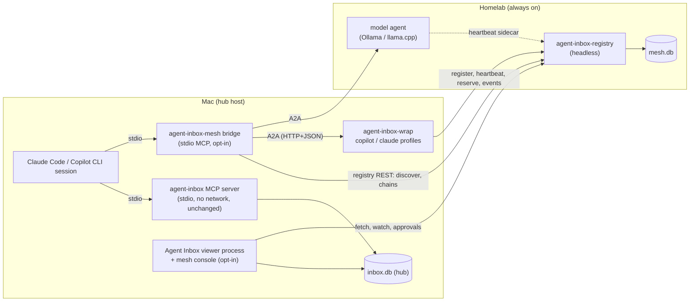

# Design: opt-in agent mesh (A2A registry, wrappers, delegation, Agent Cards)

**Date:** 2026-10-29
**Status:** Design only, for Shariq's review. Nothing here is built. No implementation issues
are opened until Shariq accepts the phases (§10) and answers the open questions (§12).
**Scope of this PR:** this document. No source, test or workflow changes.
**Related:** #8 and its design
([`2026-07-26-remote-hosted-mode-design.md`](2026-07-26-remote-hosted-mode-design.md)),
Dashboard 2.0 ([`2026-10-22-dashboard-2-proposal.md`](2026-10-22-dashboard-2-proposal.md),
phases #302–#307), and two research briefs from 2026-10-28 kept outside the repo. Every fact this
design depends on was checked again against a primary source on 2026-10-29 (§14).

---

## §0 — Summary

1. **The mesh is a set of separate, opt-in pieces around Agent Inbox.** A registry (who exists,
   where, how loaded), wrappers (turn Copilot CLI, Claude Code and local models into A2A agents),
   an MCP bridge (lets an agent discover and delegate), and a console (the Dashboard Agents view
   and the human loop). Each piece is switched on by itself and removed by itself.
2. **Off means off.** With no mesh configuration file, Agent Inbox behaves byte for byte as today:
   no listener, no process, no network call, no MCP tool, no Settings section, no new dependency
   and no hub schema change (§2).
3. **The registry is Eureka-shaped:** register, renew, evict, fetch and watch, with leases and
   a sleep-aware self-preservation rule. It copies the REST shape of `a2a-lib`'s registry server
   but does not depend on it (§4).
4. **The registry has its own SQLite file,** `~/.agent-inbox/mesh/mesh.db`, behind its own
   one-door module. The hub (`inbox.db`) gains no table, column or trigger, because the #297
   snapshot-domain contract makes every hub table permanent and the mesh must stay removable.
5. **Agent Inbox's stdio MCP server stays network-free.** Delegation tools live in a separate MCP
   server, `agent-inbox-mesh`, that a human registers on purpose (§6).
6. **One generic ACP→A2A wrapper covers Copilot (`copilot --acp`) and Claude
   (`claude-agent-acp`).** Each task gets its own session and git worktree, under a concurrency
   cap. Local models get a small TypeScript model agent, or a framework agent plus a heartbeat
   sidecar (§5).
7. **The human stays in charge.** The first hand-off in every chain needs a click in Agent Inbox.
   Tool-permission prompts inside a delegate always go to the human, never to the calling agent.
   Hop limits, loop refusal, per-chain and per-host spend caps, and a kill switch always apply
   (§7).
8. **Admission is checked by the callee, not trusted from the caller.** A wrapper accepts a task
   only after the registry reserves the hop against the chain's path, budget and kill switch.
9. **The console uses the existing machinery.** Human asks arrive as ordinary blocked rows on a
   per-chain plan, so the one attention predicate, the badge and the dock need no change. Lease,
   load and presence are drawn in the Agents view and never enter attention (§9).
10. **Seven small phases, each with a go/pivot checkpoint.** The first phase draws an Agents view
    from today's presence with no network at all. Delegation arrives in phase M4, and only one
    hop deep until phase M6 proves the safety rails (§10).

---

## §1 — Goals and non-goals

### Goals

- **G1. Agents find each other.** An agent can ask "who is alive and can do code review?" and
  get live answers, not a stale list.
- **G2. Agents delegate.** An agent can hand a bounded task to another agent over A2A, follow it
  and use the result.
- **G3. The mesh grows by registration.** A new agent, workflow or automation becomes targetable
  by registering a card. Anything that already speaks A2A joins without a wrapper.
- **G4. Non-A2A tools join through wrappers.** Copilot CLI, Claude Code and local models.
- **G5. One human console.** Agent Inbox shows every agent, its instances, lease, load and
  distribution, and is where every human decision in the mesh is made.
- **G6. Personal first, publishable later.** It works for Shariq's tailnet first, and the design
  leaves room for groups, namespaces and signed cards.

### Non-goals

- **No change for anyone who does not opt in** (§2). This is a requirement, not a preference.
- **No automatic routing in the first phases.** "Least-loaded healthy instance" arrives in M5,
  after the load data has been watched by a human.
- **No gateway or data-plane proxy.** agentgateway stays a later option if rate limits or
  weighted routing are needed.
- **No hosted inbox.** The mesh does not need #8. Remote agents do not write to the hub; the
  console relay on the hub's machine does (§3.4).
- **No sync between hubs.** Hosted-mode §8's rule stands: two SQLite files are two inboxes.
- **No push webhooks.** Streaming and polling only, so no component accepts a callback URL (§7.8).
- **No credentials in A2A messages.** Ever (§7.6).
- **No Go binary yet.** TypeScript first (decision 6).
- **No dependence on `a2a-lib`, AGNTCY, the MCP Registry or a cloud registry** (decision 2).

---

## §2 — The opt-in contract: how each piece is switched on, and what "off" guarantees

Shariq's requirement (2026-10-29): "We don't know how well it'll work." So everything is off by
default, every piece switches on alone, and every piece can be removed cleanly.

### 2.1 One root switch, one file

The mesh has one root on the hub's machine: **`~/.agent-inbox/mesh.json`**. It does not exist
until a human runs:

```sh
agent-inbox-meshctl enable --agents-view            # dry run: prints the file it would write
agent-inbox-meshctl enable --agents-view --apply    # writes it
```

`meshctl` follows `install-agents.sh`'s habits: a dry run by default, `--apply` to write, a
timestamped backup before any change, and no change to anything it does not own. The file holds
one explicit key per piece:

```json
{
  "schema": 1,
  "agentsView": true,
  "console": {
    "registry": "https://mesh.example-tailnet.ts.net",
    "tokenFile": "~/.agent-inbox/mesh/console.token",
    "relay": false,
    "publishPresence": false
  }
}
```

A missing key means off. A missing file means everything is off. The viewer reads the file at
start and again when its stat stamp moves (checked when Settings opens and at most once a minute),
the same pattern `/api/setup` uses for host configs. The browser never supplies the registry URL,
so the page cannot point the viewer at an arbitrary address (§7.8).

### 2.2 The pieces and their switches

| Piece | Runs where | Switched on by | Off means |
|---|---|---|---|
| **Agents view** (M1) | browser, from `/api/activity` | `agentsView: true` | No Settings → Mesh section, no Agents view, no extra read |
| **Registry** (M2) | its own process, any host | running `agent-inbox-registry` (or the container) | No listener and no `mesh.db` |
| **Console link** (M2) | viewer process | `console.registry` set | No request leaves the viewer except today's `gh` pollers |
| **Presence publisher** (M2) | viewer process | `console.publishPresence: true` | This hub's sessions stay private to it |
| **Console relay** (M3) | viewer process | `console.relay: true` | No mesh plan is ever written to the hub |
| **Wrapper** (M3) | its own process per profile | running `agent-inbox-wrap --profile <name>` | Nothing |
| **MCP bridge** (M4) | stdio MCP server, per agent CLI | the human registers `agent-inbox-mesh` in a host config (`meshctl install-bridge --apply`) | No agent sees a mesh tool |
| **Delegation** (M4) | registry policy | `delegation: "first-hop-click"` in the registry's config | `delegate()` is refused with "delegation is off" even when everything else runs |
| **Multi-hop** (M6) | registry policy | `maxHops` above 1 | Chains are one hop deep |

Nothing starts a mesh process at install, at build, at Electron startup or from Setup. The
Electron app never spawns the registry, a wrapper or the bridge.

### 2.3 What "off" guarantees, as checkable facts

These are the claims, each paired with the test that holds it. They follow the hosted-mode
design's §7 habit: say exactly what is proven, and no more.

- **(a) The stdio MCP server is unchanged.** `src/mcp-server.ts`'s import graph reaches no mesh
  module. The existing graph test in `test/prstate.test.ts` gains the new modules to its
  forbidden list. `tools/list` in `test/mcp.integration.test.ts` stays identical.
- **(b) The viewer is unchanged without `mesh.json`.** A DOM-harness test boots with no file and
  asserts the poll's request list is the same eight reads, `GET /api/mesh` answers
  `404 { enabled: false }`, Settings has no Mesh section, and no timer or `fetch` beyond today's
  starts. The viewer-process mesh modules are imported lazily, only when the file enables them.
- **(c) No new dependency in the app.** The registry needs only `hono`, `@hono/node-server` and
  `better-sqlite3`, which the app already ships. Everything that needs `@a2a-js/sdk`,
  `@agentclientprotocol/sdk` or `claude-agent-acp` lives in a separate workspace package,
  `packages/mesh/`, with its own lockfile. The app's `package-lock.json` and the release gates do
  not change.
- **(d) No hub schema change.** No table, column or trigger is added to `inbox.db` in any phase.
  `test/fixtures/snapshot-triggers.txt` stays byte-identical. The relay writes only through
  existing `store.ts` functions (`upsertBoard`, `updateBoardRow`, `advanceBoardRow`,
  `archiveBoard`).
- **(e) No listener on the local path.** `src/viewer-network.ts` still binds one `127.0.0.1`
  listener. The registry and wrappers are separate commands.
- **(f) Today's zero-config, no-auth local path is untouched.** No token, login or identity check
  is added to `src/viewer.ts`, `src/viewer-network.ts` or `src/mcp-server.ts`. Mesh auth lives
  only in mesh processes.

### 2.4 Removing it

`agent-inbox-meshctl disable --apply` deletes `mesh.json`. The viewer stops its mesh work at the
next stat check. `--purge` also deletes `~/.agent-inbox/mesh/` (the registry database if it is
local, tokens, wrapper profiles and their worktree roots once they hold no unpushed work, which it
lists and keeps otherwise). `meshctl uninstall-bridge --apply` removes only the
`agent-inbox-mesh` MCP registration it added. Mesh plans already written to the hub are archived,
never deleted: they are the human's history, and hub rows are never removed behind the human's
back.

---

## §3 — Architecture

### 3.1 Components



Every arrow that crosses a machine travels over the tailnet through `tailscale serve`, or over
TLS with a token when Tailscale is absent (§8). The registry can also run on the Mac; the
homelab is the recommended home because it does not sleep (§12, Q1).

| Component | Process | Network | Writes | Ships in |
|---|---|---|---|---|
| **Registry** `agent-inbox-registry` | its own Node process | one listener, `127.0.0.1` by default | `mesh.db` only, through `src/mesh-store.ts` | the app package (no new deps), npm, container |
| **Console** (Agents view data, relay, publisher) | the viewer process | outbound to the registry only | the hub, through `store.ts`, as a plan writer | the app package |
| **Wrapper** `agent-inbox-wrap` | one per policy profile, plus one child per session | one A2A listener on `127.0.0.1`; outbound to the registry | its worktree root; nothing in the hub | `packages/mesh` |
| **Bridge** `agent-inbox-mesh` | stdio MCP server, one per agent CLI | outbound to the registry and to A2A agents | nothing | `packages/mesh` |
| **meshctl** | short-lived CLI | outbound to the registry for `register`, `send`, `pause` | `mesh.json`, host MCP config (only its own entry) | `packages/mesh` |

### 3.2 Control plane and data plane

The registry is the **control plane**. It holds membership (cards, instances, leases, load) and
the **chain ledger** (chains, hops, budgets, approvals and the kill switch). It never calls an
agent and never fetches a URL a caller supplied.

A2A traffic is the **data plane**. The bridge or an upstream wrapper calls the downstream
wrapper directly. Before accepting, the downstream wrapper asks the registry to reserve the hop
(§7.1). So the registry sees every hop without carrying any payload.

### 3.3 Invariants kept

- **The MCP stdout channel is sacred.** The bridge is a stdio MCP server too, so it inherits the
  rule: no `console.log` to stdout, and every child process captures stdout. Its A2A and registry
  calls happen inside that process, which is allowed because it is a different process from
  `agent-inbox`'s MCP server. A test pins that the two import graphs share only local modules that
  open no connection (`scope.ts` and `infer.ts`, for project and branch inference).
- **No network in the existing MCP process.** Unchanged (decision 3). The bridge does not import
  `store.ts`; it never writes the hub.
- **The viewer loopback boundary** (`src/viewer-network.ts`) is unchanged. The console adds only
  outbound requests, from the viewer process, to the one registry URL in `mesh.json`. Its new
  routes (`GET /api/mesh`, `POST /api/mesh/pause`, `POST /api/mesh/resume`) sit behind the
  existing outer gate, so every mutation still needs a trusted Origin.
- **`store.ts` is the only door to the hub.** The relay writes plans through it, as the `gh`
  pollers and the hook CLI already do from their own processes. **`src/mesh-store.ts` is the only
  door to `mesh.db`,** with the same rules: WAL, `busy_timeout=5000`, `.immediate()` for any
  transaction that reads before it writes, and no raw SQL elsewhere.
- **Viewer-process-only modules** (`src/mesh-console.ts`, `src/mesh-relay.ts`) follow
  `src/prstate.ts`'s rules: they never reject, write only through `store.ts`, never touch
  `public/attention.js`, and stay out of the stdio MCP graph. In the packaged app the viewer runs
  inside Electron main, so they do little work per tick: one conditional fetch, a small diff and
  a few row writes. Heavy work belongs in the registry.
- **Hosted-mode seams.** The registry is a third kind of entry, like hosted mode's
  `src/hosted-server.ts`. It reuses that design's rules: the gate is installed before any route
  (§6, the gate-ordering trap), a non-loopback bind is refused without a token (§5), tokens are
  compared with `timingSafeEqual` after a length check, and Host is checked against the
  configured public name (§9.6, DNS rebinding). If #8 ships later, nothing here conflicts:
  remote agents could flag directly, but the mesh does not require it.

### 3.4 Why the relay lives with the hub

Human asks must become ordinary hub rows so the one attention predicate sees them. SQLite must
never be opened over a network (hosted-mode §8). So the component that writes them must run on
the hub's machine. The viewer already runs there, already writes the hub from its own process,
and is already open whenever the human could answer. A separate relay daemon would be one more
thing to start, and it would sit idle when the viewer is closed anyway.

---

## §4 — The registry

### 4.1 What it is

`agent-inbox-registry` is Agent Inbox's headless registry mode (decision 2's `--registry`). It
has no viewer, no inbox and no MCP endpoint. It serves only mesh endpoints. It runs from a
checkout (`npm run registry`), from an installed runtime, from npm, or from a container. The
Electron app gets no `--registry` flag in these phases (§12, Q9).

### 4.2 Data model

Stored in `mesh.db`. Names are illustrative; the store module owns the schema.

| Record | Key | Fields | Notes |
|---|---|---|---|
| **Agent** (logical) | `id` = `namespace/name` | `card` (the A2A Agent Card JSON, stored unchanged, at most 64 KB), `card_sha256`, `trust` (`unverified` / `verified` / `invalid`), `namespace`, `created_at`, `updated_at` | One card shared by every instance, as in `a2a-lib`. A different card while instances are live is `409 agent_card_mismatch`. |
| **Instance** | `(agent_id, instance_id)` | `kind` (`a2a`, `session`, `static`), `endpoint` (null for `session`), `host`, `owner` (the identity that registered it), `ttl_s`, `lease_token_sha256`, `registered_at`, `renewed_at`, `expires_at`, `state`, `metadata`, `load`, `load_at` | `state` is `up`, `draining`, `stale` or `expired` (§4.4). |
| **Load sample** | `(agent_id, instance_id, minute)` | started, completed, failed, cost units, max active, max input-required | One-minute buckets, kept 7 days. Feeds the distribution view. |
| **Chain** | `chain_id` | `origin` (hub id, project, session, agent), `title`, `status`, `approved_by`, `approved_at`, budget limits, spent counters, `created_at`, `deadline_at` | `status`: `awaiting_approval`, `active`, `done`, `declined`, `killed`, `expired`. |
| **Hop** | `(chain_id, task_id)` | `parent_task_id`, `depth`, `caller`, `callee_agent`, `callee_instance`, `state`, `reserved_units`, `spent_units`, `started_at`, `ended_at`, `summary` (at most 500 characters) | The authoritative path. Loop checks read it, never the caller's claim. |
| **Approval** | `approval_id` | `chain_id`, `task_id`, `kind` (`first_hop`, `permission`, `credential`, `escalated_input`), `question`, `options`, `revision`, `decision`, `decided_by`, `decided_at` | Decisions are version-pinned like hub row actions. |
| **Mesh state** | singleton | `paused` (kill switch), `paused_by`, `paused_at`, `reason`, `preserving` (self-preservation), `revision` | `revision` moves on every change and drives watch. |

Lease tokens and API tokens are stored only as SHA-256 hashes, as `a2a-lib` does.

**Load** is not on the card. Cards are cached and may be signed, while load changes every
heartbeat. The heartbeat body carries it, and the card advertises a data-only A2A extension whose
URI names the schema (A2A spec §4.6 defines data-only extensions):

```json
{
  "state": "ready",
  "activeTasks": 1, "maxConcurrent": 2, "queued": 0,
  "inputRequired": 0, "authRequired": 1,
  "window": "15m", "completed": 6, "failed": 0,
  "p50Ms": 41000, "p95Ms": 180000,
  "costUnits": 3.2, "budgetRemaining": 20,
  "probeOkAt": "2026-10-29T21:00:00Z"
}
```

`state` is `ready`, `busy` or `draining`. Four derived signals are enough for a later
least-loaded router: utilisation (`activeTasks / maxConcurrent`), distribution (tasks per
instance per window), quality (success rate and p95) and human load
(`inputRequired + authRequired`). The research found no A2A proposal for load or capacity; the
nearest is the open liveness-attestation extension proposal (A2A #1934).

### 4.3 API

The membership routes copy `a2a-lib/a2a-registry-server`'s REST shape (verified from its README
on 2026-10-29), so its clients and dashboard work against ours and ours against it:

| Method | Path | Purpose |
|---|---|---|
| `POST` | `/v1/agents` | Register an instance (server-generated id when omitted) |
| `GET` | `/v1/agents?skill=&tag=&capability=&protocolBinding=&name=&limit=&cursor=` | **Fetch**: logical agents with at least one unexpired instance |
| `GET` | `/v1/agents/{id}` | One agent and its instances |
| `POST` / `GET` | `/v1/agents/{id}/instances` | Register a named instance / list instances |
| `PUT` / `GET` / `DELETE` | `/v1/agents/{id}/instances/{instanceId}` | Create or replace / fetch / **cancel** (unregister) |
| `POST` | `/v1/agents/{id}/instances/{instanceId}/heartbeat` | **Renew**, with `X-Registry-Lease-Token`; our body may carry `load` |
| `GET` | `/v1/watch` | **Watch**: revisioned snapshots as Server-Sent Events, resumable with `after` or `Last-Event-ID` |
| `GET` | `/health/live`, `/health/ready` | Liveness and readiness |

`a2a-lib`'s legacy aliases (`/v1/registry/*`) and its agent-level heartbeat are not copied: no
existing client needs them. **Evict** is not a route; lease expiry evicts (§4.4).

Mesh routes live under `/v1/mesh/` so they never collide with the membership shape:

| Method | Path | Purpose | Who may call |
|---|---|---|---|
| `POST` | `/v1/mesh/chains` | Open a chain (state `awaiting_approval`) | `delegate` |
| `GET` | `/v1/mesh/chains/{id}` | Chain, hops, budget and pending approvals | chain participants, console |
| `POST` | `/v1/mesh/chains/{id}/hops` | **Reserve** a hop (§7.1) | the callee wrapper |
| `POST` | `/v1/mesh/chains/{id}/hops/{taskId}/events` | Report state, units and summary | the callee wrapper |
| `POST` | `/v1/mesh/approvals` | Ask the human | wrappers, the registry itself |
| `POST` | `/v1/mesh/approvals/{id}/decision` | Record the human's answer, pinned to `revision` | console only |
| `POST` / `DELETE` | `/v1/mesh/pause` | Kill switch on / off | on: any human identity or `admin`; off: `admin` only |

Two well-known documents:

- **`/.well-known/agent-card.json`:** the registry's own card. It describes the registry, lists
  no A2A skills in these phases, and points at the REST API. A registry that answers A2A
  `discover` messages is deferred until an A2A-native agent needs it.
- **`/.well-known/ai-catalog.json`:** an `application/ai-catalog+json` document whose entries
  inline the cards of `up` agents with type `application/a2a-agent-card+json`. AI Catalog is a
  draft in a temporary Linux Foundation working repo, and it has no registry API yet; its README
  says the project "should also define" one. So the feed is marked experimental, follows the
  draft's `specVersion`, and is off unless `catalog: true` is set in the registry config.

### 4.4 Leases, eviction and self-preservation

**Timings.**

| Instance kind | TTL | Heartbeat | Why |
|---|---|---|---|
| `a2a` (wrappers, model agents) | 90 s | every 30 s, with jitter and backoff | Eureka's ratio: evict after three missed renewals. `a2a-lib` advises renewing at a third of the TTL. |
| `session` (published presence) | 15 min | every 5 min | Mirrors the hub's own presence (5-minute liveness tick, ~15-minute expiry). |
| `static` (a card with no heartbeat, e.g. a third-party agent) | none | none | Shown as "declared", never routed to until M5 probes it. |

**States.** An instance is `up` while its lease holds. A wrapper that is shutting down sets
`draining` and gets no new tasks. A missed lease makes it `stale`. Normally `stale` becomes
`expired` straight away; `expired` records stay visible as "last seen" for 24 hours and are then
deleted. **Routing uses only `up`.** Self-preservation changes what is displayed and deleted,
never what is routed to.

**Self-preservation, adapted for a laptop.** Eureka stops evicting when more than 15 % of
registered clients are pending eviction at once, on the theory that the registry, not the clients,
lost the network. With five instances, 15 % is one instance, so the rule needs two changes:

1. **The registry's own sleep.** A housekeeping tick runs every 5 s. If the wall clock advanced
   more than three ticks plus the elapsed tick since the last one, the registry slept or was
   suspended. It extends every lease by the gap, so each instance gets a full TTL after wake to
   renew. This needs no claim about how the OS monotonic clock behaves during sleep.
2. **Partition, judged by host.** If instances on at least half of the hosts, and at least two
   hosts, stop renewing within one TTL, the registry enters `preserving`. It keeps those instances
   as `stale` ("registry may be partitioned") instead of expiring them, and the Agents view says
   so. It leaves `preserving` when renewals return above the threshold, or when an `admin` turns
   it off. A single host going quiet (the Mac sleeping while the registry runs on the homelab) is
   the normal case and expires normally: those agents really are unreachable.

**Mac sleep, the other way round.** A wrapper on a sleeping Mac misses its renewals and expires.
On wake it renews; if the registry already expired it, the wrapper registers again with the same
instance id and a fresh lease token, which it keeps in a `0600` file.

### 4.5 Storage: a separate database, not the hub

`mesh.db` is a separate SQLite file owned by the registry process. Reasons, in order of weight:

1. **The #297 contract makes hub tables permanent.** Every hub table must be classified in
   `SNAPSHOT_DOMAINS` or `UNREAD` forever; a domain is never retired, a snapshot trigger is never
   dropped, and an older process sharing the file must keep working. A mesh table added to the hub
   could never be removed, so the mesh could never be removed cleanly, which the opt-in
   requirement forbids.
2. **The registry often runs on another machine.** SQLite must not be opened over a network
   (hosted-mode §8). A hub table would force the registry onto the hub's machine.
3. **Write rate.** Ten wrappers renewing every 30 s, plus load samples and hop events, are
   steady small writes. In the hub they would compete for the hub's single write lock, which
   every MCP server, the viewer and the hook CLI share under a 5-second busy timeout. In
   `mesh.db` they compete with nothing.
4. **Mixed versions.** Older Agent Inbox builds sharing the hub would see unknown tables they
   cannot reason about. A separate file has no older readers.

The cost is that the console cannot join hub data and registry data in SQL. It joins them in the
viewer (§9), which is where the Agents view needs them anyway. If the registry runs on the Mac,
`mesh.db` sits in `~/.agent-inbox/mesh/` beside the hub. It is still a separate file with its
own store module.

---

## §5 — Wrappers

### 5.1 One generic ACP→A2A wrapper

Neither Copilot CLI nor Claude Code speaks A2A (Claude Code's request for an A2A client,
anthropics/claude-code#104852, is open). Both speak ACP, the Agent Client Protocol: Copilot
through `copilot --acp` (public preview), Claude through the Apache-2.0 adapter
`@agentclientprotocol/claude-agent-acp` (v0.99.0, 2026-10-28), which runs the Claude Agent SDK.
The ACP registry lists many more ACP agents. So one wrapper, `agent-inbox-wrap`, speaks A2A on
one side and ACP on the other, and reaches all of them.

A wrapper process serves one **profile**, a file in `~/.agent-inbox/mesh/wrappers/<name>.json`:

```json
{
  "agent": "copilot",
  "command": ["copilot", "--acp", "--stdio", "--available-tools=view,grep,glob", "--effort=medium"],
  "card": { "name": "copilot-review", "skills": [{ "id": "code-review", "tags": ["review"] }] },
  "repos": { "agent-inbox": "~/Development/agent-inbox" },
  "write": false,
  "maxConcurrent": 2,
  "listen": "127.0.0.1:4410",
  "costUnitsPerTurn": 1
}
```

One profile per policy is required, not a style choice: Copilot fixes tool filters and reasoning
effort when its ACP server starts, and `session/new` cannot change them (verified in GitHub's ACP
server reference).

**The A2A server** uses `@a2a-js/sdk` v1.3.0 (Apache-2.0, A2A 1.0, JSON-RPC, HTTP+JSON and gRPC).
Its transport adapters are Express routers, so the wrapper is an Express app; that is fine, because
the wrapper is not part of the Hono viewer. It serves HTTP+JSON first.

### 5.2 Sessions, tasks and turns

- **One ACP session per A2A `contextId`,** and one ACP child process per session. Claude's Agent
  SDK runs one `claude` subprocess per session anyway, and a process per session isolates crashes
  and working directories.
- **One A2A message is one ACP `session/prompt` turn.** `session/update` notifications become A2A
  status and artifact events. The turn's stop reason sets the task state: `end_turn` →
  `COMPLETED` (the final text, plus a diff summary for write profiles, as the artifact);
  `cancelled` → `CANCELED`; `refusal` → `REJECTED`; `max_tokens` or `max_turn_requests` →
  `FAILED` with the reason.
- **Follow-ups reuse the context.** A new message with the same `contextId` starts a new task in
  the same session. If the child died, the wrapper reloads the session when the agent supports
  `session/load`, and otherwise fails the task with "session lost".
- **A context belongs to one chain and one caller.** A message that reuses a `contextId` from
  another chain or caller is refused. This blocks the multi-turn steering attack Unit 42 calls
  "agent session smuggling" from crossing chains.

### 5.3 Worktrees and the working directory

The caller never chooses a path. A task may name a repository **id** from the profile's `repos`
allowlist and a ref name (validated as a plain branch name). The wrapper then runs
`git worktree add <worktreeRoot>/<chain>-<task> -b mesh/<chain>/<task> <ref>` and passes that
directory as the session's `cwd`. A task with no repository gets an empty scratch directory.
Read-only profiles (`write: false`) get a detached worktree and read-only tools.

Nothing is pushed. A push, a PR or anything outside the worktree is a permission request, which
goes to the human (§5.5). Finished worktrees are removed after the task ends; their branches are
kept for 7 days for review and then pruned unless they hold unpushed commits, which are listed
instead.

### 5.4 Concurrency caps

| Cap | Default | Enforced by |
|---|---|---|
| Per profile | Copilot 2, Claude 1 (subscription), model agent = the runtime's parallelism | the wrapper |
| Per host | sum of the host's profiles, and a configurable host total | the registry at reserve time |
| Queue | 3 tasks per profile, then `REJECTED` with a retry hint | the wrapper |

Ollama processes one request per model at a time by default (`OLLAMA_NUM_PARALLEL=1`) and answers
503 when its queue (default 512) is full. The ubi-llm box also swaps models in about a minute. So
a local model agent's cap is 1 and its p95 is long; the load view will show it.

### 5.5 Human input: INPUT_REQUIRED, AUTH_REQUIRED and permissions

Three kinds of pause, with three different owners:

| What the wrapped agent does | A2A state seen by the caller | Who answers | How it reaches Agent Inbox |
|---|---|---|---|
| Asks a clarifying question as a structured request (Claude's `AskUserQuestion`; an ACP question form) | `INPUT_REQUIRED`, with the question | **The caller.** Per A2A, the client sends the next message. | A `tracked` row "waiting on <caller>" on the chain plan. Not blocked: no human is needed yet. |
| Ends its turn with a question in plain text | `COMPLETED`, with the text | The caller, as a follow-up in the same context | The hop row shows the outcome. |
| Asks permission for a tool (`session/request_permission`, the SDK's `canUseTool`) outside the profile's auto-allow list | `AUTH_REQUIRED`, with "waiting for the callee owner's approval in Agent Inbox" | **The human, always.** Never the caller. | A blocked `approval` row (§9.3). |
| Needs a credential (a sign-in, a token) | `AUTH_REQUIRED` | The human, out of band on the callee's host | A blocked `task` row ("Sign in to … on …"), answered with "I've done my part". |

**Why the caller never approves a permission.** The caller is another model. If it could approve
its delegate's tool use, one prompt-injected agent could grant another agent's privileges: the
confused-deputy problem MCP's security guidance warns about. A2A supports exactly this split: the
agent arranges credentials out of band and keeps its stream open while in `AUTH_REQUIRED`
(spec §7.6.1), and the state alone is never authorization (§7.6.4).

**How an answer flows back.**

1. The wrapper posts `POST /v1/mesh/approvals` with the question and options, then waits.
2. The console relay sees it through `/v1/watch` and writes a blocked row on the chain plan.
3. The human answers the row in Agent Inbox, as any other row.
4. The relay reads the response through `store.ts`, posts
   `POST /v1/mesh/approvals/{id}/decision` with the approval's `revision`, then flips the row
   out of `blocked` with an `outcome`. The status flip is the acknowledgement, as for every row.
5. The wrapper sees the decision on its watch and answers ACP's `session/request_permission`
   with `allow_once` or `reject_once`. The A2A task returns to `WORKING`.

An approval is scoped to one permission request. It never authorizes later requests on the task
(A2A §7.6.4). "Allow for this chain" is a later option, only if the click count proves too high.

**If the caller cannot answer an `INPUT_REQUIRED`,** it is itself an Agent Inbox agent: it flags
a question to the human in the usual way and replies with the answer. If no answer arrives within
the chain's `inputTimeout` (default 30 minutes), or the caller's lease expires, the registry marks
the request `escalated_input` and the relay turns the row into a blocked decision for the human.
The human's answer is sent to the wrapper, which delivers it as the next user message, tagged
`source: human` in the message metadata.

### 5.6 Copilot

- Command: `copilot --acp --stdio` per session, with the profile's `--available-tools`,
  `--excluded-tools` and `--effort`.
- Auth: the host's logged-in Copilot CLI, or `COPILOT_GITHUB_TOKEN` for headless hosts (checked
  before `GH_TOKEN` and `GITHUB_TOKEN`). BYOK providers run without a GitHub login.
- Cost: premium-request billing changed on 2026-06-01. The wrapper counts turns as cost units
  until real per-task cost is measured in M3.
- Risk: ACP in Copilot CLI is public preview (§11).

### 5.7 Claude

- Command: `claude-agent-acp` per session (it starts `claude` through the Agent SDK).
- **Auth follows decision 1.** A profile marked `"personal": true` uses the host's own Claude
  subscription login. Every other profile must supply `ANTHROPIC_API_KEY` and refuses to start
  without it. Anthropic's Agent SDK overview says third-party developers may not offer claude.ai
  login or rate limits for their products without approval, so the published default is API keys
  and the docs never offer subscription login.
- **`--bare` is not available for personal use.** Bare mode never reads OAuth credentials, so it
  needs an API key. A personal profile therefore runs normal mode, which loads user, project and
  local settings and runs a project's hooks and `.mcp.json` even in an untrusted folder. Two
  mitigations: the working directory is always a fresh worktree of an allowlisted repository, so
  the only project settings are the repository's own; and the wrapper sets
  `CLAUDE_CODE_DISABLE_AUTO_MEMORY=1` and, where the adapter allows it, `settingSources: []`.
  M3 checks what the adapter lets a client set (§12, Q11).
- Licence note: the TypeScript Agent SDK the adapter uses is under Anthropic's Commercial Terms,
  not an open-source licence. The wrapper depends on it as a user-installed package and does not
  vendor it.

### 5.8 Local models

A model is not an agent. Two routes, both TypeScript-first (decision 6):

- **Model agent (built in `packages/mesh`):** `agent-inbox-wrap --agent openai-compatible`
  serves A2A with `@a2a-js/sdk` and calls an OpenAI-compatible endpoint (Ollama's
  `/v1/chat/completions`, llama.cpp, vLLM). It has no tools. Its skills are text-in, text-out:
  `second-opinion`, `bulk-read`, `summarize`. Because it owns its queue, its load is exact.
- **Framework agent (adopted):** a tool-using local agent built with Strands' `A2AServer` or
  Pydantic AI's FastA2A, plus `agent-inbox-meshctl heartbeat --card-url <url>`, a sidecar that
  registers the agent's own card and renews its lease. The sidecar cannot see load, so such an
  agent shows membership only until it reports load itself.

---

## §6 — The MCP bridge: `agent-inbox-mesh`

A separate stdio MCP server, registered by the human in a host's config (decision 3). It is an
A2A client and a registry client. It never writes the hub; human asks reach the hub through the
registry and the relay. It infers the origin project and branch locally, as `scope.ts` does.

Tool results follow `src/shape.ts`'s habits: bounded payloads, a `*_chars` count for anything
trimmed, and every remote string marked untrusted (§7.5). Tool names below are the server-local
names; hosts show them prefixed (`agent-inbox-mesh-discover`).

### `discover`

```
discover({ skill?: string, tag?: string, text?: string, include_unavailable?: boolean })
→ { revision, agents: [{
      id, name, skills: [{ id, name, tags }],
      description: { text /* ≤ 200 chars */, untrusted: true },
      instances: { up, busy, draining, stale },
      load: { utilisation, queued, waitingOnHuman },
      hosts: [string], trust: "unverified" | "verified" | "invalid"
    }] }
```

Returns only agents with an `up` instance unless `include_unavailable` is set. `text` matches
names, skill ids and tags, never card descriptions.

### `delegate`

```
delegate({
  agent?: string, skill?: string,          // one of the two
  message: string,                         // ≤ 16 KB
  context?: string,                        // ≤ 16 KB, shown to the human with the request
  workspace?: { repo: string, ref?: string },  // a repo id from the callee's allowlist
  budget?: { maxCostUnits?: number, maxMinutes?: number },  // ≤ the registry's ceilings
  chain_id?: string,                       // continue an approved chain
  wait_seconds?: number                    // 0–60, default 0
}) → { chain_id, task_id?, state, instance?, approval?: { id, title }, budget }
```

- **No `chain_id`:** opens a chain in `awaiting_approval` and returns at once. The relay puts the
  first-hop approval in front of the human (§9.3). Once approved, the bridge sends the A2A
  message and the state moves to `submitted`.
- **With `chain_id`:** a further task in an already-approved chain. No new click; it counts
  against the chain's budget and hop limit.
- **`skill` without `agent`:** before M5, the bridge picks the `up` instance with the most recent
  heartbeat and reports which one. From M5, the least-loaded healthy instance.
- Refusals are plain: "delegation is off", "mesh is paused", "budget exceeded", "would loop
  back to copilot-review", "no up instance has skill code-review".

### `status`

```
status({ task_id?: string, chain_id?: string, wait_seconds?: number /* 0–60 */ })
→ { chain: { id, status, budget: { limit, spent }, hops: [...] },
    task?: { id, state, message?: { text, untrusted: true },
             artifacts: [{ name, text /* ≤ 8 KB */, artifact_chars, untrusted: true }],
             input_required?: { question, untrusted: true },
             waiting_on_human?: { kind, title } } }
```

The bridge keeps an A2A subscription open for its own tasks while its process lives, so `status`
answers from memory; `wait_seconds` lets an agent wait without a polling loop.

### `reply`

```
reply({ task_id: string, text: string /* ≤ 16 KB */ }) → { state }
```

Sends the next message on a task in `INPUT_REQUIRED`, or a follow-up in a finished task's
context. It cannot answer an approval. Approvals are human-only and are made in Agent Inbox.

### `cancel`

```
cancel({ task_id?: string, chain_id?: string }) → { cancelled: [task_id] }
```

Not in the original four, but needed: an agent must be able to stop what it started. A chain
cancel cancels every open hop below it.

**Bridge lifetime.** The bridge lives as long as its CLI session. If it exits while its chain is
still `awaiting_approval`, the chain expires after 30 minutes. Running hops keep going under their
own budgets; results stay readable in the registry and on the chain plan.

---

## §7 — Delegation safety

Every rule here applies from the first phase that has delegation (M4), whatever the budget.

### 7.1 Callee-side admission

A wrapper accepts an A2A task only after `POST /v1/mesh/chains/{id}/hops` succeeds. The
registry decides in one `.immediate()` transaction, from its own records:

1. the mesh is not paused;
2. the chain is `active` (approved) and not past its deadline;
3. the parent hop exists, and its callee is the caller asking now (identity from §8);
4. the new depth is at most `maxHops`;
5. the callee agent is not already in the path from the origin (**no back-edges**, which also
   refuses A→B→A);
6. the chain's task count and units, and the callee host's concurrent tasks and daily units,
   stay within limits after reserving this hop's estimate.

The chain id, parent task id and depth travel in A2A message metadata under a profile extension
URI, but they are only hints. The registry's hop records are the truth, so a caller that lies
about its depth or path gains nothing.

### 7.2 The first-hop click (decision 4)

Every chain starts in `awaiting_approval`. The human sees the delegating agent, the target, the
message, the context and the budget, and chooses **Approve** or **Decline**. Later hops in the
chain run without a click while they stay within the budget, hop limit and kill switch.

### 7.3 Budgets (decision 7)

| Limit | Default | Ceiling the bridge cannot exceed |
|---|---|---|
| Hops per chain (`maxHops`) | 1 until M6, then 3 | 3 |
| Tasks per chain | 5 | 20 |
| Cost units per chain | 10 | set per registry |
| Wall time per chain | 60 min | 4 h |
| Concurrent tasks per host | sum of profile caps | set per host |
| Cost units per host per day | 50 | set per host |

A **cost unit** is wrapper-reported: real API cost where the agent reports it (the Agent SDK
reports an estimated `total_cost_usd`; M3 checks whether the ACP adapter passes it on), otherwise a configured price per turn plus a price per minute. A hop
reserves an estimate and settles the real figure when it ends. What a unit is worth in money is
open (§12, Q5).

### 7.4 The kill switch

`POST /v1/mesh/pause` sets the mesh's `paused` flag. From then on every reserve and every new
chain is refused. Wrappers watching the registry cancel their running ACP turns
(`session/cancel`) and mark the tasks `CANCELED`; the target is every task stopped within
10 seconds. The Agents view has a **Pause mesh** button, and `meshctl pause` does the same from a
terminal. Resuming needs an `admin` identity.

Wrappers fail closed. If a wrapper cannot reach the registry, it accepts no new task. If it misses
three heartbeats in a row, it cancels its running tasks, because it can no longer see the kill
switch.

### 7.5 Prompt injection

Remote output, card text and other agents' messages are untrusted data.

- The bridge marks every remote string `untrusted: true` and trims it. Its tool descriptions say
  to treat those fields as data, never instructions.
- Card descriptions are never placed in a prompt or a tool description. `discover` exposes skill
  ids, tags and a short, marked excerpt.
- A wrapped agent runs with a fixed tool allowlist and its own worktree. Read-only profiles have
  no write or shell tools.
- One context per chain and caller (§5.2) limits multi-turn steering.
- Anything that leaves the worktree, pushes or calls the network outside the agent's own model
  provider is a permission request, so it reaches the human.
- The console renders all mesh text through `esc()` and `textContent`, and every link through
  `chipHtml()`, as for any agent text. It loads no image or icon URL from a card.

### 7.6 Credentials and the confused deputy

- A wrapper never forwards the caller's token to its agent or anywhere else. It uses only its own
  host's credentials.
- No credential ever travels in an A2A message. `AUTH_REQUIRED` is resolved out of band on the
  callee's host (A2A §7.6.1 and §7.6.3).
- An approval answers one permission request, by id and revision, and nothing else.
- Callers cannot approve a delegate's permissions (§5.5).

### 7.7 Loops

Hop limits and back-edge refusal stop structural loops (§7.1). Two more checks catch the rest:
the registry refuses a chain whose task count passes its limit even when every hop is new, and it
flags a chain on the Agents view when the same callee receives the same message hash three times.

### 7.8 SSRF

- The registry fetches nothing a caller supplied: no active health checks (an SSRF path in
  `a2a-lib`, which its README warns about), no `jku` fetches, no push-notification URLs.
- No component accepts an A2A push-notification config. The mesh uses streaming and polling. The
  A2A spec's own SSRF list (reject 127/8, 10/8, 172.16/12, 192.168/16, localhost, link-local) does
  not include Tailscale's 100.64.0.0/10, so an allowlist is safer than a denylist anyway.
- An instance's `endpoint` must be HTTPS on a host in the registry's allowlist (by default this
  tailnet's MagicDNS suffix, or `127.0.0.1` for a registry on the same host). With Tailscale, it
  must also be the registering node's own name, so a node cannot advertise someone else's
  service.
- The bridge calls only endpoints the registry returned for an `up` instance.
- The viewer calls only the registry URL in `mesh.json`, never a URL from the page.

---

## §8 — Identity and auth

### 8.1 Layers

1. **Network:** the tailnet and its ACL grants, or a private LAN.
2. **Who is calling:** Tailscale node identity when present (decision 5); otherwise a bearer
   token; later, OIDC.
3. **What they may do:** capabilities `register`, `discover`, `delegate`, `approve` and `admin`,
   granted per identity and namespace.

### 8.2 With Tailscale

Each service (registry, wrapper) listens on `127.0.0.1` and is published with `tailscale serve`.
Agent hosts are tagged nodes. Serve's user identity headers are **not** set for traffic from
tagged devices, but its app-capabilities header is: since Tailscale v1.92, `serve
--accept-app-caps <cap>` forwards the selected capabilities of the connecting user **or tagged
node** as `Tailscale-App-Capabilities`, and strips a spoofed copy. A grant then carries the mesh
capability:

```json
{
  "src": ["tag:agent-host"],
  "dst": ["tag:mesh-registry"],
  "app": { "<domain>/cap/agent-mesh": [{ "actions": ["register", "discover", "delegate"],
                                          "namespace": "shariq" }] }
}
```

The header is trusted only because the listener is loopback-only, which is what Tailscale's docs
require. A service that binds its tailnet address directly, without serve, reads the same capabilities
from the local Tailscale client's LocalAPI WhoIs for the peer address. The capability domain must be
one Shariq controls (§12, Q2).

### 8.3 Without Tailscale

Static bearer tokens, one per identity, each with capabilities and a namespace, stored hashed in
the registry's config (`tokens.json`, `0600`). Tokens are compared after a length check with
`timingSafeEqual`, as in hosted-mode §5. Binding a non-loopback address without TLS and tokens is
refused at startup. A2A cards declare an HTTP bearer security scheme, so A2A-native clients see an
honest scheme.

### 8.4 OIDC, groups and namespaces (M7)

- Agent ids are `namespace/name`. A namespace is a person or group.
- Tokens and capabilities are scoped to namespaces. Cross-namespace delegation is off unless a
  namespace pair is allowed explicitly.
- OIDC: the registry verifies JWTs against a configured issuer's JWKS and maps a groups claim to
  namespaces. `tsidp` (BSD-3-Clause) can issue such tokens from tailnet identity, which makes a
  card's `openIdConnect` scheme honest.
- For groups, who approves a permission request (the callee host's owner or the chain's origin
  human) is open (§12, Q8).

### 8.5 Card signing (M7)

- A2A cards may be signed with JWS over the RFC 8785 canonical form (A2A §8.4). The registry
  verifies against local JWKS and records `trust` beside the unchanged card, as `a2a-lib` does.
  Remote `jku` fetching stays off.
- AI Catalog defines optional Trust Manifests and a `did:web` entry-signature profile
  (ADRs 0025–0028). Because the catalog is still a draft, the feed follows it only after M7 is
  approved and the draft has settled.

---

## §9 — The console: Agents view and the human loop

### 9.1 Where it sits

Dashboard 2.0 chose Mission control (direction A): live lanes per session (#304), a Needs-you
rail (#303), a Today ribbon (#305). The Agents view is a second lens on the same region, not a
new tab: a **Sessions | Agents** switch above the lanes, drawn only when `agentsView` is on.
Sessions keeps #304's lanes. Agents groups the same data by logical agent and adds registry data.

If #304 has not merged when M1 starts, M1 builds on `public/livebar.js`'s session model and the
existing Live dispatch region, and moves onto lanes when they land. Either way it uses the same
liveness classification, so Sessions and Agents never disagree about who is alive.

### 9.2 What a card shows

```
┌ copilot-review ─────────────────────── shariq/ · verified ┐
│ code-review · triage                       mac, homelab   │
│ ● mac-1      up        renewed 12s   ▮▮▯ 2/3  queued 0    │
│ ● homelab-1  draining  renewed 25s   ▮▯▯ 1/3              │
│ ○ mac-2      last seen 3h ago (expired)                   │
│ Tasks 24h ▁▂▅▃▁▁▂  · ok 96% · p95 3m · waiting on you 1 → │
└───────────────────────────────────────────────────────────┘
```

- **Card:** name, namespace, skills, version, trust, hosts. All card text through `textContent`;
  no remote icons.
- **Instances:** state dot, host, lease age ("renewed 12s ago") and a TTL bar, the load
  utilisation bar, queue, and `stale` or `expired` "last seen" lines.
- **Load and distribution:** tasks per instance over the selected range as inline SVG bars,
  success rate and p95 (M5). Before M5, only lease and state.
- **Waiting on a human:** the count of this agent's blocked chain rows, read from the frame's
  `attentionEntries`. It links to the row. It reads the predicate and never feeds it.
- **Sessions from presence:** M1 groups `/api/activity` sessions by agent kind (claude-code,
  copilot) as `session` instances, with the same working, quiet, idle and dormant states Live
  uses. With a registry linked, published sessions from other hubs appear the same way.
- **Mesh banner:** "Mesh paused by …" or "Registry may be partitioned (preserving 4 instances)",
  with **Pause mesh** / **Resume**.

### 9.3 Chain plans: how human asks appear

The relay writes one plan per chain, in the origin project, titled
`Mesh: <first message, trimmed> (<chain id prefix>)`, with agent `agent-inbox-mesh`. Rows are
stable by label:

| Row | Status | Human action |
|---|---|---|
| `Approve hand-off` | `blocked`, `action_owner: approval`, options **Approve** (recommended) / **Decline** | Approve or decline the first hop. `next_step` names the target and budget; `context` holds the message and the delegating agent's context. |
| `Hop 1 → copilot-review@mac` | `partial` while running, `done` with `outcome` on success, `na` with `outcome` on failure, cancel or rejection | None |
| `Approval: <tool> on <host>` | `blocked`, `action_owner: approval`, options **Allow once** / **Deny** | Answer a permission request. |
| `Sign in: <service> on <host>` | `blocked`, `action_owner: task` | "I've done my part" after signing in on that host. |
| `Waiting on <caller>` | `tracked` | None, until escalated; then `board_advance` turns it into a blocked decision. |

Every ask is one surface: a blocked row, never also a question item. Rows follow every board
rule: revision-pinned writes, the status flip as acknowledgement, `board_advance` for a chained
step. The plan is archived when the chain ends.

### 9.4 Invariants

- **The one attention predicate.** Only blocked chain rows enter attention, through
  `public/attention.js` unchanged. Lease, load, state, trust, distribution, paused and preserving
  never reach a badge, a count, the dock or a notification.
- **Presence is not attention.** As today.
- **Two render entries.** The Agents view is ambient: the ambient painter updates it in place
  while a draft is open. Its Pause and Resume buttons end in `reloadAndPaint()`.
- **Poll budget.** With `agentsView` off, nothing changes. In M1 the view reads only
  `/api/activity`, which the poll already reads. From M2 it adds one conditional read,
  `GET /api/mesh`, only while the view is visible. The viewer serves it from a cached registry
  watch with an ETag, so an idle tick is a 304.
- **Motion.** At most one pulse per agent card, counted within #302's cap of 12 infinite
  animations, and off under reduced motion.
- **DOM.** The Agents section stays under 400 elements (24 cards).
- **Idle frames** (#298): mesh state the view reads joins `frameInputs()`.

---

## §10 — Phased plan

Each phase is one or two reviewable PRs, useful on its own, and ends at a **go/pivot
checkpoint**: Shariq reads the phase's evidence and chooses **continue**, **change** or **stop**
before the next phase starts. Every phase ships its "off" tests (§2.3) and leaves the mesh off by
default. "Agent" below means the implementing agent; "reviewer" means an independent review
before merge.

### M1 — See the agents (local only, no network). About 3–4 days.

- **Ships:** `meshctl enable --agents-view`, the Settings → Mesh section (shown only with
  `mesh.json`), and the Agents view built from `/api/activity` alone (§9.2, sessions only).
- **Validation:**
  - Agent: the off tests pass; a DOM test shows the badge, tabs, dock projection and poll request
    list identical with the view on and off; renderer CPU within #281's idle baseline plus 1 point.
  - Shariq: uses it for one week alongside Live, then answers three questions. Did it answer "who
    is alive and doing what" faster than the Live drawer? Was grouping by agent useful? Did
    anything look wrong?
- **Checkpoint:** *Continue* if the view is used at least a few times a week and nothing was
  wrong. *Change* if grouping by agent adds nothing over lanes: fold the useful parts into #304's
  lanes and skip to M2's registry only if cross-host visibility is still wanted. *Stop* if Shariq
  never looks at it: the mesh's console premise is weak.

### M2 — The registry and cross-host view. About 1–1.5 weeks.

- **Ships:** `agent-inbox-registry` and `mesh-store.ts` (membership routes, watch, leases,
  self-preservation, tokens, Tailscale capability check), `meshctl register` for static and
  sidecar agents, `meshctl heartbeat`, the console link (`GET /api/mesh`) and the presence
  publisher. Registry runs on the homelab, or on the Mac.
- **Validation:**
  - Agent: lease and self-preservation tests with a fake clock (sleep gap, single-host loss,
    partition); a sleep test on the real Mac (8 hours closed, no mass eviction, every instance
    `up` within one TTL of wake); registry idle at under 1 % CPU and 80 MB RSS; a gate-ordering
    test that every route answers 401 without a credential.
  - Reviewer: security review of auth, Host checks and the listener before it joins the tailnet.
  - Shariq: one week with the Mac, the homelab and ubi-llm (registered as `static` or with the
    sidecar) on one view. Count phantom instances (shown `up` but gone) and missing ones.
- **Checkpoint:** *Continue* if a week shows no phantom or missing instance and the cross-host
  view is wanted. *Change* if Tailscale capability checks are awkward: run on tokens only. *Stop*
  if remote agents are not worth seeing: keep M1 and stop here.

### M3 — One wrapper, called by hand. About 2–3 weeks.

- **Ships:** `packages/mesh` with `agent-inbox-wrap` (Copilot profile first, then Claude through
  `claude-agent-acp`), per-task worktrees, caps, cards and load heartbeats; `meshctl send` to send
  a task by hand; the console relay with approval and sign-in rows (§9.3); the kill switch.
  No agent can delegate yet.
- **Validation:**
  - Agent: 20 hand-sent tasks per wrapper in three shapes (read-only review, small edit in a
    worktree, a task that triggers a permission). Record success, p50 and p95 time, cost per
    task, and each approval's round trip. An audit that no file outside the worktree changed. A
    kill-switch test: every running task cancelled within 10 seconds.
  - Agent: a spike on what `claude-agent-acp` lets a client set (`settingSources`, structured
    questions, cost reporting) and on how `copilot --acp` reports permission requests.
  - Reviewer: security review of the wrapper (paths, tool allowlists, credentials, context
    binding).
  - Shariq: judges whether at least 80 % of results were usable.
- **Checkpoint:** *Continue* at 80 % usable with zero escapes from the worktree and every
  approval answered correctly. *Change* if Copilot's preview ACP is unstable (fall back to
  `copilot -p` with JSONL output for one-shot tasks) or if one agent is clearly better (keep only
  that one). *Stop* if delegated results are worse than doing the work in-session.

### M4 — Agents delegate, one hop deep, with the first-hop click. About 1.5–2 weeks.

- **Ships:** the chain ledger and admission (§7.1), budgets, the `agent-inbox-mesh` bridge
  (`discover`, `delegate`, `status`, `reply`, `cancel`), `meshctl install-bridge`, the first-hop
  approval row and hop rows. `maxHops` is fixed at 1.
- **Validation:**
  - Agent: an adversarial suite: a caller lying about depth or path, a back-edge, a budget
    overrun, a delegation while paused, an expired approval, a forged chain id, a context reused
    across chains. Every one refused.
  - Shariq: one week of real use. Count delegations proposed, approved and declined, clicks per
    chain, and how often the result was used.
- **Checkpoint:** *Continue* if Shariq approves at least half of the proposals and uses most
  results. *Change* if proposals are noisy (tighten the tool descriptions, require a skill match,
  or limit which agents may call `delegate`). *Stop* if delegation costs more attention than it
  saves.

### M5 — Load, distribution and a local model. About 1–2 weeks.

- **Ships:** load samples and the distribution view, least-loaded selection for `delegate({
  skill })`, a real-call probe (a tiny A2A message to an allowlisted endpoint, the lesson of A2A
  #1934), and the `openai-compatible` model agent on ubi-llm.
- **Validation:**
  - Agent: with two instances of one skill under a synthetic load of 20 tasks, each takes 40–60 %;
    nothing goes to a `draining`, `stale` or `expired` instance; a model swap on ubi-llm shows as
    `busy`, not failure.
  - Shariq: is the distribution view useful for deciding where work should go?
- **Checkpoint:** *Continue* if the numbers hold and the view informs decisions. *Change* if load
  reports are noisy (show only utilisation and queue). *Stop* routing work here if one instance
  per skill is the reality; keep the view.

### M6 — Multi-hop within budget. About 1 week.

- **Ships:** `maxHops` up to 3, so a wrapped agent with the bridge can delegate further without
  another click; chain plans show the tree.
- **Validation:**
  - Agent: a synthetic loop agent that always delegates is stopped by the hop limit and
    back-edge rule every time; runaway spend is capped at the chain's limit; the kill switch stops a
    three-hop chain within 10 seconds.
  - Shariq: two weeks of use; any chain he did not expect is reviewed.
- **Checkpoint:** *Continue* if no chain surprised him. *Change* back to one hop if deeper chains
  were rarely useful. *Stop* multi-hop at the first escape from a budget.

### M7 — Publishable. About 3–4 weeks.

- **Ships:** namespaces and group tokens, OIDC (including `tsidp`), card JWS verification, the
  AI Catalog feed, the npm package and container image, docs for users without Tailscale. A Go
  `tsnet` binary only if users ask for single-binary installs.
- **Validation:**
  - Agent: a clean machine with no Tailscale reaches a working two-host mesh from the docs alone
    in under 30 minutes.
  - Reviewer: a full security review.
  - Shariq: one other person or group runs it for two weeks.
- **Checkpoint:** *Continue* to a public release if that user keeps it. *Change* the packaging if
  setup was the obstacle. *Stop* at "personal tool" if nobody else wants it.

---

## §11 — Risks

| Risk | Effect | Mitigation |
|---|---|---|
| **The mesh costs more attention than it saves.** Pass 1 of the research recommended a much smaller design. | Work without value. | M1 and M2 cost under three weeks and need no delegation; each checkpoint may stop. |
| **Copilot's ACP server is public preview.** | The Copilot wrapper breaks on a CLI update. | Pin the CLI version per profile; keep `copilot -p` JSONL as a fallback for one-shot tasks. |
| **`claude-agent-acp` moves fast** (v0.99.0, a release most days). | Behaviour shifts under the wrapper. | Pin it; M3's spike records the exact surface used. |
| **Anthropic's terms.** | A published wrapper that offered subscription login would breach them. | API keys by default; `personal: true` only for one's own host (decision 1). |
| **Runaway spend.** | Money and quota. | Per-chain and per-host caps from day one; the kill switch; hop limit 1 until M6. |
| **Prompt injection across agents.** | A delegate steers its caller or the reverse. | §7.5; human approval for every permission; read-only profiles by default. |
| **Personal Claude profiles cannot use `--bare`.** | A repository's own hooks and MCP servers run. | Allowlisted repositories only; fresh worktrees; settings sources limited where the adapter allows. |
| **Mac sleep mid-chain.** | Deadlines pass while the origin sleeps. | Chains time out cleanly as `expired`; whether deadlines should pause during sleep is open (Q12). |
| **Viewer work in Electron main.** | A slow relay freezes the packaged app's UI. | One conditional fetch per tick, bounded diffs; the registry does the heavy work. |
| **A2A, AI Catalog and MCP keep changing.** A2A is at 1.0.1; AI Catalog is a draft; MCP's tasks extension may later replace the bridge's polling. | Rework. | Membership uses a REST shape already in use; catalog output is optional; the bridge is small. |
| **Single maintainer.** | The mesh outgrows the time to run it. | Every piece can be removed (§2.4); phases may stop. |

---

## §12 — Open questions for Shariq

1. **Where does the registry live day to day?** Recommendation: the homelab (container), because
   it does not sleep. The Mac works too, with §4.4's sleep rule.
2. **Which domain names the mesh's capability and extension URIs** (for example
   `<domain>/cap/agent-mesh` and `https://<domain>/ext/load/v1`)? It must be one you control.
3. **Is ubi-llm on the tailnet?** It decides whether M2 can register it directly.
4. **Which repositories may wrappers check out, and may delegated tasks ever push a branch?**
   Recommendation: start read-only (`write: false`) for every profile in M3.
5. **What is a cost unit worth,** and what defaults for the per-chain (10) and per-host per-day
   (50) caps?
6. **Should an unanswered `INPUT_REQUIRED` escalate to you after 30 minutes,** or stay with the
   calling agent until the chain expires?
7. **Agents view placement:** a lens on the Dashboard's lanes (recommended), or its own tab?
8. **For groups (M7), who approves a permission request:** the callee host's owner, or the
   chain's origin human?
9. **Should the Electron app gain a headless `--registry` start,** or is the CLI and container
   enough?
10. **Package name for npm:** `agent-inbox-mesh`, or a scoped name?
11. **Personal Claude profiles:** acceptable to run without `--bare` under §5.7's mitigations, or
    should Claude wrappers use an API key even for personal use?
12. **Should chain deadlines pause while the origin Mac sleeps?**

---

## §13 — Decision log

| Date | Decision | Source |
|---|---|---|
| 2026-10-28 | Goal: agents discover and delegate to each other over A2A; a Eureka-like registry; ideally over Tailscale; personal first, publishable later; wrappers for non-A2A tools; Agent Cards with load in the Dashboard; Agent Inbox as the human console. | Shariq |
| 2026-10-29 | **D1.** Claude auth for wrappers: subscription for personal use, API keys for anything published. | Shariq accepted the default |
| 2026-10-29 | **D2.** Registry built into Agent Inbox as a headless `--registry` mode, matching `a2a-lib`'s REST shape, without depending on `a2a-lib`. | Shariq accepted the default |
| 2026-10-29 | **D3.** The existing stdio MCP server stays network-free; a separate opt-in MCP bridge provides `discover`, `delegate`, `status` and `reply`. | Shariq accepted the default |
| 2026-10-29 | **D4.** The first hand-off in each chain needs the human's click; later hops run within budget; hop limits and a kill switch always apply. | Shariq accepted the default |
| 2026-10-29 | **D5.** Tailscale is optional: its identity when present, tokens or OIDC otherwise. | Shariq accepted the default |
| 2026-10-29 | **D6.** TypeScript only first (npm package and container); a Go `tsnet` binary later if needed. | Shariq accepted the default |
| 2026-10-29 | **D7.** Spend caps per chain and per host from day one. | Shariq accepted the default |
| 2026-10-29 | **R1.** Opt-in and triggerable: off by default, each piece on or off alone and removable; nothing changes for anyone who does not enable it. | Shariq (hard requirement) |
| 2026-10-29 | **R2.** Built piece by piece and tested as built: small phases, each useful alone, with validation criteria and a go/pivot checkpoint; the first phase small, cheap and observable, with no delegation. | Shariq (hard requirement) |

Proposed in this design, for Shariq to confirm or change:

| # | Proposal | Section |
|---|---|---|
| P1 | The registry keeps its own `mesh.db`; the hub gets no schema change in any phase. | §4.5, §2.3 |
| P2 | One root file, `~/.agent-inbox/mesh.json`, created only by `meshctl`, switches each piece. | §2 |
| P3 | The console relay runs in the viewer process and writes human asks as blocked rows on per-chain plans. | §3.4, §9.3 |
| P4 | Callee-side admission: wrappers accept a task only after the registry reserves the hop. | §7.1 |
| P5 | Permission prompts inside a delegate always go to the human, never to the calling agent. | §5.5 |
| P6 | No push webhooks and no registry-side fetches of caller-supplied URLs. | §7.8 |
| P7 | Mesh code that needs new dependencies lives in `packages/mesh` with its own lockfile. | §2.3 |
| P8 | `maxHops` is 1 until M6's checkpoint. | §7.3, §10 |
| P9 | A `cancel` tool beside the four agreed bridge tools. | §6 |

---

## §14 — Verification log

Facts this design depends on, checked against primary sources on 2026-10-29.

| Fact | Result | Source |
|---|---|---|
| A2A spec version | 1.0.0 (2026-03-12) and 1.0.1 (**2026-05-26**; the brief said 05-28) | [A2A releases](https://github.com/a2aproject/A2A/releases) |
| A2A task states | Eight states, written `TASK_STATE_*` in JSON (ProtoJSON), including `TASK_STATE_INPUT_REQUIRED` and `TASK_STATE_AUTH_REQUIRED` | [spec](https://github.com/a2aproject/A2A/blob/main/docs/specification.md) |
| In-task authorization | Out-of-band credentials; the state alone is not authorization; chained `AUTH_REQUIRED` allowed (§7.6) | same |
| Webhook SSRF list | Reject 127/8, 10/8, 172.16/12, 192.168/16, localhost, link-local | same |
| Card discovery and signing | `/.well-known/agent-card.json`; JWS over RFC 8785 JCS (§8.4) | same |
| `@a2a-js/sdk` | v1.3.0 (2026-09-29), Apache-2.0, A2A 1.0, JSON-RPC, HTTP+JSON, gRPC, SQLite task store; **server adapters are Express** | [a2a-js](https://github.com/a2aproject/a2a-js), npm |
| `a2a-lib` registry | REST shape as §4.3; default TTL 60 s; **binds `0.0.0.0` with no write token by default**; npm `@a2a-lib/registry-server` **0.3.1** (GitHub release v0.2.5, Docker 0.3.0); 1 star | [README](https://github.com/a2a-lib/a2a-registry-server), npm |
| `claude-agent-acp` | v0.99.0 (2026-10-28), Apache-2.0, npm `@agentclientprotocol/claude-agent-acp`, permission requests and subagent sessions | [repo](https://github.com/agentclientprotocol/claude-agent-acp) |
| `copilot --acp` | Public preview; stdio default; TCP binds `127.0.0.1`, one agent connection per socket; tool filters and effort fixed at server start; BYOK without GitHub login | [ACP server reference](https://docs.github.com/en/copilot/reference/copilot-cli-reference/acp-server) |
| Copilot headless auth | `COPILOT_GITHUB_TOKEN`, then `GH_TOKEN`, then `GITHUB_TOKEN` | [CLI reference](https://docs.github.com/en/copilot/reference/copilot-cli-reference/cli-command-reference) |
| Copilot billing | Premium-request billing changed on 2026-06-01; the legacy article now covers only annual plans that kept it | [requests](https://docs.github.com/en/copilot/concepts/billing/copilot-requests) |
| Claude subscription login | "Anthropic does not allow third party developers to offer claude.ai login or rate limits" without approval | [Agent SDK overview](https://code.claude.com/docs/en/agent-sdk/overview) |
| Claude `--bare` | **Never reads OAuth credentials**, needs `ANTHROPIC_API_KEY`; without it, `-p` runs a project's hooks and `.mcp.json` even untrusted | [headless](https://code.claude.com/docs/en/headless) |
| Agent SDK sessions | One `claude` subprocess per session; `settingSources: []` skips settings; `canUseTool` fires for permissions and `AskUserQuestion`; results report an estimated `total_cost_usd` | [hosting](https://code.claude.com/docs/en/agent-sdk/hosting), [user input](https://code.claude.com/docs/en/agent-sdk/user-input), [TypeScript reference](https://code.claude.com/docs/en/agent-sdk/typescript) |
| ACP turns | Stop reasons `end_turn`, `max_tokens`, `max_turn_requests`, `refusal`, `cancelled`; `session/load` with the `loadSession` capability | [prompt turn](https://agentclientprotocol.com/protocol/prompt-turn), [session setup](https://agentclientprotocol.com/protocol/session-setup) |
| Tailscale Serve | Identity headers not set for tagged devices; **`--accept-app-caps` forwards capabilities of users or tagged nodes (v1.92+)** (the brief marked this unverified); backends should listen on localhost | [Serve](https://tailscale.com/kb/1312/serve) |
| App capabilities | Read through tsnet, LocalAPI, `tailscale whois` or the Serve header; custom names `{domain}/{path}` on a domain you control | [app capabilities](https://tailscale.com/kb/1537/grants-app-capabilities) |
| `tsidp` | v0.0.18 (2026-10-21), BSD-3-Clause | [repo](https://github.com/tailscale/tsidp) |
| AI Catalog | Draft (`specVersion` "1.0") in a temporary LF working repo, now titled "Common AI Catalog and Registry Standard"; **no registry API yet**; A2A cards typed `application/a2a-agent-card+json`; ADRs 0025–0029 (0029 is new) | [repo](https://github.com/Agent-Card/ai-catalog) |
| Eureka self-preservation | Three missed renewals mean unclean termination; preservation above 15 % | [wiki](https://github.com/Netflix/eureka/wiki/Server-Self-Preservation-Mode) |
| Ollama | `OLLAMA_NUM_PARALLEL` default 1, `OLLAMA_MAX_QUEUE` default 512, 503 when full | [FAQ](https://docs.ollama.com/faq) |
| Local frameworks | Strands `A2AServer` (`strands-agents[a2a]`); FastA2A **v2.1.1** (the brief said v2.0.0) | [Strands A2A](https://strandsagents.com/latest/documentation/docs/user-guide/concepts/multi-agent/agent-to-agent/), [PyPI](https://pypi.org/project/fasta2a/) |
| Open issues | claude-code#104852 (A2A client), A2A #1934 (liveness attestation) and #1824 (curated registries) are open | GitHub |

Not re-checked, because the design does not depend on them: agentgateway, kagent, AGNTCY
Directory, the MCP Registry, the cloud registries, and the Copilot SDK's API.
